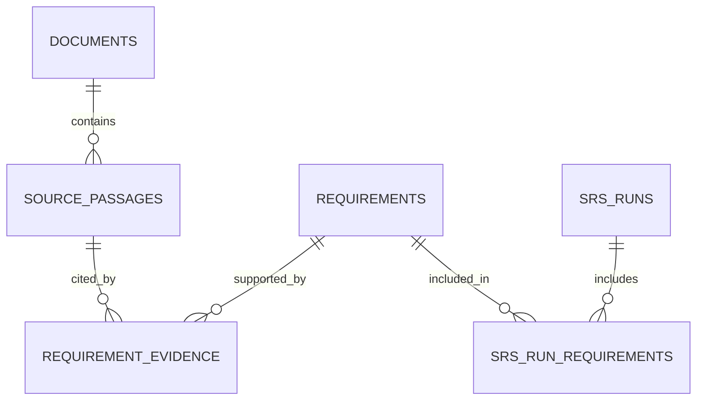

# SpecTestAI

SpecTestAI biến tài liệu nguồn (PDF, DOCX, TXT, MD: email đề xuất, biên bản họp, mô tả nghiệp vụ…) thành một **Software Requirements Specification (SRS) theo IEEE 830**, trong đó **mỗi requirement truy ngược được về đúng đoạn văn gốc** đã sinh ra nó.

Nguyên tắc xuyên suốt: model AI được dùng để *đọc* và *viết*, nhưng **không được tự quyết định** điều gì là requirement:

- **Mọi bằng chứng (evidence) phải là nguyên văn** của tài liệu nguồn và được kiểm tra bằng code.
- **Chỉ con người approve requirement**, và hệ thống chặn approve nếu evidence không hợp lệ.
- **SRS chỉ chứa requirement đã approve.** Statement và priority được chép nguyên văn từ registry; model không có chỗ để thêm requirement mới.

---

## Mục lục

1. [Kiến trúc](#1-kiến-trúc)
2. [Cài đặt](#2-cài-đặt)
3. [Chạy từng bước](#3-chạy-từng-bước)
4. [Chạy nhanh bằng](#4-chạy-nhanh-bằng-apppy) `app.py`
5. [Cấu hình](#5-cấu-hình)
6. [Xử lý sự cố](#6-xử-lý-sự-cố)
7. [Dữ liệu và quyền riêng tư](#7-dữ-liệu-và-quyền-riêng-tư)
8. [Giới hạn hiện tại](#8-giới-hạn-hiện-tại)

---

## 1. Kiến trúc

### 1.1 Pipeline

```mermaid
flowchart LR
    A["src/input<br/>PDF · DOCX · TXT · MD"] -->|"1 document_loader<br/>(Gemini)"| B[("source_passages")]
    B -->|"2 requirement_extractor<br/>(Gemini)"| C["RequirementDraft<br/>FR / NFR + evidence"]
    C -->|"3 evidence_validator"| D["Draft có<br/>evidence hợp lệ"]
    D -->|"requirement_registry"| E[("requirements<br/>status = pending")]
    E -->|"4 Người review<br/>approve / reject"| F[("requirements<br/>status = approved")]
    F -->|"5–6 srs_generator<br/>(Gemini)"| G["SRS (JSON)<br/>schemas/srs.py"]
    G -->|"7 srs_validator<br/>+ markdown exporter"| H["src/output<br/>SRS_….md"]
```



| Bước | Module | Làm gì | Gọi model? |
|---|---|---|---|
| 1 | `services/document_loader.py` | Tách tài liệu thành đoạn văn (passage), **kiểm tra từng đoạn có đúng nguyên văn** không, gán id cố định, lưu vào DB | Có (`GEMINI_MODEL_LOADER`) |
| 2 | `agents/requirement_extractor.py` | Trích functional (FR) và nonfunctional requirement (NFR); mỗi requirement phải trích passage id và quote | Có (`GEMINI_MODEL_EXTRACTOR`) |
| 3 | `services/evidence_validator.py` | Mọi quote phải nằm trong đúng passage được trích; sai một item là loại cả requirement | Không |
| 3 | `services/requirement_registry.py` | Cấp id `RQ-0001…`, lưu với status `pending`, bỏ qua câu trùng | Không |
| 4 | `services/requirement_registry.py` (CLI) | Người review approve / reject. **Approve bị chặn** nếu evidence không hợp lệ | Không |
| 5–6 | `agents/srs_generator.py` | Code dựng mục 3, 5, 6 từ requirement đã approve (chép nguyên văn, tự đánh số); model chỉ viết văn xuôi và các cặp stimulus/response | Có (`GEMINI_MODEL_GENERATOR`) |
| 7 | `services/srs_validator.py` | Dò lại nguồn gốc của **từng** FR/NFR trong registry; kiểm tra mọi nguồn được trích | Không |
| 7 | `exporters/markdown.py` | Xuất `SRS_….md` kèm trích dẫn, bảng truy vết và nguyên văn nguồn | Không |

### 1.2 Các tầng

```
src/
├── app.py                 Hai hàm pipeline (theo dự án): generate_srs_pipeline(), generate_approved_srs()
├── config.py              Đường dẫn, tên model, retry; đọc src/.env
├── agents/                Bước dùng LLM để suy luận nội dung
│   ├── requirement_extractor.py
│   └── srs_generator.py
├── prompts/               System prompt + hàm dựng user prompt cho từng agent
├── llm_clients/
│   └── gemini_client.py   Tạo client, retry 408/5xx, xử lý 429 (không retry khi hết quota ngày),
│                          kiểm tra response bị cắt
├── services/              Đọc, kiểm tra, lưu dữ liệu (không suy luận nội dung)
│   ├── document_loader.py
│   ├── evidence_validator.py
│   ├── project_registry.py    Tạo / đổi tên dự án, liên kết tài liệu
│   ├── requirement_registry.py
│   └── srs_validator.py
├── exporters/
│   └── markdown.py
├── schemas/               Model Pydantic: RequirementDraft / Requirement, SRS (IEEE 830)
├── database/              SQLite: migrations/, migrate, repository, init_db, evidence_rules
├── templates/             IEEE_830_SRS_Template.md, standard_srs.yaml
├── input/                 Tài liệu nguồn            (gitignored)
├── data/                  spectest.db               (gitignored)
└── output/                SRS đã xuất               (gitignored)
```

Mỗi thư mục có một `spec.md` đặc tả chi tiết:

- [database/spec.md](src/database/spec.md)
- [schemas/spec.md](src/schemas/spec.md)
- [services/spec.md](src/services/spec.md)
- [agents/spec.md](src/agents/spec.md)
- [exporters/spec.md](src/exporters/spec.md)

### 1.3 Dữ liệu



| Bảng | Id | Ghi chú |
|---|---|---|
| `documents` | `DOC-<12 hex đầu của sha256>` | Cùng nội dung file thì cùng id; file đã ingest sẽ không bị xử lý lại |
| `source_passages` | `DOC-…-P0001`, `-P0002`… | Đoạn văn đúng nguyên văn tài liệu, kèm số trang (PDF) |
| `requirements` | `RQ-0001`… | `type`, `statement`, `priority`, field riêng của FR / NFR, `status` (`pending` / `approved` / `rejected`) |
| `requirement_evidence` | (requirement, passage) | Bảng nối, kèm `quote` |
| `srs_runs`, `srs_run_requirements` | | Có sẵn trong schema; generator hiện chưa ghi vào |

### 1.4 Các bảo đảm và nơi chúng được thực thi

| Bảo đảm | Thực thi ở đâu |
|---|---|
| Passage đúng nguyên văn tài liệu | `document_loader` so với text gốc (PDF: text layer từng trang qua `pdfplumber`) |
| Evidence hợp lệ = có passage, có quote, quote nằm trong passage | `database/evidence_rules.py`: **một định nghĩa duy nhất**, dùng chung mọi tầng |
| Requirement `approved` luôn có evidence hợp lệ | `SQLiteRepository` chặn ở **mọi** đường dẫn tới `approved`, trong cùng transaction với thao tác ghi |
| Không có đường tự động approve | `save_candidates()` luôn lưu `pending` |
| SRS không có requirement mới | Generator dựng mục 3, 5, 6 bằng code; model không có field nào để viết requirement |
| Mỗi FR/NFR trong SRS truy được về registry | `srs_validator` dò lại theo statement nguyên văn, priority, nguồn và evidence |
| Lỗi không để lại dữ liệu dở | Mọi thao tác ghi nhiều dòng chạy trong một transaction; exporter chỉ ghi file khi validate xong |

---

## 2. Cài đặt

Yêu cầu:

- **Python ≥ 3.10** (đã chạy với 3.13).
- **[uv](https://docs.astral.sh/uv/)**, khuyến nghị dùng. Dùng `pip` cũng được.
- **Gemini API key**, lấy tại [Google AI Studio](https://aistudio.google.com/apikey).

```bash
git clone <repo-url> SpecTestAI
cd SpecTestAI

uv venv .venv --python 3.13
uv pip install --python .venv google-genai pydantic pdfplumber
```

Phiên bản đã kiểm thử: `google-genai 3.3.0`, `pydantic 2.14.3`, `pdfplumber 0.11.10`. Thiếu `pdfplumber` thì passage PDF vẫn được lưu, nhưng không kiểm tra được nguyên văn.

Tạo file `src/.env`:

```dotenv
GEMINI_API_KEY=your-api-key
GEMINI_MODEL_LOADER=gemini-3.5-flash-lite
GEMINI_MODEL_EXTRACTOR=gemini-3.8-flash
GEMINI_MODEL_GENERATOR=gemini-3.8-flash
```

`src/.env` không được commit. Các biến khác xem ở [mục 5](#5-cấu-hình).

> Mọi lệnh bên dưới **chạy từ thư mục** `src/`. Có thể chạy bằng `uv run python …`, hoặc kích hoạt venv rồi chạy `python …`:
>
> - Windows PowerShell: `..\.venv\Scripts\Activate.ps1`
> - Git Bash: `source ../.venv/Scripts/activate`
> - macOS / Linux: `source ../.venv/bin/activate`

---

## 3. Chạy từng bước

```bash
cd src
```

### Bước 0. Khởi tạo database

```bash
uv run python -m database.init_db
```

```
Database created: .../src/data/spectest.db
  documents                     0 rows
  ...
Schema OK
```

Lệnh tạo `src/data/spectest.db` nếu chưa có (chạy toàn bộ `database/migrations/*.sql`), và kiểm tra DB hiện có đã ở phiên bản schema mới nhất chưa. Nếu DB cũ hơn code, **không cần xóa dữ liệu**: chạy

```bash
uv run python -m database.migrate up                 # backup file DB, rồi chạy các migration còn thiếu
```

Chi tiết: [database/spec.md](src/database/spec.md) mục 7. `--reset` vẫn còn nhưng **xóa toàn bộ dữ liệu**.

### Bước 0b. Tạo dự án

Mỗi lần chạy pipeline là cho **một dự án**: tài liệu, requirement và SRS đều mang `project_id` của dự án đó.

```bash
uv run python -m services.project_registry create "Example Support Platform"   # in ra PRJ-…
uv run python -m services.project_registry list                                # dự án, tài liệu, số requirement
uv run python -m services.project_registry rename PRJ-… "Tên mới"
```

Các lệnh bên dưới dùng `PRJ-…` là id vừa tạo.

### Bước 1. Ingest tài liệu

Đặt file vào `src/input/` (hỗ trợ `.pdf`, `.docx`, `.txt`, `.md`), rồi chạy:

```bash
uv run python -m services.document_loader --project PRJ-…              # mọi file trong src/input
uv run python -m services.document_loader --project PRJ-… path/a.pdf   # file cụ thể
```

Tài liệu được liên kết với dự án trong cùng transaction với việc lưu passage. File đã ingest trước đó (cùng hash) không được đọc lại mà chỉ được liên kết thêm vào dự án, nên một file có thể dùng cho nhiều dự án.

```
INFO proposal_a.pdf: DOC-1a2b3c4d5e6f, 98 passages, 0 rejected, 0 unverified, coverage 92%
```

- `rejected`**:** số đoạn Gemini trả về nhưng không khớp nguyên văn tài liệu. Các đoạn này bị bỏ và được ghi vào log.
- `coverage`**:** tỷ lệ text gốc được giữ lại thành passage. Với PDF, dưới 100% là bình thường, vì header/footer lặp lại ở mỗi trang bị bỏ.
- **Chạy lại** thì file đã ingest được bỏ qua, không gọi Gemini lần nữa.

### Bước 2. Xem thử requirement được trích (không lưu)

```bash
uv run python -m agents.requirement_extractor --project PRJ-…                     # mọi tài liệu của dự án
uv run python -m agents.requirement_extractor --project PRJ-… DOC-1a2b3c4d5e6f    # một tài liệu của dự án
```

```
INFO DOC-1a2b3c4d5e6f: 98 passages -> 12 requirements (12 FR, 0 NFR), 0 rejected
[FUN must   Case Management] The system shall allow every case to be assigned to a team member.
    evidence: DOC-1a2b3c4d5e6f-P0073
```

Bước này chỉ in kết quả ra màn hình. Mỗi tài liệu được gọi Gemini một lần. Tài liệu lỗi bị bỏ qua, các tài liệu còn lại vẫn được xử lý.

### Bước 3. Trích, kiểm tra evidence và lưu vào registry

Chưa có lệnh CLI riêng cho bước này; dùng hàm pipeline trong `app.py`:

```bash
uv run python -c "import logging; logging.basicConfig(level=logging.INFO, format='%(levelname)s %(message)s'); import app; app.generate_srs_pipeline(None, 'PRJ-…')"
```

Hàm này chạy lại bước 1 (bỏ qua file đã ingest) và bước 2, rồi:

1. `evidence_validator.validate()` loại các requirement có quote không nằm trong passage;
2. `requirement_registry.save_candidates(..., project_id=...)` lưu phần còn lại vào dự án, với status `pending` và id `RQ-0001`, `RQ-0002`… Requirement trích passage của tài liệu **ngoài dự án** thì cả lô bị từ chối.

Requirement có câu trùng với câu đã lưu **trong cùng dự án** (ở mọi status) sẽ không bị lưu lại. Hai dự án khác nhau được phép có câu giống nhau.

### Bước 4. Review: approve / reject

```bash
uv run python -m services.requirement_registry list pending --project PRJ-…
uv run python -m services.requirement_registry show RQ-0005
uv run python -m services.requirement_registry approve RQ-0005 RQ-0006
uv run python -m services.requirement_registry reject RQ-0007
```

- `show` in từng quote **kèm nguyên văn passage gốc** để đối chiếu, và cho biết evidence có hợp lệ không.
- `list` đánh dấu `[INVALID EVIDENCE]` cho requirement không thể approve.
- `approve` bị từ chối, và status giữ nguyên, nếu evidence không hợp lệ. Quy tắc này được thực thi ở cả tầng repository.

> **Lưu ý:** mỗi requirement thuộc đúng một dự án (`project_id NOT NULL`), và chỉ requirement đã approve của dự án được chọn mới vào SRS của dự án đó.

### Bước 5. Sinh SRS (JSON)

```bash
uv run python -m agents.srs_generator --project-id PRJ-… \
    --org "ExampleCorp" --author "Alice Example" \
    --out output/srs.json
```

```
INFO SRS: 7 features, 27 requirements, documents DOC-1a2b3c4d5e6f, attempts 1
```

- **Chỉ dùng requirement đã approve của dự án đó.** Một SRS = một dự án: generator từ chối (trước khi gọi model) bộ requirement trải trên nhiều dự án.
- **Code dựng mục 3, 5, 6** từ requirement đã approve.
- **Model viết phần văn xuôi** (mục 1, 2, 4), mô tả feature và các cặp stimulus/response. Mục nào nguồn không nói đủ thì để `unresolved`, không bịa.
- **Tên dự án** mặc định là tên trong bảng `projects` (đổi bằng `--project "Tên"`). **Tổ chức, tác giả** lấy từ tham số; nếu thiếu, SRS giữ placeholder `<Organization>` / `<Author>`.
- **Kết quả được validate** bằng `schemas/srs.py`.

### Bước 6. Kiểm tra và xuất Markdown

```bash
uv run python -m exporters.markdown output/srs.json --project PRJ-…
```

```
.../src/output/SRS_Example-Support-Platform_v1-0_2026-11-16.md
```

Exporter gọi `srs_validator` trước, và **không ghi file nếu có lỗi**. File xuất ra gồm:

| Phần | Nội dung |
|---|---|
| Mục 1–6 | Theo IEEE 830, kèm trích dẫn `[S3]` tới nguồn |
| Từng FR / NFR | Priority, sequence liên quan, và dòng "Origin: registry RQ-…" |
| Appendix A. Traceability Matrix | SRS id → RQ id → passage → tài liệu, trang → quote |
| Appendix B. Sources | Nguyên văn từng passage được trích |
| Appendix C. Validation Notes | Warning, ví dụ mục `unresolved` hay placeholder còn sót |

---

## 4. Chạy nhanh bằng `app.py`

```bash
uv run python -m services.project_registry create "Example Support Platform"   # bước 0b, in ra PRJ-…
uv run python -c "import app; app.generate_srs_pipeline(None, 'PRJ-…')"         # bước 1–3
uv run python -m services.requirement_registry approve RQ-0001 ...             # bước 4 (thủ công)
uv run python -c "import app; print(app.generate_approved_srs('PRJ-…'))"       # bước 5–7, in đường dẫn file .md
```

`generate_approved_srs()` lấy tên dự án từ bảng `projects`. Tổ chức và tác giả vẫn là placeholder; muốn điền, dùng lệnh CLI ở bước 5.

---

## 5. Cấu hình

Đặt trong `src/.env` hoặc biến môi trường. Biến môi trường thật được ưu tiên hơn file `.env`.

| Biến | Mặc định | Ý nghĩa |
|---|---|---|
| `GEMINI_API_KEY` | (bắt buộc) | Key Gemini (`GOOGLE_API_KEY` **không** được đọc) |
| `GEMINI_MODEL_LOADER` | `gemini-3.5-flash-lite` | Model tách đoạn văn |
| `GEMINI_MODEL_EXTRACTOR` | `gemini-3.8-flash` | Model trích requirement |
| `GEMINI_MODEL_GENERATOR` | `gemini-3.8-flash` | Model viết SRS |
| `GEMINI_TIMEOUT_MS` | `300000` | Timeout cho mỗi lần gọi |
| `GEMINI_RETRY_ATTEMPTS` | `4` | Tổng số lần thử cho 408 / 5xx / 429 theo phút; `1` = không retry. 429 hết quota ngày không bao giờ được retry |
| `GEMINI_RETRY_INITIAL_DELAY` | `2` | Giây chờ trước lần retry đầu, tăng gấp đôi mỗi lần |
| `GEMINI_RETRY_MAX_DELAY` | `30` | Thời gian chờ tối đa giữa hai lần retry 408 / 5xx (giây) |
| `SPECTEST_INPUT_DIR` | `src/input` | Thư mục tài liệu nguồn |
| `SPECTEST_DATA_DIR` / `SPECTEST_DB_PATH` | `src/data` / `src/data/spectest.db` | Vị trí database |
| `SPECTEST_OUTPUT_DIR` | `src/output` | Thư mục SRS xuất ra |

---

## 6. Xử lý sự cố

| Triệu chứng | Nguyên nhân / cách xử lý |
|---|---|
| `RepositoryError: … database is at version N but the code needs M` | DB cũ hơn code. Chạy `python -m database.migrate up` (tự backup trước, giữ nguyên dữ liệu) |
| `RepositoryError: … no migration history and its tables do not match migration 001` | DB tạo từ một schema rất cũ (trước phase 1), không migrate được. Lấy ra dữ liệu cần giữ, rồi `python -m database.init_db --reset` |
| `GEMINI_API_KEY is not set` | Thiếu key trong `src/.env` |
| `Gemini HTTP 404 NOT_FOUND` | Sai tên model trong `GEMINI_MODEL_*` |
| `Gemini daily quota exhausted (…)` | Hết quota trong ngày; chạy lại sau khi quota reset. File hoặc tài liệu đã xử lý xong sẽ được bỏ qua |
| `Gemini stopped early (finish_reason=MAX_TOKENS)` | Tài liệu quá dài cho một lần gọi; không có gì được lưu. Chia nhỏ tài liệu |
| Nhiều đoạn bị `rejected` khi ingest | Model không chép nguyên văn; xem log `rejected (page …)`. Chạy lại file đó (xóa document trong DB trước) hoặc đổi model |
| `… cannot be approved, invalid evidence: …` | Quote không nằm trong passage, hoặc thiếu quote. Xem `registry show <id>`; reject requirement đó |
| `SRS failed validation (…)` | SRS không còn khớp registry, ví dụ requirement bị reject sau khi sinh. Sinh lại SRS |
| Chữ tiếng Việt lỗi trên console Windows | Các lệnh CLI đã ép output sang UTF-8; nếu gọi qua `python -c`, đặt `PYTHONIOENCODING=utf-8` |

---

## 7. Dữ liệu và quyền riêng tư

- **Các thư mục chứa dữ liệu thật đều được** `.gitignore` **bỏ qua:** `src/input/` (tài liệu nguồn), `src/data/` (DB chứa nguyên văn passage), `src/output/` (SRS chứa trích dẫn nguyên văn), và `src/.env`. Đừng thêm dữ liệu thật vào file được git track, kể cả ví dụ trong tài liệu.
- **Nội dung tài liệu được gửi tới Gemini API của Google** ở bước 1 (cả file), bước 2 và bước 5 (các passage). Chỉ dùng với tài liệu được phép gửi cho bên thứ ba.

---

## 8. Giới hạn hiện tại

- **Kết quả của model dao động giữa các lần chạy.** Bước review ở bước 4 là nơi bắt các requirement bị gộp, sót hoặc gần trùng. Chống trùng chỉ bắt câu giống hệt nhau.
- **Phần văn xuôi và các cặp stimulus/response trong SRS do model viết.** Code bảo đảm chúng liên kết đúng requirement và trích nguồn có thật, nhưng vẫn cần người đọc lại trước khi gửi khách.
- **Mỗi tài liệu được xử lý trong một lần gọi model.** Tài liệu rất dài có thể gây `MAX_TOKENS` 65.536k with `thinking`.
- **Generator chưa lưu SRS vào** `srs_runs`, và chưa có lệnh CLI riêng cho bước 3.
- **Thư mục** `src/test/` **chưa có test tự động.**
