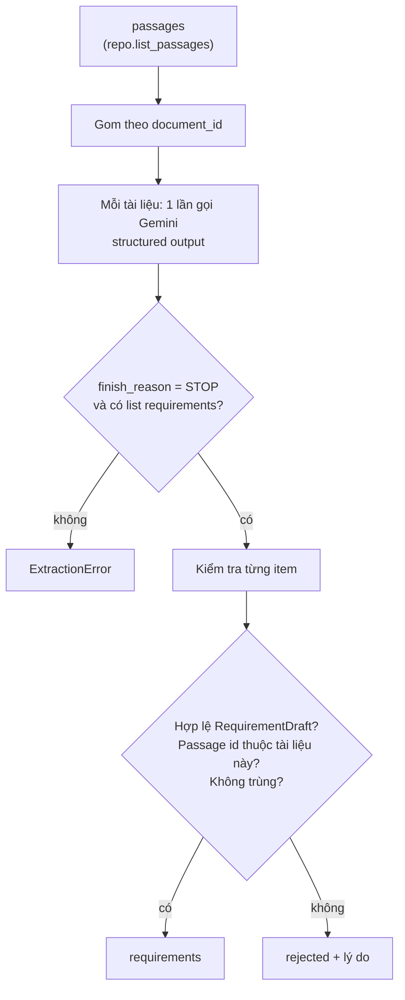

# Agents Spec — SpecTestAI

Đặc tả tầng agent: các bước trong pipeline của [app.py](../app.py) dùng LLM để *suy luận* trên nội dung (trích requirement, sinh SRS). Phần này khác với tầng service ([services/spec.md](../services/spec.md)), vốn chỉ đọc, kiểm tra và lưu dữ liệu.

| File | Bước trong `app.py` | Trạng thái |
|---|---|---|
| [requirement_extractor.py](requirement_extractor.py) | 2. Trích requirement ứng viên từ passage | ✔ Đã triển khai |
| [srs_generator.py](srs_generator.py) | 6. Dựng SRS từ requirement đã duyệt | Chưa triển khai (file trống) |

Các module liên quan:

| Module | Vai trò |
|---|---|
| [prompts/requirement_prompt.py](../prompts/requirement_prompt.py) | System prompt và hàm dựng user prompt cho extractor |
| [llm_clients/gemini_client.py](../llm_clients/gemini_client.py) | Gọi Gemini, dùng chung với `document_loader`: tạo client, retry, xử lý 429, kiểm tra response bị cắt |
| [schemas/requirement.py](../schemas/requirement.py) | `RequirementDraft`, là output của extractor ([schemas/spec.md](../schemas/spec.md)) |
| [database/sqlite_repository.py](../database/sqlite_repository.py) | Nguồn passage khi chạy CLI. Extractor **không ghi** vào DB |

---

## 1. `requirement_extractor.py`

Đọc passage của từng tài liệu, dùng Gemini trích **functional requirement (FR)** và **nonfunctional requirement (NFR)** dạng `RequirementDraft`. Mỗi requirement phải trích ít nhất một passage làm bằng chứng (evidence).

### 1.1 Luồng xử lý



- Mỗi tài liệu được xử lý riêng trong **một lần gọi**. Prompt chỉ chứa passage của tài liệu đó, nên requirement không thể trích passage của tài liệu khác.
- Item không hợp lệ bị **loại, không sửa**, và lý do được ghi vào báo cáo. Một item hỏng không làm mất các item khác.
- Extractor không ghi DB. Lưu requirement là việc của `requirement_registry`, kiểm tra quote là việc của `evidence_validator`. Cả hai service này chưa triển khai.

### 1.2 Gọi Gemini

| Thiết lập | Giá trị |
|---|---|
| Model | `config.GEMINI_MODEL_EXTRACTOR`, mặc định `gemini-3.8-flash` |
| `temperature` | `0` |
| `response_mime_type` | `application/json` |
| `response_json_schema` | `RESPONSE_SCHEMA` (mục 1.3) |
| System instruction | `SYSTEM_PROMPT` trong `prompts/requirement_prompt.py` (mục 1.4) |
| User content | `build_user_prompt(document_id, passages)` (mục 1.4) |
| Retry, 429, timeout | Như `document_loader`, xem [services/spec.md](../services/spec.md) mục 1.6 |

### 1.3 Schema output

Gemini nhận schema của `RequirementExtraction`:

```python
class RequirementExtraction(BaseModel):
    requirements: list[_FunctionalOut | _NonfunctionalOut]
```

| Biến thể | `type` | Field bắt buộc | Field tùy chọn |
|---|---|---|---|
| `_FunctionalOut` | `"functional"` | `statement`, `priority`, `evidence` (≥ 1), `feature` | `stimulus_or_condition`, `response` |
| `_NonfunctionalOut` | `"nonfunctional"` | `statement`, `priority`, `evidence` (≥ 1), `nfr_category`, `verification_method`, `acceptance_measure` | |

**Vì sao không gửi thẳng `RequirementDraft`:** `RequirementDraft` để mọi field riêng của FR/NFR là tùy chọn, và kiểm tra quy tắc FR/NFR bằng validator. JSON Schema không diễn tả được validator đó. Khi gửi thẳng `RequirementDraft`, model từng trả FR thiếu `feature` (lần chạy 2: 1 item bị loại). Hai biến thể riêng buộc model sinh đúng field ngay từ đầu (lần chạy 3–4: 0 item bị loại).

Mô tả của từng field (`Field(description=...)`) được lấy từ `RequirementDraft`, nên **schema chính là chỉ dẫn từng field cho model**. Prompt không lặp lại schema, vì tài liệu Gemini khuyên không lặp lại schema trong prompt.

Sau khi nhận về, **mỗi item được validate lại bằng `RequirementDraft`**, nên mọi quy tắc trong [schemas/spec.md](../schemas/spec.md) mục 3.2 đều được áp dụng.

### 1.4 Prompt

**Nguồn gốc:** được viết lại từ `AI-Requirement-Engineering-System/prompts/`. Thư mục gốc không bị sửa.

| | Nội dung |
|---|---|
| Giữ lại | Vai trò "expert Business Analyst and Requirement Engineer" và phạm vi bao quát actor, FR, mục tiêu, scope (`requirement_prompt.py`); bao quát cả FR lẫn NFR (`srs_prompt.py`); tiêu chí đầy đủ, nhất quán, không bỏ sót FR/NFR (`reviewer_prompt.py`) |
| Đổi | Output văn bản tự do → JSON có cấu trúc theo schema |
| Đảo ngược | "Generate non-functional requirements based on the project context" và các chỉ dẫn "suggest": giờ requirement nào cũng phải có passage nêu nó; không thêm gì từ kiến thức chung |

**Cấu trúc `SYSTEM_PROMPT`:**

| Mục | Quy tắc chính |
|---|---|
| EVIDENCE | Trích passage bằng đúng giá trị `id`, chỉ dùng id có trong prompt. `quote` chép nguyên văn, giữ ngôn ngữ gốc. Chỉ trích những gì passage nêu, không suy ra từ "hệ thống thường cần" |
| COVERAGE | Đọc hết passage. Trong chuỗi email/biên bản họp, những thứ sau là requirement: tính năng được nói là cần, quan trọng hoặc **còn thiếu**; **việc thủ công hay khó khăn** mà hệ thống được kỳ vọng giải quyết (không bịa cách giải quyết); **quy tắc nghiệp vụ có số liệu**; **đề xuất mà bên kia không phản đối**. Tin nhắn sau có thể thay đổi đề xuất trước: lấy bản mới nhất và trích cả hai. Mỗi gạch đầu dòng thường là một requirement. **Mô tả hiện trạng hay công cụ đang dùng chỉ là bối cảnh**, trừ khi có người yêu cầu hệ thống mới giữ, thay thế hoặc đổi hành vi đó |
| STATEMENT | Tiếng Anh, dạng "shall". **Giữ nguyên giá trị cụ thể** (tên, kênh, hệ thống, số liệu, thời hạn). Không thêm sự kiện, con số hay công nghệ. Lệnh cấm viết dạng "shall not", thường là `must` |
| FUNCTIONAL vs NONFUNCTIONAL | FR: `feature` dài 2–5 từ, các FR liên quan dùng cùng tên; `stimulus_or_condition` và `response` chỉ có khi passage mô tả cặp sự kiện → phản hồi. NFR: `nfr_category`, `verification_method`, `acceptance_measure` diễn đạt bằng chính lời của nguồn, không thêm ngưỡng mới |
| PRIORITY | MoSCoW theo cách diễn đạt của nguồn (bảng dưới) |

**Priority:**

| Priority | Khi nào |
|---|---|
| `must` | must / shall / required / need / essential / "very important", hoặc mục tiêu cốt lõi được nêu |
| `should` | should / important / preferred; khó khăn mà người dùng muốn được giải quyết |
| `could` | could / nice to have / optional / giai đoạn sau; **đề xuất mà bên kia chưa xác nhận** |
| `wont` | Tính năng bị từ chối rõ ràng, ngoài phạm vi hoặc không cần. Viết dạng khẳng định ("The system shall provide live chat.") + `wont`. **Không bao giờ** kết hợp `wont` với "shall not" |

**Quyết định đã xác nhận (2026-11-16):** đề xuất của một bên mà bên kia chưa phản đối **vẫn được trích**, với priority `could`. Bước người review (`status = "pending"`) quyết định giữ hay bỏ. Quyết định này cũng được ghi ở đầu `prompts/requirement_prompt.py`.

**User prompt** (`build_user_prompt`):

```
<document id="DOC-bd148209ea0b">
<passage id="DOC-bd148209ea0b-P0001" page="1">Alice Example <alice@example.com></passage>
...
</document>

Extract the requirements stated in these passages.
```

Thuộc tính `page` bị bỏ khi passage không có số trang (TXT/MD/DOCX). Text của passage được đưa vào nguyên văn, không escape.

### 1.5 Kiểm tra từng item

Thứ tự kiểm tra trong `_check_item()`. Item dừng ở bước đầu tiên không đạt:

| # | Kiểm tra | Lý do bị loại (ví dụ) |
|---|---|---|
| 1 | Validate bằng `RequirementDraft`: đúng kiểu, không có field lạ, quy tắc FR/NFR, ≥ 1 evidence, không trích trùng passage | `invalid: item: Value error, Functional requirement requires a feature` / `invalid: confidence: Extra inputs are not permitted` |
| 2 | Mọi `passage_id` phải nằm trong passage của **chính tài liệu này** | `cites passage ids not in this document: ['DOC-a-P0099']` |
| 3 | `statement` không trùng một requirement trước đó (bỏ qua hoa thường và khoảng trắng) | `duplicate statement` |

Lý do chỉ ghi **lỗi validation đầu tiên** của item. Kiểm tra trùng chỉ bắt câu giống hệt nhau, không bắt câu cùng ý nhưng diễn đạt khác.

**Không kiểm tra ở đây:**
- `quote` có thật sự nằm trong passage không → `evidence_validator`. Ở cả 4 lần chạy thật, mọi quote đều khớp, nhưng chưa có gì bắt buộc điều này.
- Evidence có thật sự *chứng minh* statement không. Việc này cần người review.

### 1.6 API

```python
from agents import requirement_extractor
```

| Hàm | Mô tả |
|---|---|
| `extract(passages, *, client=None, model=None) -> list[RequirementDraft]` | Requirement hợp lệ của mọi tài liệu, theo thứ tự tài liệu rồi theo thứ tự model trả về. Đây là hàm `app.py` gọi |
| `extract_with_report(passages, *, client=None, model=None) -> list[ExtractionReport]` | Như trên, kèm báo cáo cho từng tài liệu, và ghi log |
| `extract_document(document_id, passages, *, client=None, model=None) -> ExtractionReport` | Một tài liệu, một lần gọi |

- `passages` là các dict có ít nhất `id`, `document_id` và `text` (`page` tùy chọn), đúng dạng `repo.list_passages()` và `document_loader.ingest()` trả về.
- `client`: mặc định tạo `genai.Client` từ `config.GEMINI_API_KEY`, và tạo **một lần** cho mọi tài liệu. Có thể truyền client giả khi test.
- Danh sách passage rỗng thì trả về `[]`, không tạo client và không gọi model.

`ExtractionReport`:

| Field / property | Ý nghĩa |
|---|---|
| `document_id` | Id tài liệu |
| `passage_count` | Số passage đã gửi |
| `requirements` | `list[RequirementDraft]` hợp lệ |
| `rejected` | `list[Rejected]`; mỗi phần tử có `item` (item gốc model trả về) và `reason` |
| `functional` / `nonfunctional` | Lọc `requirements` theo loại |

**Lỗi**

| Tình huống | Lỗi |
|---|---|
| Thiếu `GEMINI_API_KEY` hoặc chưa cài `google-genai` | `ExtractionError` |
| Hết quota ngày, 429 lặp lại, response bị cắt (`MAX_TOKENS`…), không có candidate | `ExtractionError` (bọc `GeminiError`) |
| Response không phải JSON / không có list `requirements` | `ExtractionError` |
| HTTP 400 / 401 / 403 / 404 (ví dụ sai tên model) | `google.genai.errors.APIError`, **không** được bọc |

Một tài liệu lỗi làm `extract()` / `extract_with_report()` **dừng ngay**. Requirement của các tài liệu đã xử lý trước đó không được trả về. Extractor không lưu gì, nên khi chạy lại, mọi tài liệu sẽ được gọi lại từ đầu.

### 1.7 Cấu hình

| Biến (`src/.env` hoặc môi trường) | Mặc định | Ghi chú |
|---|---|---|
| `GEMINI_MODEL_EXTRACTOR` | `gemini-3.8-flash` | Model trích requirement |
| `GEMINI_API_KEY`, `GEMINI_TIMEOUT_MS`, `GEMINI_RETRY_*` | | Dùng chung với loader, xem [services/spec.md](../services/spec.md) mục 1.7 |

### 1.8 Chạy từ dòng lệnh

Chạy từ `src/`. Lệnh đọc passage từ DB (chỉ đọc), in requirement, và **không ghi gì**:

```bash
uv run python -m agents.requirement_extractor                     # mọi tài liệu trong DB
uv run python -m agents.requirement_extractor DOC-bd148209ea0b    # một tài liệu
```

```
INFO DOC-bd148209ea0b: 133 passages -> 27 requirements (27 FR, 0 NFR), 0 rejected

=== DOC-bd148209ea0b
[FUN must   Channel Integration] The system shall integrate customer support communications from eBay, Kaufland, OTTO, Amazon EU, Amazon US, and two email accounts ...
    evidence: DOC-bd148209ea0b-P0008, DOC-bd148209ea0b-P0063
```

`ExtractionError` in ra `ERROR …` và thoát với exit code 1. Lỗi HTTP không retry được (mục 1.6) in ra traceback.

### 1.9 Kết quả trên dữ liệu thật

Hai tài liệu trong `src/input` là chuỗi email đề xuất dự án với khách hàng. Mỗi lần chạy mất khoảng 60–120 giây cho cả hai.

| Lần chạy | Thay đổi | AI tool for Product Development (98 passage) | AI-Powered Customer Support (133 passage) |
|---|---|---|---|
| 1 | Prompt ban đầu | 12 FR | 17 FR |
| 2 | Thêm quy tắc COVERAGE cho chuỗi email, giữ giá trị cụ thể, phân biệt "shall not" và `wont` | 12 FR | 16 FR, 1 bị loại (FR thiếu `feature`) |
| 3 | Schema hai biến thể FR/NFR | 11 FR | 20 FR + 1 NFR, 0 bị loại; NFR là **suy diễn sai** ("retain conversations 24 months" lấy từ mô tả công cụ HelpdeskTool hiện có) |
| 4 | Quy tắc "mô tả hiện trạng là bối cảnh" | 12 FR | 27 FR, 0 bị loại |

Lần chạy 4, kiểm tra tự động: **0 quote** không khớp passage, **0 con số** trong statement mà passage được trích không có. Đối chiếu thủ công với passage gốc: đã bắt được kênh còn thiếu (WhatsApp, Temu, VoiceAgent), thời hạn trả lời theo sàn (Amazon 24h; OTTO, eBay, Kaufland 48h), quy tắc xử lý case chờ lâu nhất trước, và ràng buộc "AI không được tự quyết định hoàn tiền". Header, chữ ký và lịch họp không bị trích.

### 1.10 Test

Client có thể thay bằng client giả, nên logic được test offline mà không gọi mạng:

```python
from types import SimpleNamespace as NS
import json

class FakeGemini:
    def __init__(self, requirements):
        self.models = self
        self._out = requirements

    def generate_content(self, model, contents, config):
        return NS(text=json.dumps({"requirements": self._out}),
                  candidates=[NS(finish_reason=NS(name="STOP"))])

drafts = requirement_extractor.extract(passages, client=FakeGemini([...]))
```

Các trường hợp đã kiểm tra:

- Mỗi tài liệu một lần gọi, và prompt chỉ chứa passage của tài liệu đó.
- FR, NFR và `wont` được giữ lại.
- Bị loại: id lạ, id của tài liệu khác, FR thiếu `feature`, NFR thiếu field, evidence rỗng, statement trùng, field lạ, item không phải object.
- Response bị cắt, không phải JSON, hoặc thiếu list đều báo `ExtractionError`.
- Không có passage thì không gọi model; thiếu API key thì báo lỗi.
- Schema có hai biến thể với field bắt buộc và mô tả.

### 1.11 Giới hạn hiện tại

- **Kết quả dao động giữa các lần chạy**, dù `temperature = 0`. Số requirement của cùng một tài liệu dao động 16–27 qua các phiên bản prompt; model đôi khi gộp nhiều gạch đầu dòng thành một. Bước người review là nơi bắt các lỗi này.
- **Ít hoặc không có NFR** với các tài liệu chủ yếu nói về tính năng. Với hai email hiện tại, điều này phù hợp: chúng không nêu yêu cầu hiệu năng hay bảo mật. Tuy vậy, "trả lời tiếng Đức/Anh" đang được xếp là FR, dù có thể coi là NFR nhóm Localization.
- **Một lần gọi cho mỗi tài liệu.** Tài liệu rất dài có thể vượt giới hạn output và gây `MAX_TOKENS`. Chưa chia nhỏ tài liệu.
- **Không kiểm tra quote, không lưu kết quả.** Hai việc này thuộc `evidence_validator` và `requirement_registry`, đều chưa triển khai.
- **Không có bước rà soát lần hai** để tìm requirement còn sót. Đây là hướng cải thiện độ bao phủ nếu cần, đổi lại tốn thêm một lần gọi mỗi tài liệu.

---

## 2. `srs_generator.py` (chưa triển khai)

Vai trò dự kiến, suy ra từ `app.py`. Phần này **chưa phải đặc tả cuối cùng**.

```python
srs = srs_generator.generate(requirements=requirements, template=srs_template)
```

| | Dự kiến |
|---|---|
| Input | `list[Requirement]` đã `approved` (từ `requirement_registry.get_approved()`), cùng template [templates/standard_srs.yaml](../templates/standard_srs.yaml) |
| Output | `schemas.srs.SRS`. Mục lục do `build_toc()` sinh, không do model viết |
| Ánh xạ | FR gom theo `feature` thành mục 3.N/5.N; `stimulus_or_condition`/`response` thành 5.N.2; NFR gom theo `nfr_category` thành 6.N; id `REQ-N.M`/`NF-N.M` đánh số theo vị trí ([schemas/spec.md](../schemas/spec.md) mục 3.5 và 6) |
| Cần quyết định | `source_ids` trong SRS lấy từ passage id hay document id; mục văn bản tự do (1.x, 2.x, 4.x) do model viết từ passage, hay để `unresolved` |
| Lưu | `repo.add_srs_run()` ghi lại SRS và danh sách requirement đã dùng |
