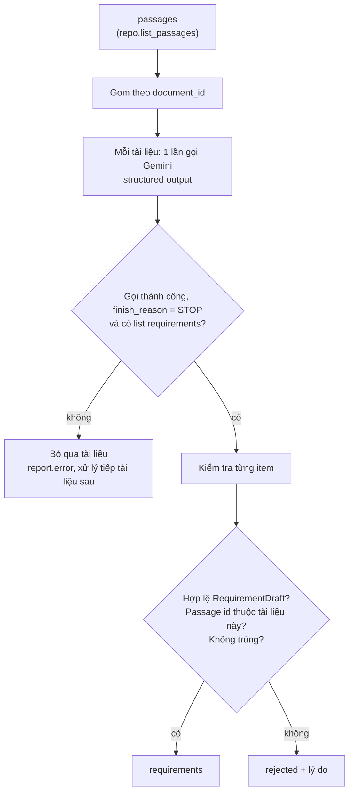

# Agents Spec — SpecTestAI

Đặc tả tầng agent: các bước trong pipeline của [app.py](../app.py) dùng LLM để *suy luận* trên nội dung (trích requirement, sinh SRS). Phần này khác với tầng service ([services/spec.md](../services/spec.md)), vốn chỉ đọc, kiểm tra và lưu dữ liệu.

| File | Bước trong `app.py` | Trạng thái |
|---|---|---|
| [requirement_extractor.py](requirement_extractor.py) | 2. Trích requirement ứng viên từ passage | ✔ Đã triển khai |
| [srs_generator.py](srs_generator.py) | 6. Dựng SRS từ requirement đã duyệt | ✔ Đã triển khai |

Các module liên quan:

| Module | Vai trò |
|---|---|
| [prompts/requirement_prompt.py](../prompts/requirement_prompt.py) | System prompt và hàm dựng user prompt cho extractor |
| [prompts/srs_prompt.py](../prompts/srs_prompt.py) | System prompt và hàm dựng user prompt cho generator |
| [llm_clients/gemini_client.py](../llm_clients/gemini_client.py) | Gọi Gemini, dùng chung với `document_loader`: tạo client, retry, xử lý 429, kiểm tra response bị cắt |
| [schemas/requirement.py](../schemas/requirement.py) | `RequirementDraft`, là output của extractor ([schemas/spec.md](../schemas/spec.md)) |
| [database/sqlite_repository.py](../database/sqlite_repository.py) | Nguồn passage khi chạy CLI. Extractor **không ghi** vào DB |

---

## 1. `requirement_extractor.py`

Đọc passage của từng tài liệu, dùng Gemini trích **functional requirement (FR)** và **nonfunctional requirement (NFR)** dạng `RequirementDraft`. Mỗi requirement phải trích ít nhất một passage làm bằng chứng (evidence).

### 1.1 Luồng xử lý



- Mỗi tài liệu được xử lý riêng trong **một lần gọi**. Prompt chỉ chứa passage của tài liệu đó, nên requirement không thể trích passage của tài liệu khác.
- Item không hợp lệ bị **loại, không sửa**, và lý do được ghi vào báo cáo. Một item hỏng không làm mất các item khác.
- Extractor không ghi DB. Kiểm tra quote là việc của `services/evidence_validator.py`, lưu requirement là việc của `services/requirement_registry.py` ([services/spec.md](../services/spec.md) mục 2 và 3).

### 1.2 Gọi Gemini

| Thiết lập | Giá trị |
|---|---|
| Model | `config.GEMINI_MODEL_EXTRACTOR`, mặc định `gemini-3.8-flash` |
| `temperature` | `0` |
| `response_mime_type` | `application/json` |
| `response_json_schema` | `RESPONSE_SCHEMA` (mục 1.3) |
| System instruction | `SYSTEM_PROMPT` trong `prompts/requirement_prompt.py` (mục 1.4) |
| User content | `build_user_prompt(document_id, passages)` (mục 1.4) |
| Retry, 429, timeout | Như `document_loader`, xem [services/spec.md](../services/spec.md) mục 1.6 |

### 1.3 Schema output

Gemini nhận schema của `RequirementExtraction`:

```python
class RequirementExtraction(BaseModel):
    requirements: list[_FunctionalOut | _NonfunctionalOut]
```

| Biến thể | `type` | Field bắt buộc | Field tùy chọn |
|---|---|---|---|
| `_FunctionalOut` | `"functional"` | `statement`, `priority`, `evidence` (≥ 1), `feature` | `stimulus_or_condition`, `response` |
| `_NonfunctionalOut` | `"nonfunctional"` | `statement`, `priority`, `evidence` (≥ 1), `nfr_category`, `verification_method`, `acceptance_measure` | |

**Vì sao không gửi thẳng `RequirementDraft`:** `RequirementDraft` để mọi field riêng của FR/NFR là tùy chọn, và kiểm tra quy tắc FR/NFR bằng validator. JSON Schema không diễn tả được validator đó. Khi gửi thẳng `RequirementDraft`, model từng trả FR thiếu `feature` (lần chạy 2: 1 item bị loại). Hai biến thể riêng buộc model sinh đúng field ngay từ đầu (lần chạy 3–4: 0 item bị loại).

Mô tả của từng field (`Field(description=...)`) được lấy từ `RequirementDraft`, nên **schema chính là chỉ dẫn từng field cho model**. Prompt không lặp lại schema, vì tài liệu Gemini khuyên không lặp lại schema trong prompt.

Sau khi nhận về, **mỗi item được validate lại bằng `RequirementDraft`**, nên mọi quy tắc trong [schemas/spec.md](../schemas/spec.md) mục 3.2 đều được áp dụng.

### 1.4 Prompt

**Nguồn gốc:** được viết lại từ `AI-Requirement-Engineering-System/prompts/`. Thư mục gốc không bị sửa.

| | Nội dung |
|---|---|
| Giữ lại | Vai trò "expert Business Analyst and Requirement Engineer" và phạm vi bao quát actor, FR, mục tiêu, scope (`requirement_prompt.py`); bao quát cả FR lẫn NFR (`srs_prompt.py`); tiêu chí đầy đủ, nhất quán, không bỏ sót FR/NFR (`reviewer_prompt.py`) |
| Đổi | Output văn bản tự do → JSON có cấu trúc theo schema |
| Đảo ngược | "Generate non-functional requirements based on the project context" và các chỉ dẫn "suggest": giờ requirement nào cũng phải có passage nêu nó; không thêm gì từ kiến thức chung |

**Cấu trúc `SYSTEM_PROMPT`:**

| Mục | Quy tắc chính |
|---|---|
| EVIDENCE | Trích passage bằng đúng giá trị `id`, chỉ dùng id có trong prompt. `quote` chép nguyên văn, giữ ngôn ngữ gốc. Chỉ trích những gì passage nêu, không suy ra từ "hệ thống thường cần" |
| COVERAGE | Đọc hết passage. Trong chuỗi email/biên bản họp, những thứ sau là requirement: tính năng được nói là cần, quan trọng hoặc **còn thiếu**; **việc thủ công hay khó khăn** mà hệ thống được kỳ vọng giải quyết (không bịa cách giải quyết); **quy tắc nghiệp vụ có số liệu**; **đề xuất mà bên kia không phản đối**. Tin nhắn sau có thể thay đổi đề xuất trước: lấy bản mới nhất và trích cả hai. Mỗi gạch đầu dòng thường là một requirement. **Mô tả hiện trạng hay công cụ đang dùng chỉ là bối cảnh**, trừ khi có người yêu cầu hệ thống mới giữ, thay thế hoặc đổi hành vi đó |
| STATEMENT | Tiếng Anh, dạng "shall". **Giữ nguyên giá trị cụ thể** (tên, kênh, hệ thống, số liệu, thời hạn). Không thêm sự kiện, con số hay công nghệ. Lệnh cấm viết dạng "shall not", thường là `must` |
| FUNCTIONAL vs NONFUNCTIONAL | FR: `feature` dài 2–5 từ, các FR liên quan dùng cùng tên; `stimulus_or_condition` và `response` chỉ có khi passage mô tả cặp sự kiện → phản hồi. NFR: `nfr_category`, `verification_method`, `acceptance_measure` diễn đạt bằng chính lời của nguồn, không thêm ngưỡng mới |
| PRIORITY | MoSCoW theo cách diễn đạt của nguồn (bảng dưới) |

**Priority:**

| Priority | Khi nào |
|---|---|
| `must` | must / shall / required / need / essential / "very important", hoặc mục tiêu cốt lõi được nêu |
| `should` | should / important / preferred; khó khăn mà người dùng muốn được giải quyết |
| `could` | could / nice to have / optional / giai đoạn sau; **đề xuất mà bên kia chưa xác nhận** |
| `wont` | Tính năng bị từ chối rõ ràng, ngoài phạm vi hoặc không cần. Viết dạng khẳng định ("The system shall provide live chat.") + `wont`. **Không bao giờ** kết hợp `wont` với "shall not" |

**Quyết định đã xác nhận (2026-11-16):** đề xuất của một bên mà bên kia chưa phản đối **vẫn được trích**, với priority `could`. Bước người review (`status = "pending"`) quyết định giữ hay bỏ. Quyết định này cũng được ghi ở đầu `prompts/requirement_prompt.py`.

**User prompt** (`build_user_prompt`):

```
<document id="DOC-bd148209ea0b">
<passage id="DOC-bd148209ea0b-P0001" page="1">Alice Example <alice@example.com></passage>
...
</document>

Extract the requirements stated in these passages.
```

Thuộc tính `page` bị bỏ khi passage không có số trang (TXT/MD/DOCX). Text của passage được đưa vào nguyên văn, không escape.

### 1.5 Kiểm tra từng item

Thứ tự kiểm tra trong `_check_item()`. Item dừng ở bước đầu tiên không đạt:

| # | Kiểm tra | Lý do bị loại (ví dụ) |
|---|---|---|
| 1 | Validate bằng `RequirementDraft`: đúng kiểu, không có field lạ, quy tắc FR/NFR, ≥ 1 evidence, không trích trùng passage | `invalid: item: Value error, Functional requirement requires a feature` / `invalid: confidence: Extra inputs are not permitted` |
| 2 | Mọi `passage_id` phải nằm trong passage của **chính tài liệu này** | `cites passage ids not in this document: ['DOC-a-P0099']` |
| 3 | `statement` không trùng một requirement trước đó (bỏ qua hoa thường và khoảng trắng) | `duplicate statement` |

Lý do chỉ ghi **lỗi validation đầu tiên** của item. Kiểm tra trùng chỉ bắt câu giống hệt nhau, không bắt câu cùng ý nhưng diễn đạt khác.

**Không kiểm tra ở đây:**
- `quote` có thật sự nằm trong passage không → `evidence_validator`. Ở cả 4 lần chạy thật, mọi quote đều khớp, nhưng chưa có gì bắt buộc điều này.
- Evidence có thật sự *chứng minh* statement không. Việc này cần người review.

### 1.6 API

```python
from agents import requirement_extractor
```

| Hàm | Mô tả |
|---|---|
| `extract(passages, *, client=None, model=None) -> list[RequirementDraft]` | Requirement hợp lệ của các tài liệu xử lý thành công, theo thứ tự tài liệu rồi theo thứ tự model trả về. Tài liệu lỗi bị bỏ qua (mục "Lỗi" bên dưới). Đây là hàm `app.py` gọi |
| `extract_with_report(passages, *, client=None, model=None) -> list[ExtractionReport]` | Như trên, kèm báo cáo cho **mọi** tài liệu, kể cả tài liệu lỗi, và ghi log |
| `extract_document(document_id, passages, *, client=None, model=None) -> ExtractionReport` | Một tài liệu, một lần gọi. Lỗi thì raise `ExtractionError`, không bỏ qua |

- `passages` là các dict có ít nhất `id`, `document_id` và `text` (`page` tùy chọn), đúng dạng `repo.list_passages()` và `document_loader.ingest()` trả về.
- `client`: mặc định tạo `genai.Client` từ `config.GEMINI_API_KEY`, và tạo **một lần** cho mọi tài liệu. Có thể truyền client giả khi test.
- Danh sách passage rỗng thì trả về `[]`, không tạo client và không gọi model.

`ExtractionReport`:

| Field / property | Ý nghĩa |
|---|---|
| `document_id` | Id tài liệu |
| `passage_count` | Số passage đã gửi |
| `requirements` | `list[RequirementDraft]` hợp lệ |
| `rejected` | `list[Rejected]`; mỗi phần tử có `item` (item gốc model trả về) và `reason` |
| `error` | `None` nếu thành công; thông báo lỗi nếu tài liệu bị bỏ qua |
| `failed` | `True` khi `error` khác `None` |
| `functional` / `nonfunctional` | Lọc `requirements` theo loại |

**Lỗi của một tài liệu.** Mọi lỗi khi xử lý một tài liệu đều được quy về `ExtractionError`:

| Tình huống | Thông báo (ví dụ) |
|---|---|
| Hết quota ngày, 429 lặp lại, response bị cắt (`MAX_TOKENS`…), không có candidate | `DOC-…: Gemini daily quota exhausted (…)` / `… stopped early (finish_reason=MAX_TOKENS)` |
| HTTP 400 / 401 / 403 / 404 mà SDK không retry (ví dụ sai tên model) | `DOC-…: Gemini HTTP 404 NOT_FOUND: models/x is not found` |
| Response không phải JSON / không có list `requirements` | `DOC-…: Gemini response is not JSON …` / `… has no "requirements" list` |

**Bỏ qua tài liệu lỗi.** Trong `extract()` / `extract_with_report()`, tài liệu lỗi **bị bỏ qua** và các tài liệu còn lại vẫn được xử lý:

- Báo cáo của tài liệu lỗi có `error` là thông báo lỗi và `requirements` rỗng. Lỗi được ghi log ở mức `ERROR`: `DOC-…: skipped, …`.
- `extract()` chỉ trả requirement của các tài liệu thành công. Người gọi cần biết tài liệu nào lỗi thì dùng `extract_with_report()` và đọc `failed`/`error`.

**Khi nào vẫn raise `ExtractionError`:**

| Tình huống | Lý do |
|---|---|
| Không tạo được client (thiếu `GEMINI_API_KEY`, chưa cài `google-genai`) | Không tài liệu nào xử lý được |
| **Mọi** tài liệu đều lỗi: `All N document(s) failed; first error: …` | Để hết quota hay sai tên model không bị hiểu nhầm thành "tài liệu không có requirement nào" |

Lỗi không đến từ Gemini, tức lỗi lập trình (ví dụ `RuntimeError`), **không** bị bỏ qua mà được ném ra nguyên dạng.

Extractor không lưu gì, nên muốn xử lý lại tài liệu lỗi thì gọi lại với passage của tài liệu đó, ví dụ `python -m agents.requirement_extractor DOC-…`.

### 1.7 Cấu hình

| Biến (`src/.env` hoặc môi trường) | Mặc định | Ghi chú |
|---|---|---|
| `GEMINI_MODEL_EXTRACTOR` | `gemini-3.8-flash` | Model trích requirement |
| `GEMINI_API_KEY`, `GEMINI_TIMEOUT_MS`, `GEMINI_RETRY_*` | | Dùng chung với loader, xem [services/spec.md](../services/spec.md) mục 1.7 |

### 1.8 Chạy từ dòng lệnh

Chạy từ `src/`. Lệnh đọc passage từ DB (chỉ đọc), in requirement, và **không ghi gì**:

```bash
uv run python -m agents.requirement_extractor                     # mọi tài liệu trong DB
uv run python -m agents.requirement_extractor DOC-bd148209ea0b    # một tài liệu
```

```
INFO DOC-bd148209ea0b: 133 passages -> 27 requirements (27 FR, 0 NFR), 0 rejected

=== DOC-bd148209ea0b
[FUN must   Channel Integration] The system shall integrate customer support communications from eBay, Kaufland, OTTO, Amazon EU, Amazon US, and two email accounts ...
    evidence: DOC-bd148209ea0b-P0008, DOC-bd148209ea0b-P0063
```

Exit code:

| Kết quả | Output | Exit code |
|---|---|---|
| Mọi tài liệu thành công | Requirement của mọi tài liệu | 0 |
| Một số tài liệu lỗi | Requirement của các tài liệu thành công, rồi `ERROR k of N document(s) skipped: DOC-…` | 1 |
| Mọi tài liệu lỗi, hoặc không tạo được client | `ERROR …` | 1 |

### 1.9 Kết quả trên dữ liệu thật

Hai tài liệu trong `src/input` là chuỗi email đề xuất dự án với khách hàng. Mỗi lần chạy mất khoảng 60–120 giây cho cả hai.

| Lần chạy | Thay đổi | AI tool for Product Development (98 passage) | AI-Powered Customer Support (133 passage) |
|---|---|---|---|
| 1 | Prompt ban đầu | 12 FR | 17 FR |
| 2 | Thêm quy tắc COVERAGE cho chuỗi email, giữ giá trị cụ thể, phân biệt "shall not" và `wont` | 12 FR | 16 FR, 1 bị loại (FR thiếu `feature`) |
| 3 | Schema hai biến thể FR/NFR | 11 FR | 20 FR + 1 NFR, 0 bị loại; NFR là **suy diễn sai** ("retain conversations 24 months" lấy từ mô tả công cụ HelpdeskTool hiện có) |
| 4 | Quy tắc "mô tả hiện trạng là bối cảnh" | 12 FR | 27 FR, 0 bị loại |

Lần chạy 4, kiểm tra tự động: **0 quote** không khớp passage, **0 con số** trong statement mà passage được trích không có. Đối chiếu thủ công với passage gốc: đã bắt được kênh còn thiếu (WhatsApp, Temu, VoiceAgent), thời hạn trả lời theo sàn (Amazon 24h; OTTO, eBay, Kaufland 48h), quy tắc xử lý case chờ lâu nhất trước, và ràng buộc "AI không được tự quyết định hoàn tiền". Header, chữ ký và lịch họp không bị trích.

### 1.10 Test

Client có thể thay bằng client giả, nên logic được test offline mà không gọi mạng:

```python
from types import SimpleNamespace as NS
import json

class FakeGemini:
    def __init__(self, requirements):
        self.models = self
        self._out = requirements

    def generate_content(self, model, contents, config):
        return NS(text=json.dumps({"requirements": self._out}),
                  candidates=[NS(finish_reason=NS(name="STOP"))])

drafts = requirement_extractor.extract(passages, client=FakeGemini([...]))
```

Các trường hợp đã kiểm tra:

- Mỗi tài liệu một lần gọi, và prompt chỉ chứa passage của tài liệu đó.
- FR, NFR và `wont` được giữ lại.
- Bị loại: id lạ, id của tài liệu khác, FR thiếu `feature`, NFR thiếu field, evidence rỗng, statement trùng, field lạ, item không phải object.
- Response bị cắt, không phải JSON, hoặc thiếu list đều báo `ExtractionError`.
- HTTP 404 (dùng `ClientError` thật của SDK) được bọc thành `ExtractionError`; tài liệu đó bị bỏ qua, tài liệu tiếp theo vẫn được xử lý; `extract()` trả requirement của tài liệu thành công.
- Mọi tài liệu lỗi thì raise; lỗi lập trình (`RuntimeError`) vẫn được ném ra.
- Không có passage thì không gọi model; thiếu API key thì báo lỗi.
- Schema có hai biến thể với field bắt buộc và mô tả.

### 1.11 Giới hạn hiện tại

- **Kết quả dao động giữa các lần chạy**, dù `temperature = 0`. Số requirement của cùng một tài liệu dao động 16–27 qua các phiên bản prompt; model đôi khi gộp nhiều gạch đầu dòng thành một. Bước người review là nơi bắt các lỗi này.
- **Ít hoặc không có NFR** với các tài liệu chủ yếu nói về tính năng. Với hai email hiện tại, điều này phù hợp: chúng không nêu yêu cầu hiệu năng hay bảo mật. Tuy vậy, "trả lời tiếng Đức/Anh" đang được xếp là FR, dù có thể coi là NFR nhóm Localization.
- **Một lần gọi cho mỗi tài liệu.** Tài liệu rất dài có thể vượt giới hạn output và gây `MAX_TOKENS`. Chưa chia nhỏ tài liệu.
- **Không kiểm tra quote, không lưu kết quả.** Hai việc này thuộc `evidence_validator` và `requirement_registry` (bước tiếp theo trong `app.py`).
- **Không có bước rà soát lần hai** để tìm requirement còn sót. Đây là hướng cải thiện độ bao phủ nếu cần, đổi lại tốn thêm một lần gọi mỗi tài liệu.

---

## 2. `srs_generator.py`

Sinh SRS theo IEEE 830 (`schemas.srs.SRS`) từ các requirement **đã approve**, dùng `GEMINI_MODEL_GENERATOR`.

### 2.1 Ai viết phần nào

**Tiêu chí "không có requirement ID mới" được bảo đảm bằng cấu trúc.** Model **không có field nào** để viết statement, priority hay id của requirement. Vì vậy SRS không thể chứa requirement nào ngoài các requirement đã approve trong registry.

| Phần của SRS | Ai viết | Nội dung |
|---|---|---|
| Document control, revision history | Code | Tham số `project_name`, `organization`, `prepared_by`, `version`; ngày hôm nay. **Không** do model đoán. Thiếu thì dùng placeholder của template (`<Project Name>`, `<Organization>`, `<Author>`) |
| Mục lục | Code | `build_toc()` |
| 1.2 Document Conventions | Code | Văn bản cố định mô tả cách đánh số của chính tài liệu (`DOCUMENT_CONVENTIONS`) |
| 1.5 References | Code | Mỗi tài liệu nguồn mà evidence trích tới là một reference (`REF-001`…): tên file và đường dẫn |
| 3.N / 5.N: tên, thứ tự, priority của feature | Code | Gom FR theo `feature` của registry, theo thứ tự đầu vào. Priority ở 5.N.1 là priority cao nhất trong các FR của feature |
| 5.N.3: functional requirement | Code | `statement` và `priority` **chép nguyên văn** từ registry; id `REQ-N.M` do code đánh số |
| 6.N: nonfunctional requirement | Code | Chép nguyên văn `statement`, `priority`, `verification_method`, `acceptance_measure`; id `NF-N.M`; nhóm theo `nfr_category` (mục 2.4) |
| `source_ids` của mọi requirement, sequence, feature | Code | Passage id lấy từ evidence trong registry |
| 1.1, 1.3, 1.4, 2.1–2.7, 4.1–4.3 (văn xuôi) | Model | Phải trích passage; nguồn không nói đủ thì để `unresolved` |
| Mô tả feature (dùng cho cả 3.N và 5.N.1) | Model | 1–3 câu dựa trên các FR đã approve |
| 5.N.2: cặp stimulus/response | Model | Diễn đạt lại một hoặc nhiều FR **của chính feature đó**, liên kết bằng RQ id; id `SR-N.M` do code đánh số |

**Ánh xạ.** Mỗi FR/NFR trong SRS ứng với đúng một requirement đã approve, ghi trong `GenerationReport.requirement_map`, ví dụ `{"REQ-1.1": "RQ-0013", "NF-1.1": "RQ-0040"}`. Schema SRS (`extra="forbid"`, id dạng `REQ-n.m`/`NF-n.m`) không có chỗ cho RQ id, nên bảng ánh xạ được trả riêng.

### 2.2 Đầu vào

`requirements` có thể là `Requirement`, dict từ repository, hoặc chuỗi id. Generator **đọc lại từng id từ registry**, và registry là nguồn chuẩn. Bất kỳ id nào vi phạm một trong các điều sau đều làm generator raise `GenerationError`, không sinh gì:

| Kiểm tra | Thông báo |
|---|---|
| Id có trong registry | `RQ-9999: not in the registry` |
| Status là `approved` | `RQ-0007: status is 'pending', not 'approved'` |
| Evidence vẫn hợp lệ (`repo.approval_problems`) | `RQ-…: invalid evidence (…)` |
| Có ít nhất 1 FR (mục 3 và 5 bắt buộc có feature) | `An SRS needs at least one approved functional requirement …` |
| Danh sách không rỗng | `No requirements given` |

Model nhận: các requirement đã approve, gom theo feature (kèm cặp stimulus/response nếu registry có), các NFR để làm bối cảnh, và **toàn bộ passage của các tài liệu được trích**.

### 2.3 Kiểm tra output của model

Model trả JSON theo schema sinh `SrsDraft`: 13 narrative, cộng `features: [{feature, description, sequences: [{stimulus_or_condition, response, requirement_ids}]}]`. Code không gửi `SRS.model_json_schema()` cho model, vì model không thể tự thỏa mãn các quy tắc về mục lục và đánh số.

| Tình huống | Xử lý |
|---|---|
| Narrative `specified` trích passage id không được gửi | Chuyển thành `unresolved`, kèm lý do; ghi warning |
| Narrative `specified` không trích passage nào | Chuyển thành `unresolved`; ghi warning |
| Narrative `specified` nhưng không có text | **Lỗi**, gọi lại model |
| Narrative `unresolved`/`not_applicable` có text | Bỏ text; thiếu reason thì dùng "Not stated in the source documents." |
| Sequence liên kết id không phải FR của feature đó (id lạ, hoặc FR của feature khác) | Bỏ sequence đó; ghi warning |
| Feature không có trong danh sách (bịa thêm) | Bỏ qua; ghi warning |
| Feature bị trả hai lần | Giữ lần đầu; ghi warning |
| Thiếu feature, feature không có mô tả, hoặc không còn sequence hợp lệ nào | **Lỗi**, gọi lại model |
| JSON không khớp schema sinh | **Lỗi**, gọi lại model |

Mỗi **lỗi** khiến model được gọi lại **một lần**, kèm danh sách vấn đề trong prompt. Lần thứ hai vẫn lỗi thì raise `GenerationError`. Warning không làm gọi lại. Không trường hợp nào ở trên có thể thêm hay làm rơi requirement.

Sau khi lắp ráp, tài liệu được validate bằng `schemas.srs.SRS` (mọi quy tắc trong [schemas/spec.md](../schemas/spec.md) mục 4.3). Code cũng kiểm tra `requirement_map` là song ánh với danh sách đầu vào, và khớp với `SRS.requirement_ids()`.

### 2.4 Nonfunctional requirement

- **6.1 và 6.2 luôn tồn tại**, tên đúng `Performance` / `Security`. NFR có `nfr_category` khớp **không phân biệt hoa thường** ("performance" → 6.1).
- **Nhóm không có requirement** có status `unresolved`, reason `No approved performance requirements.` (hoặc `security`).
- **Category khác** thành 6.3, 6.4… theo thứ tự xuất hiện đầu tiên. Tên hiển thị là cách viết đầu tiên gặp.

### 2.5 Prompt

Prompt nằm ở [prompts/srs_prompt.py](../prompts/srs_prompt.py), viết lại từ `AI-Requirement-Engineering-System/prompts/srs_prompt.py`.

| | Nội dung |
|---|---|
| Giữ lại | Vai trò "Senior Requirement Engineer", văn phong tài liệu nghiệp vụ chuyên nghiệp; phần giới thiệu, mục đích, phạm vi, actor nay nằm ở mục 1, 2, 4 của IEEE 830 |
| Đổi | Model không viết requirement; chỉ viết văn xuôi và các cặp stimulus/response diễn đạt lại requirement có sẵn |
| Bỏ | "Generate detailed functional requirements", "generate non-functional requirements based on the project context", risks, future enhancements |

Quy tắc chính:

- Chỉ dùng requirement đã approve và passage nguồn.
- Không thêm requirement, con số, công nghệ, user class hay hệ thống nào.
- Không viết câu "shall" mới trong văn xuôi.
- **Không suy diễn quan hệ hay vai trò** mà nguồn không nêu (gọi sản phẩm là "thay thế" công cụ cũ, gọi ai đó là developer…).
- Không nhắc id `RQ-` trong văn bản.
- Thà `unresolved` còn hơn bịa.

### 2.6 API

```python
from agents import srs_generator
```

| Hàm | Mô tả |
|---|---|
| `generate(requirements, template=None, **options) -> SRS` | Như `app.py` gọi (`generate(requirements=..., template=...)`) |
| `generate_with_report(requirements, *, template=None, project_name=None, organization=None, prepared_by=None, version="1.0", date=None, client=None, model=None, repo=None) -> GenerationReport` | Như trên, kèm báo cáo |

- `template`: dict đã parse từ `templates/standard_srs.yaml` (không bắt buộc). Nếu có, `document_control` của nó được dùng làm giá trị mặc định. Generator không tự đọc YAML, vì `.venv` hiện chưa có PyYAML.
- `repo`: mặc định mở `config.DB_PATH`. `client`: mặc định tạo Gemini client; có thể truyền client giả khi test.

`GenerationReport`:

| Field | Ý nghĩa |
|---|---|
| `srs` | `schemas.srs.SRS` đã validate |
| `requirement_map` | `{"REQ-1.1": "RQ-0013", …}` |
| `documents` | Id các tài liệu nguồn được trích |
| `warnings` | Những gì đã bị bỏ hoặc chuyển thành `unresolved` (mục 2.3) |
| `attempts` | 1 hoặc 2 |

Lỗi: mọi trường hợp đều là `GenerationError`, gồm lỗi Gemini (quota, response bị cắt, HTTP 4xx…), đầu vào không hợp lệ, và output vẫn sai sau 2 lần gọi. Generator **không lưu** SRS vào `srs_runs`.

### 2.7 Chạy từ dòng lệnh

Chạy từ `src/`. Lệnh dùng **mọi** requirement đang approve (`requirement_registry.get_approved()`):

```bash
uv run python -m agents.srs_generator --project "AI-Powered Customer Support Platform" \
    --org ExampleCorp --author "Alice Example" --out output/srs.json
```

Lệnh in số feature, số requirement, các tài liệu được trích và warning, rồi ghi SRS dạng JSON ra file (hoặc in ra nếu không có `--out`). Lỗi thì exit code 1.

### 2.8 Kết quả trên dữ liệu thật

Chạy trên **bản sao** của DB, với 27 requirement đã approve của tài liệu "AI-Powered Customer Support Platform" (được chọn theo tài liệu mà evidence trích tới):

- **Kết quả:** SRS hợp lệ ngay lần gọi đầu, mất khoảng 35 giây; 7 feature, 27 FR, `REQ-1.1`…`REQ-7.9`; ánh xạ khớp đúng 27 RQ id; 6.1/6.2 `unresolved` (không có NFR được approve).
- **Lần chạy 1 cho thấy ba lỗi văn xuôi, đã sửa:**
  - Mục 1.2 ghi sai "requirements are identified using the prefix RQ-" → nay mục này do code viết.
  - Mục 2.1 suy diễn "replaces the existing HelpdeskTool helpdesk", trong khi khách nói HelpdeskTool "work fine".
  - Mục 1.3 gán vai trò "developer" và chỉ sai mục chi tiết.

  Hai lỗi sau được sửa bằng quy tắc mới trong prompt; lần chạy 2 không còn lỗi nào trong ba lỗi này.
- **Sequence:** đọc thủ công, các cặp stimulus/response chỉ diễn đạt lại FR, giữ đúng giá trị cụ thể (mốc 24h/48h), không có hành vi mới.

### 2.9 Giới hạn

- **Cặp stimulus/response và văn xuôi do model viết**, nên vẫn cần người đọc lại trước khi gửi khách. Code chỉ bảo đảm liên kết đúng FR và passage được trích có tồn tại, không bảo đảm câu chữ trung thành với nguồn.
- **Chưa có khái niệm "dự án".** `get_approved()` trả mọi requirement đã approve. Hiện DB chứa requirement của hai dự án khác nhau (hai email đề xuất). Nếu approve cả hai, lệnh CLI sẽ sinh **một** SRS trộn hai sản phẩm. Cách tạm thời: chỉ approve requirement của một dự án, hoặc gọi `generate()` với danh sách id đã lọc. `GenerationReport.documents` cho biết SRS dựa trên những tài liệu nào.
- **Model chỉ được gọi lại một lần.** Tài liệu rất lớn (nhiều passage) có thể vượt giới hạn output và gây `MAX_TOKENS`.
- **Không lưu kết quả.** Generator không ghi vào `srs_runs` (`repo.add_srs_run`). Việc kiểm tra placeholder còn sót và dò nguồn gốc nằm ở `services/srs_validator.py`, việc xuất file nằm ở `exporters/markdown.py` ([exporters/spec.md](../exporters/spec.md)).
