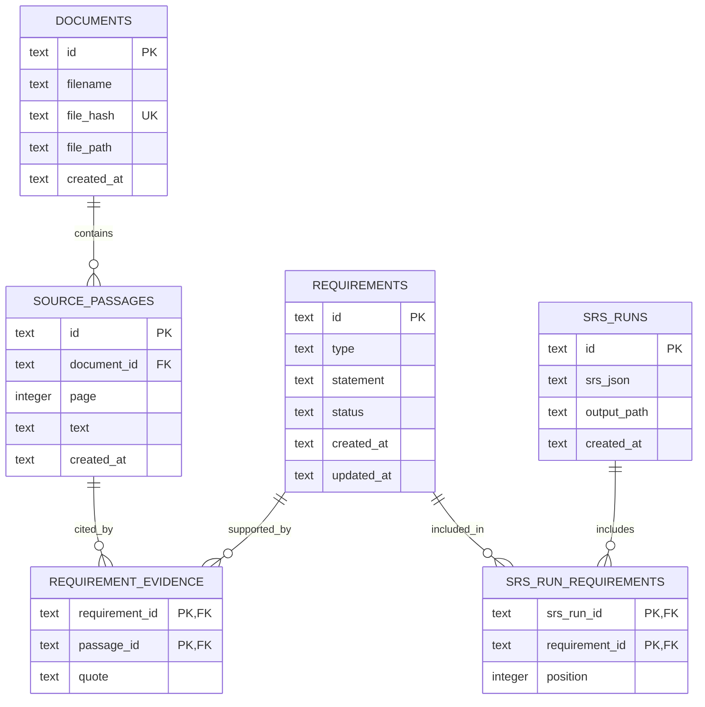
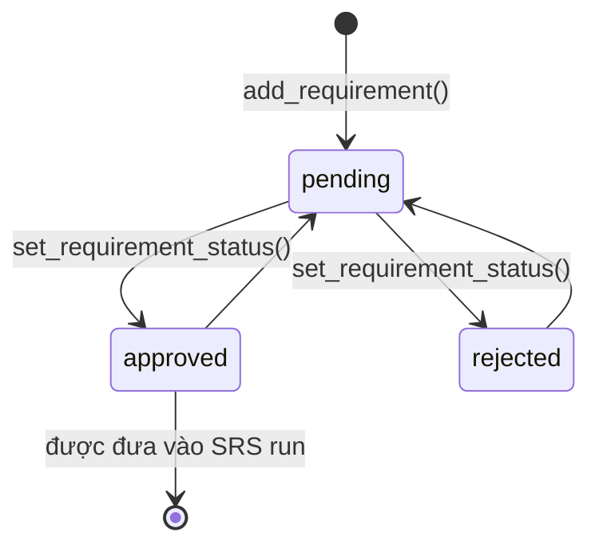

# Database Spec — SpecTestAI

Đặc tả tầng lưu trữ SQLite của SpecTestAI: lưu tài liệu nguồn, các đoạn trích (passage), requirement kèm bằng chứng truy vết, và các lần sinh SRS.

| File | Vai trò |
|---|---|
| [schema.sql](schema.sql) | Định nghĩa bảng, khóa ngoại, ràng buộc, index |
| [sqlite_repository.py](sqlite_repository.py) | Class `SQLiteRepository`: toàn bộ thao tác đọc/ghi |

---

## 1. Mô hình dữ liệu



Hai quan hệ nhiều-nhiều trong ERD gốc được hiện thực bằng **bảng nối**:

| Quan hệ trong ERD gốc | Bảng nối |
|---|---|
| `SOURCE_PASSAGES }o--o{ REQUIREMENTS : supports` | `requirement_evidence` |
| `REQUIREMENTS }o--o{ SRS_RUNS : included_in` | `srs_run_requirements` |

Hai cột `evidence_json` và `requirement_ids_json` trong ERD gốc **không còn tồn tại** trong database. Repository vẫn trả dữ liệu đó dưới dạng list (xem [mục 4](#4-dạng-dữ-liệu-trả-về)).

---

## 2. Các bảng

Mọi `id` là `TEXT`. Nếu không truyền id, repository sinh `uuid4().hex`. Có thể truyền id tự đặt, ví dụ `REQ-001`.

Mọi timestamp là chuỗi ISO 8601 UTC, ví dụ `2026-11-16T08:30:12.345Z`, do SQLite sinh tự động.

### 2.1 `documents`

Tài liệu đầu vào (PDF, DOCX, TXT…).

| Cột | Kiểu | Ràng buộc | Ghi chú |
|---|---|---|---|
| `id` | TEXT | PK | |
| `filename` | TEXT | NOT NULL | Tên file gốc |
| `file_hash` | TEXT | NOT NULL, UNIQUE | Hash nội dung, dùng để chống ingest trùng |
| `file_path` | TEXT | NOT NULL | Đường dẫn lưu file |
| `created_at` | TEXT | NOT NULL, mặc định là thời điểm tạo | |

### 2.2 `source_passages`

Đoạn văn được tách ra từ một document. Đây là đơn vị nhỏ nhất dùng làm bằng chứng.

| Cột | Kiểu | Ràng buộc | Ghi chú |
|---|---|---|---|
| `id` | TEXT | PK | |
| `document_id` | TEXT | NOT NULL, FK → `documents.id`, `ON DELETE CASCADE` | |
| `page` | INTEGER | `NULL` hoặc `>= 1` | `NULL` cho nguồn không chia trang |
| `text` | TEXT | NOT NULL | Nội dung đoạn |
| `created_at` | TEXT | NOT NULL, mặc định là thời điểm tạo | |

Index: `(document_id, page)`.

### 2.3 `requirements`

Requirement được trích xuất, chờ người review.

| Cột | Kiểu | Ràng buộc | Ghi chú |
|---|---|---|---|
| `id` | TEXT | PK | |
| `type` | TEXT | NOT NULL | Ví dụ `functional`, `non-functional`. Database không giới hạn giá trị |
| `statement` | TEXT | NOT NULL | Nội dung requirement |
| `status` | TEXT | NOT NULL, mặc định `pending`, CHECK ∈ {`pending`, `approved`, `rejected`} | |
| `created_at` | TEXT | NOT NULL, mặc định là thời điểm tạo | |
| `updated_at` | TEXT | NOT NULL | Tự cập nhật khi sửa nội dung hoặc đổi trạng thái |

Index: `status`.

### 2.4 `srs_runs`

Mỗi lần sinh một bản SRS từ các requirement đã duyệt.

| Cột | Kiểu | Ràng buộc | Ghi chú |
|---|---|---|---|
| `id` | TEXT | PK | |
| `srs_json` | TEXT | NOT NULL, CHECK `json_valid` | Toàn bộ nội dung SRS dạng JSON |
| `output_path` | TEXT | Cho phép `NULL` | `NULL` cho tới khi export ra file |
| `created_at` | TEXT | NOT NULL, mặc định là thời điểm tạo | |

### 2.5 `requirement_evidence` (bảng nối)

Mỗi dòng ghi lại một sự kiện: "passage X là bằng chứng cho requirement Y".

| Cột | Kiểu | Ràng buộc | Ghi chú |
|---|---|---|---|
| `requirement_id` | TEXT | FK → `requirements.id`, `ON DELETE CASCADE` | |
| `passage_id` | TEXT | FK → `source_passages.id`, `ON DELETE RESTRICT` | |
| `quote` | TEXT | Cho phép `NULL` | Trích nguyên văn từ passage, nếu có |

Khóa chính là `(requirement_id, passage_id)`, nên một passage chỉ được trích một lần cho mỗi requirement. Có index trên `passage_id` để truy vết ngược.

### 2.6 `srs_run_requirements` (bảng nối)

Mỗi dòng ghi lại một sự kiện: "requirement Y nằm trong SRS run Z, ở vị trí thứ N".

| Cột | Kiểu | Ràng buộc | Ghi chú |
|---|---|---|---|
| `srs_run_id` | TEXT | FK → `srs_runs.id`, `ON DELETE CASCADE` | |
| `requirement_id` | TEXT | FK → `requirements.id`, `ON DELETE RESTRICT` | |
| `position` | INTEGER | NOT NULL, `>= 0` | Thứ tự trong SRS, bắt đầu từ 0 |

Khóa chính là `(srs_run_id, requirement_id)`. Cặp `(srs_run_id, position)` là UNIQUE. Có index trên `requirement_id`.

---

## 3. Quy tắc toàn vẹn dữ liệu

### 3.1 Khi xóa

| Thao tác | Kết quả |
|---|---|
| Xóa document | Các passage của nó bị xóa theo. **Bị chặn** nếu có passage đang là bằng chứng cho requirement |
| Xóa passage | **Bị chặn** nếu passage đang là bằng chứng cho requirement |
| Xóa requirement | Các liên kết evidence bị xóa theo. **Bị chặn** nếu requirement đã nằm trong một SRS run |
| Xóa SRS run | Các liên kết trong `srs_run_requirements` bị xóa theo. Requirement vẫn được giữ lại |

### 3.2 Ai kiểm tra quy tắc nào

| Quy tắc | Database (FK / CHECK) | Repository (Python) |
|---|---|---|
| Passage phải thuộc một document có thật | ✔ | |
| Evidence phải trỏ tới passage có thật | ✔ | ✔ (để báo lỗi rõ ràng hơn) |
| SRS run chỉ chứa requirement có thật | ✔ | ✔ (để báo lỗi rõ ràng hơn) |
| `status` chỉ nhận 3 giá trị hợp lệ | ✔ | ✔ |
| `page >= 1`, `srs_json` là JSON hợp lệ | ✔ | |
| Mỗi file (theo `file_hash`) chỉ được lưu một lần | ✔ (UNIQUE) | ✔ (trả lại id của document đã có) |
| **SRS run chỉ chứa requirement đã `approved`** | | ✔ (khóa ngoại không diễn tả được điều kiện này) |
| Một passage không được liệt kê hai lần trong evidence của một requirement | ✔ (PK) | ✔ |

> **Bắt buộc:** SQLite chỉ kiểm tra khóa ngoại khi mỗi connection bật `PRAGMA foreign_keys = ON`. `SQLiteRepository` tự bật khi khởi tạo. Nếu bạn mở database bằng một công cụ khác (DB Browser, sqlite3 CLI…) thì phải tự bật lệnh này.

### 3.3 Vòng đời requirement



Database không giới hạn hướng chuyển trạng thái: có thể chuyển giữa 3 trạng thái theo bất kỳ chiều nào. Ràng buộc cứng duy nhất là `add_srs_run()` từ chối requirement chưa `approved`, trừ khi gọi với `require_approved=False`.

### 3.4 Giao dịch (transaction)

Mỗi hàm ghi chạy trong một transaction. Nếu có lỗi, toàn bộ thao tác được rollback. Ví dụ, `add_requirement()` với một evidence không hợp lệ sẽ không để lại requirement nào trong database. `update_requirement(evidence=…)` bị lỗi thì evidence cũ được giữ nguyên.

---

## 4. Dạng dữ liệu trả về

Các hàm đọc trả về `dict`. Riêng requirement và SRS run được bổ sung thêm field lấy từ bảng nối:

```python
# get_requirement() / list_requirements()
{
    "id": "REQ-001",
    "type": "functional",
    "statement": "Users can log in",
    "status": "approved",
    "created_at": "2026-11-16T08:30:12.345Z",
    "updated_at": "2026-11-16T09:01:00.000Z",
    "evidence": [                                  # theo thứ tự đã thêm
        {"passage_id": "5525b5f1...", "quote": "log in"},
        {"passage_id": "a91c07de...", "quote": None},
    ],
}

# get_srs_run() / list_srs_runs()
{
    "id": "e3f0...",
    "srs_json": "{...}",                           # chuỗi gốc lưu trong DB
    "srs": {...},                                  # srs_json đã được parse
    "output_path": "output/srs.md",
    "created_at": "...",
    "requirement_ids": ["REQ-002", "REQ-001"],     # sắp theo position
}
```

---

## 5. API — `SQLiteRepository`

```python
from database.sqlite_repository import SQLiteRepository, RepositoryError
```

Mọi lỗi vi phạm quy tắc đều raise `RepositoryError`.

### Khởi tạo

| Hàm | Mô tả |
|---|---|
| `SQLiteRepository(db_path=":memory:")` | Mở hoặc tạo database. Tự tạo thư mục cha và chạy `schema.sql` |
| `init_schema()` | Chạy lại `schema.sql`. Lệnh idempotent vì dùng `IF NOT EXISTS` |
| `close()` | Đóng connection. Cũng có thể dùng `with SQLiteRepository(...) as repo:` |

### Documents

| Hàm | Mô tả |
|---|---|
| `add_document(filename, file_hash, file_path, document_id=None) -> str` | Thêm document. Nếu `file_hash` đã tồn tại thì trả về id cũ, không thêm mới |
| `get_document(document_id)` | Lấy document theo id. Trả `None` nếu không có |
| `get_document_by_hash(file_hash)` | Lấy document theo hash. Trả `None` nếu không có |
| `list_documents()` | Danh sách document, sắp theo thời gian tạo |
| `delete_document(document_id)` | Xóa document và các passage của nó. Raise lỗi nếu có passage đang được trích làm bằng chứng |

### Source passages

| Hàm | Mô tả |
|---|---|
| `add_passage(document_id, text, page=None, passage_id=None) -> str` | Thêm một passage |
| `add_passages(document_id, [(page, text), ...]) -> list[str]` | Thêm nhiều passage trong một transaction |
| `get_passage(passage_id)` / `get_passages([ids])` | Lấy một hoặc nhiều passage |
| `list_passages(document_id=None)` | Danh sách passage, của tất cả document hoặc của một document |
| `get_requirements_for_passage(passage_id)` | **Truy vết ngược**: các requirement dùng passage này làm bằng chứng |

### Requirements

| Hàm | Mô tả |
|---|---|
| `add_requirement(type, statement, evidence=(), status="pending", requirement_id=None) -> str` | Thêm requirement. Mỗi phần tử của `evidence` là một chuỗi `passage_id` hoặc một dict `{"passage_id", "quote"}` |
| `update_requirement(id, *, type=None, statement=None, evidence=None)` | Sửa nội dung. Nếu truyền `evidence` thì danh sách evidence cũ bị **thay toàn bộ** |
| `set_requirement_status(id, status)` | Đổi trạng thái |
| `get_requirement(id)` | Lấy requirement kèm `evidence` |
| `list_requirements(status=None)` | Danh sách requirement, có thể lọc theo trạng thái |
| `get_approved_requirements()` | Viết tắt của `list_requirements("approved")` |
| `delete_requirement(id)` | Xóa requirement. Raise lỗi nếu nó đã nằm trong một SRS run |

### SRS runs

| Hàm | Mô tả |
|---|---|
| `add_srs_run(srs, requirement_ids, output_path=None, run_id=None, require_approved=True) -> str` | Lưu một lần sinh SRS. `requirement_ids` bị trùng sẽ được gộp, giữ thứ tự xuất hiện đầu tiên |
| `set_srs_output_path(run_id, output_path)` | Ghi đường dẫn file sau khi export |
| `get_srs_run(run_id)` / `list_srs_runs()` | Lấy một hoặc tất cả SRS run, kèm `srs` đã parse và `requirement_ids` |
| `delete_srs_run(run_id)` | Xóa SRS run. Requirement vẫn được giữ lại |

---

## 6. Ví dụ theo pipeline trong `app.py`

```python
from database.sqlite_repository import SQLiteRepository

with SQLiteRepository("output/spectest.db") as repo:
    # 1. Ingest tài liệu và lưu passage
    doc_id = repo.add_document("spec.pdf", file_hash="sha256:ab12...", file_path="input/spec.pdf")
    p1, p2 = repo.add_passages(doc_id, [(1, "The system shall let users log in."),
                                        (2, "Reports can be exported to PDF.")])

    # 2–3. Lưu requirement đã qua kiểm tra evidence, trạng thái ban đầu là pending
    req = repo.add_requirement(
        "functional", "Users can log in",
        evidence=[{"passage_id": p1, "quote": "users log in"}],
        requirement_id="REQ-001",
    )

    # 4. Người review duyệt requirement
    repo.set_requirement_status(req, "approved")

    # 5–7. Sinh SRS chỉ từ requirement đã approved
    approved = repo.get_approved_requirements()
    run_id = repo.add_srs_run({"title": "SRS v1"}, [r["id"] for r in approved])
    repo.set_srs_output_path(run_id, "output/srs_v1.md")

    # Truy vết: passage p1 sinh ra những requirement nào?
    repo.get_requirements_for_passage(p1)
```

---

## 7. Lưu ý vận hành

- **Đổi schema:** chưa có cơ chế migration. `CREATE TABLE IF NOT EXISTS` không sửa bảng đã tồn tại. Khi đổi schema, cần xóa file `.db` cũ hoặc tự viết script migration. Một file `.db` tạo từ bản schema cũ (còn cột `evidence_json` và `requirement_ids_json`) sẽ không tương thích với bản này.
- **Một connection, một luồng:** mỗi `SQLiteRepository` giữ một `sqlite3.Connection`. Mặc định Python không cho dùng chung connection này giữa các thread, nên mỗi thread nên tạo repository riêng.
- **Yêu cầu SQLite có JSON1:** cột `srs_json` dùng `json_valid`. JSON1 được tích hợp sẵn từ SQLite 3.38. Kiểm tra phiên bản bằng `python -c "import sqlite3; print(sqlite3.sqlite_version)"`.
