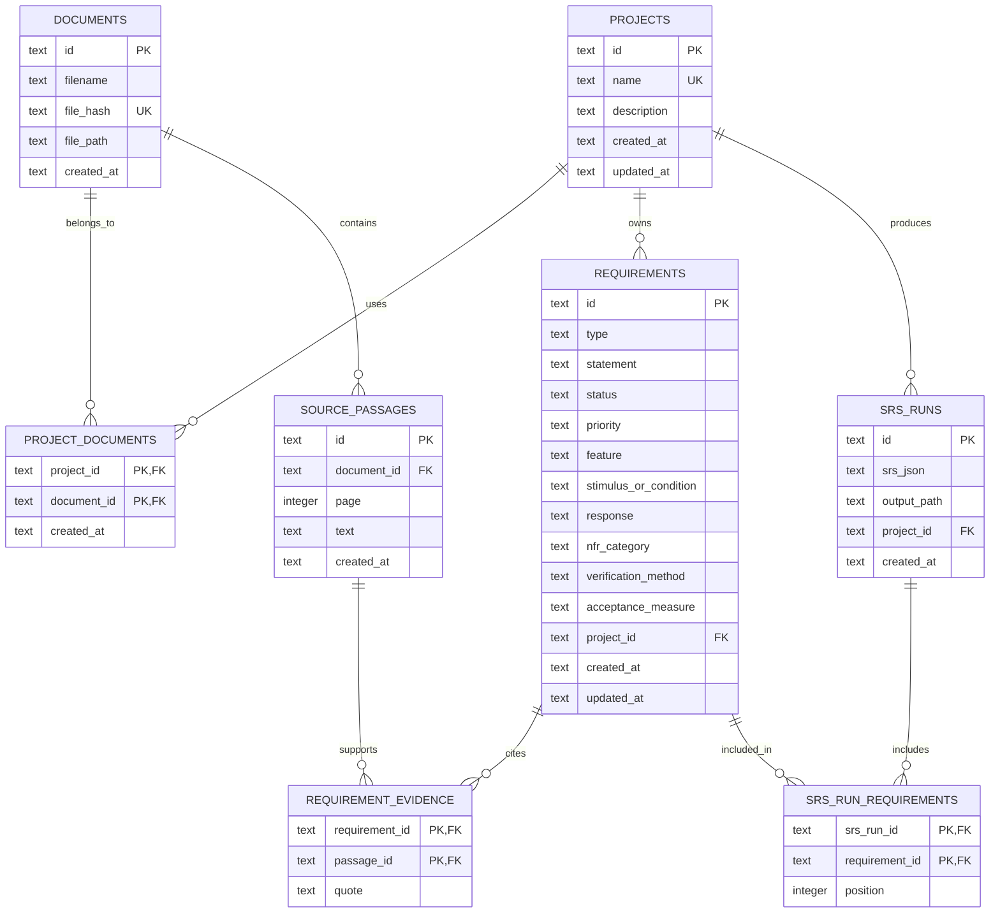
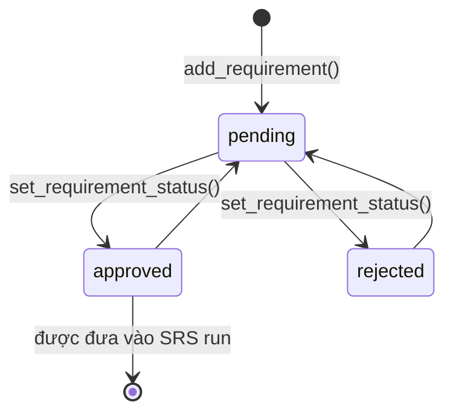

# Database Spec — SpecTestAI

Đặc tả tầng lưu trữ SQLite của SpecTestAI: lưu dự án, tài liệu nguồn, các đoạn trích (passage), requirement kèm bằng chứng truy vết, và các lần sinh SRS.

| File | Vai trò |
|---|---|
| [migrations/](migrations/) | Định nghĩa bảng, khóa ngoại, ràng buộc, index, theo phiên bản: `001_initial.sql` (schema phase 1, trước đây là `schema.sql`), `002_projects.sql`, `003_project_id_not_null.sql` |
| [migrate.py](migrate.py) | Framework migration: chạy, ghi lịch sử, kiểm tra checksum, backup (mục 7) |
| [sqlite_repository.py](sqlite_repository.py) | Class `SQLiteRepository`: toàn bộ thao tác đọc/ghi |
| [evidence_rules.py](evidence_rules.py) | Định nghĩa **duy nhất** của "evidence hợp lệ" và hàm chuẩn hóa text `normalize_for_match`, dùng chung cho repository, `services/evidence_validator.py` và `services/document_loader.py` |
| [init_db.py](init_db.py) | Lệnh tạo và kiểm tra DB (mục 7) |

Model Pydantic tương ứng được mô tả trong [schemas/spec.md](../schemas/spec.md).

---

## 1. Mô hình dữ liệu



Ba quan hệ nhiều-nhiều được hiện thực bằng **bảng nối**:

| Quan hệ | Bảng nối |
|---|---|
| `PROJECTS }o--o{ DOCUMENTS` | `project_documents` |
| `SOURCE_PASSAGES }o--o{ REQUIREMENTS : supports` | `requirement_evidence` |
| `REQUIREMENTS }o--o{ SRS_RUNS : included_in` | `srs_run_requirements` |

Bảng `schema_migrations` (lịch sử migration, mục 7) không thuộc mô hình dữ liệu nên không có trong ERD.

Hai cột `evidence_json` và `requirement_ids_json` trong ERD gốc **không còn tồn tại** trong database. Repository vẫn trả dữ liệu đó dưới dạng list (xem [mục 4](#4-dạng-dữ-liệu-trả-về)).

---

## 2. Các bảng

Mọi `id` là `TEXT`. Nếu không truyền id, repository sinh `uuid4().hex`. Có thể truyền id tự đặt, ví dụ `REQ-001`.

Mọi timestamp là chuỗi ISO 8601 UTC, ví dụ `2026-11-16T08:30:12.345Z`, do SQLite sinh tự động.

### 2.1 `documents`

Tài liệu đầu vào (PDF, DOCX, TXT…).

| Cột | Kiểu | Ràng buộc | Ghi chú |
|---|---|---|---|
| `id` | TEXT | PK | |
| `filename` | TEXT | NOT NULL | Tên file gốc |
| `file_hash` | TEXT | NOT NULL, UNIQUE | Hash nội dung, dùng để chống ingest trùng |
| `file_path` | TEXT | NOT NULL | Đường dẫn lưu file |
| `created_at` | TEXT | NOT NULL, mặc định là thời điểm tạo | |

### 2.2 `source_passages`

Đoạn văn được tách ra từ một document. Đây là đơn vị nhỏ nhất dùng làm bằng chứng.

| Cột | Kiểu | Ràng buộc | Ghi chú |
|---|---|---|---|
| `id` | TEXT | PK | |
| `document_id` | TEXT | NOT NULL, FK → `documents.id`, `ON DELETE CASCADE` | |
| `page` | INTEGER | `NULL` hoặc `>= 1` | `NULL` cho nguồn không chia trang |
| `text` | TEXT | NOT NULL | Nội dung đoạn |
| `created_at` | TEXT | NOT NULL, mặc định là thời điểm tạo | |

Index: `(document_id, page)`.

### 2.3 `requirements`

Requirement được trích xuất, chờ người review. Các cột khớp với `RequirementDraft` / `Requirement` trong [schemas/requirement.py](../schemas/requirement.py), và mang đủ thông tin để đặt requirement vào đúng mục của SRS:

- `functional` → mục 5 (và 3), gom theo `feature`.
- `nonfunctional` → mục 6, gom theo `nfr_category`.

| Cột | Kiểu | Ràng buộc | Ghi chú |
|---|---|---|---|
| `id` | TEXT | PK | |
| `type` | TEXT | NOT NULL, CHECK ∈ {`functional`, `nonfunctional`} | |
| `statement` | TEXT | NOT NULL | Câu dạng "shall" |
| `status` | TEXT | NOT NULL, mặc định `pending`, CHECK ∈ {`pending`, `approved`, `rejected`} | |
| `priority` | TEXT | NOT NULL, CHECK ∈ {`must`, `should`, `could`, `wont`} | |
| `feature` | TEXT | | *Chỉ FR, bắt buộc.* Tên feature, dùng cho mục 3.N / 5.N |
| `stimulus_or_condition` | TEXT | | *Chỉ FR, tùy chọn.* Sự kiện hoặc điều kiện kích hoạt (5.N.2) |
| `response` | TEXT | | *Chỉ FR, tùy chọn.* Phản hồi của hệ thống (5.N.2) |
| `nfr_category` | TEXT | | *Chỉ NFR, bắt buộc.* `Performance`, `Security` hoặc nhóm khác (6.N) |
| `verification_method` | TEXT | CHECK ∈ {`test`, `inspection`, `analysis`, `demonstration`} | *Chỉ NFR, bắt buộc* |
| `acceptance_measure` | TEXT | | *Chỉ NFR, bắt buộc.* Ngưỡng đo được, ví dụ `p95 <= 2 s` |
| `created_at` | TEXT | NOT NULL, mặc định là thời điểm tạo | |
| `updated_at` | TEXT | NOT NULL | Tự cập nhật khi sửa nội dung hoặc đổi trạng thái |

Ràng buộc cấp bảng (vi phạm thì lỗi báo đúng tên ràng buộc):

| Tên | Quy tắc |
|---|---|
| `functional_fields` | FR phải có `feature`; không được có `nfr_category`, `verification_method`, `acceptance_measure` |
| `nonfunctional_fields` | NFR phải có `nfr_category`, `verification_method`, `acceptance_measure`; không được có `feature`, `stimulus_or_condition`, `response` |
| `stimulus_response_pair` | `stimulus_or_condition` và `response` phải cùng có giá trị hoặc cùng NULL |

Ví dụ dữ liệu:

| id | type | priority | feature | stimulus_or_condition | response | nfr_category | verification_method | acceptance_measure |
|---|---|---|---|---|---|---|---|---|
| REQ-001 | functional | must | Login | User submits valid credentials | Dashboard is shown | NULL | NULL | NULL |
| REQ-002 | functional | should | Login | NULL | NULL | NULL | NULL | NULL |
| REQ-003 | nonfunctional | must | NULL | NULL | NULL | Performance | test | p95 <= 2 s |

Index: `status`, `feature`, `nfr_category`. Index trên `feature` và `nfr_category` là partial index, chỉ chứa các dòng khác NULL.

### 2.4 `srs_runs`

Mỗi lần sinh một bản SRS từ các requirement đã duyệt.

| Cột | Kiểu | Ràng buộc | Ghi chú |
|---|---|---|---|
| `id` | TEXT | PK | |
| `srs_json` | TEXT | NOT NULL, CHECK `json_valid` | Toàn bộ nội dung SRS dạng JSON |
| `output_path` | TEXT | Cho phép `NULL` | `NULL` cho tới khi export ra file |
| `created_at` | TEXT | NOT NULL, mặc định là thời điểm tạo | |

### 2.5 `requirement_evidence` (bảng nối)

Mỗi dòng ghi lại một sự kiện: "passage X là bằng chứng cho requirement Y".

| Cột | Kiểu | Ràng buộc | Ghi chú |
|---|---|---|---|
| `requirement_id` | TEXT | FK → `requirements.id`, `ON DELETE CASCADE` | |
| `passage_id` | TEXT | FK → `source_passages.id`, `ON DELETE RESTRICT` | |
| `quote` | TEXT | Cho phép `NULL` | Trích nguyên văn từ passage, nếu có |

Khóa chính là `(requirement_id, passage_id)`, nên một passage chỉ được trích một lần cho mỗi requirement. Có index trên `passage_id` để truy vết ngược.

### 2.6 `srs_run_requirements` (bảng nối)

Mỗi dòng ghi lại một sự kiện: "requirement Y nằm trong SRS run Z, ở vị trí thứ N".

| Cột | Kiểu | Ràng buộc | Ghi chú |
|---|---|---|---|
| `srs_run_id` | TEXT | FK → `srs_runs.id`, `ON DELETE CASCADE` | |
| `requirement_id` | TEXT | FK → `requirements.id`, `ON DELETE RESTRICT` | |
| `position` | INTEGER | NOT NULL, `>= 0` | Thứ tự trong SRS, bắt đầu từ 0 |

Khóa chính là `(srs_run_id, requirement_id)`. Cặp `(srs_run_id, position)` là UNIQUE. Có index trên `requirement_id`.

### 2.7 `projects` (từ migration 002)

Một dự án, ví dụ một sản phẩm khách hàng đề xuất. Requirement và SRS run thuộc về một dự án.

| Cột | Kiểu | Ràng buộc | Ghi chú |
|---|---|---|---|
| `id` | TEXT | PK | Backfill dùng `PRJ-<phần hash của document id>` |
| `name` | TEXT | NOT NULL, UNIQUE, không rỗng | |
| `description` | TEXT | | |
| `created_at`, `updated_at` | TEXT | NOT NULL, mặc định là thời điểm tạo | |

### 2.8 `project_documents` (bảng nối, từ migration 002)

Mỗi dòng ghi lại một sự kiện: "dự án X dùng tài liệu Y". Một tài liệu có thể thuộc nhiều dự án (ví dụ glossary dùng chung).

| Cột | Kiểu | Ràng buộc | Ghi chú |
|---|---|---|---|
| `project_id` | TEXT | FK → `projects.id`, `ON DELETE CASCADE` | |
| `document_id` | TEXT | FK → `documents.id`, `ON DELETE CASCADE` | |
| `created_at` | TEXT | NOT NULL | |

Khóa chính là `(project_id, document_id)`. Có index trên `document_id`.

### 2.9 Cột `project_id` trên `requirements` và `srs_runs`

| Cột | Kiểu | Ràng buộc | Ghi chú |
|---|---|---|---|
| `requirements.project_id` | TEXT | **NOT NULL**, FK → `projects.id`, `ON DELETE RESTRICT` | Dự án sở hữu requirement |
| `srs_runs.project_id` | TEXT | **NOT NULL**, FK → `projects.id`, `ON DELETE RESTRICT` | Dự án của bản SRS |

Mọi requirement và SRS run đều thuộc một dự án. Có index trên cả hai cột.

Lịch sử: migration 002 thêm hai cột này dạng cho phép `NULL`, vì `ALTER TABLE ADD COLUMN` của SQLite không thêm được `NOT NULL` khi không có default khác `NULL`. Migration 003 dựng lại hai bảng với `NOT NULL`. Comment trong `002_projects.sql` còn nhắc tới một lệnh backfill; lệnh này đã bị bỏ trước khi có requirement nào thiếu dự án, và file 002 đã chạy nên được giữ nguyên (mục 7).

---

## 3. Quy tắc toàn vẹn dữ liệu

### 3.1 Khi xóa

| Thao tác | Kết quả |
|---|---|
| Xóa document | Các passage của nó bị xóa theo. **Bị chặn** nếu có passage đang là bằng chứng cho requirement |
| Xóa passage | **Bị chặn** nếu passage đang là bằng chứng cho requirement |
| Xóa requirement | Các liên kết evidence bị xóa theo. **Bị chặn** nếu requirement đã nằm trong một SRS run |
| Xóa SRS run | Các liên kết trong `srs_run_requirements` bị xóa theo. Requirement vẫn được giữ lại |
| Xóa project | Các liên kết trong `project_documents` bị xóa theo; document vẫn được giữ. **Bị chặn** nếu project còn requirement hoặc SRS run |
| Gỡ document khỏi project (`unlink_document`) | **Bị chặn** nếu có requirement của project đang trích passage từ document đó |

### 3.2 Ai kiểm tra quy tắc nào

| Quy tắc                                                                                                                | Database (FK / CHECK) | Repository (Python)                                                                                                                     |
| ---------------------------------------------------------------------------------------------------------------------- | --------------------- | --------------------------------------------------------------------------------------------------------------------------------------- |
| Passage phải thuộc một document có thật                                                                                | ✔                     |                                                                                                                                         |
| Evidence phải trỏ tới passage có thật                                                                                  | ✔                     | ✔ (để báo lỗi rõ ràng hơn)                                                                                                              |
| SRS run chỉ chứa requirement có thật                                                                                   | ✔                     | ✔ (để báo lỗi rõ ràng hơn)                                                                                                              |
| `status` chỉ nhận 3 giá trị hợp lệ                                                                                     | ✔                     | ✔                                                                                                                                       |
| `type`, `priority`, `verification_method` chỉ nhận giá trị hợp lệ                                                      | ✔                     |                                                                                                                                         |
| FR / NFR có đủ field của loại mình và không có field của loại kia                                                      | ✔                     |                                                                                                                                         |
| `stimulus_or_condition` và `response` đi theo cặp                                                                      | ✔                     |                                                                                                                                         |
| `page >= 1`, `srs_json` là JSON hợp lệ                                                                                 | ✔                     |                                                                                                                                         |
| Mỗi file (theo `file_hash`) chỉ được lưu một lần                                                                       | ✔ (UNIQUE)            | ✔ (trả lại id của document đã có)                                                                                                       |
| **SRS run chỉ chứa requirement đã** `approved`                                                                         |                       | ✔ (khóa ngoại không diễn tả được điều kiện này)                                                                                         |
| **Requirement** `approved` **phải có evidence hợp lệ** (mục 3.3)                                                       |                       | ✔ (kiểm tra trong cùng transaction với thao tác ghi)                                                                                    |
| Một passage không được liệt kê hai lần trong evidence của một requirement                                              | ✔ (PK)                | ✔                                                                                                                                       |
| Requirement và SRS run luôn có `project_id`, trỏ tới project có thật                                                   | ✔ (NOT NULL, FK)      | ✔ (để báo lỗi rõ ràng hơn)                                                                                                              |
| **Phạm vi dự án:** mọi passage requirement trích phải thuộc document đã liên kết với dự án của nó                      |                       | ✔ (kiểm tra trong cùng transaction ở `add_requirement`, `update_requirement(evidence=…)`, `set_requirement_project`, `unlink_document`) |
| **SRS run chỉ chứa requirement của dự án của nó**                                                                      |                       | ✔ (`add_srs_run`, `set_requirement_project`)                                                                                            |

> **Bắt buộc:** SQLite chỉ kiểm tra khóa ngoại khi mỗi connection bật `PRAGMA foreign_keys = ON`. `SQLiteRepository` tự bật khi khởi tạo. Nếu bạn mở database bằng một công cụ khác (DB Browser, sqlite3 CLI…) thì phải tự bật lệnh này.

### 3.3 Vòng đời requirement



Có thể chuyển giữa 3 trạng thái theo bất kỳ chiều nào, với **một điều kiện cho** `approved`: requirement phải có evidence hợp lệ theo [evidence_rules.py](evidence_rules.py). Nghĩa là có ít nhất 1 evidence, và mọi evidence item đều trỏ tới passage có thật, có quote, và quote nằm trong chính passage đó (sau chuẩn hóa).

Repository kiểm tra điều kiện này **trong cùng transaction** ở mọi đường có thể dẫn tới `approved`. Nếu không đạt, nó raise `RepositoryError` và **không ghi gì**:

| Thao tác                                                                                               | Khi nào bị chặn                                                 |
| ------------------------------------------------------------------------------------------------------ | --------------------------------------------------------------- |
| `set_requirement_status(id, "approved")`                                                               | Evidence đang lưu không hợp lệ; status giữ nguyên               |
| `add_requirement(..., status="approved")` / `add_requirements_with_sequential_ids` với dòng `approved` | Evidence của dòng đó không hợp lệ; cả thao tác (cả lô) rollback |
| `update_requirement(id, evidence=…)` trên requirement **đang** `approved`                              | Evidence mới không hợp lệ; evidence cũ được giữ                 |

Requirement `pending` hoặc `rejected` **được phép** có evidence không hợp lệ; nó chỉ không thể chuyển sang `approved`.

Còn hai cách lách mà repository không chặn được: ghi thẳng bằng SQL, và sửa text của passage ngoài repository. `services/requirement_registry.get_approved()` kiểm tra lại evidence lần cuối để bắt các trường hợp này.

Ràng buộc còn lại: `add_srs_run()` từ chối requirement chưa `approved`, trừ khi gọi với `require_approved=False`.

### 3.4 Giao dịch (transaction)

Mỗi hàm ghi chạy trong một transaction. Nếu có lỗi, toàn bộ thao tác được rollback. Ví dụ, `add_requirement()` với một evidence không hợp lệ sẽ không để lại requirement nào trong database. `update_requirement(evidence=…)` bị lỗi thì evidence cũ được giữ nguyên.

---

## 4. Dạng dữ liệu trả về

Các hàm đọc trả về `dict`. Riêng requirement và SRS run được bổ sung thêm field lấy từ bảng nối:

```python
# get_requirement() / list_requirements()
{
    "id": "REQ-001",
    "type": "functional",
    "statement": "Upon login with valid credentials, the system shall show the dashboard.",
    "status": "approved",
    "priority": "must",
    "feature": "Login",
    "stimulus_or_condition": "User submits valid credentials",
    "response": "Dashboard is shown",
    "nfr_category": None,
    "verification_method": None,
    "acceptance_measure": None,
    "created_at": "2026-11-16T08:30:12.345Z",
    "project_id": "PRJ-7f3a...",
    "updated_at": "2026-11-16T09:01:00.000Z",
    "evidence": [                                  # theo thứ tự đã thêm
        {"passage_id": "5525b5f1...", "quote": "log in"},
        {"passage_id": "a91c07de...", "quote": None},
    ],
}

# get_srs_run() / list_srs_runs()
{
    "id": "e3f0...",
    "srs_json": "{...}",                           # chuỗi gốc lưu trong DB
    "srs": {...},                                  # srs_json đã được parse
    "output_path": "output/srs.md",
    "project_id": "PRJ-7f3a...",
    "created_at": "...",
    "requirement_ids": ["REQ-002", "REQ-001"],     # sắp theo position
}
```

Dict requirement có thể validate thẳng thành model, không cần chuyển đổi gì thêm:

```python
from schemas.requirement import Requirement
req = Requirement.model_validate(repo.get_requirement("REQ-001"))
```

Các hàm `list_*` trả về theo thứ tự tạo. Nếu hai bản ghi có cùng `created_at`, thứ tự chèn (`rowid`) quyết định.

---

## 5. API — `SQLiteRepository`

```python
from database.sqlite_repository import SQLiteRepository, RepositoryError
```

Mọi lỗi vi phạm quy tắc đều raise `RepositoryError`.

### Khởi tạo

| Hàm | Mô tả |
|---|---|
| `SQLiteRepository(db_path=":memory:")` | Mở hoặc tạo database. Tự tạo thư mục cha. File mới (rỗng) được dựng bằng **mọi migration**. File đã có mà cũ hơn code thì bị từ chối (`RepositoryError` kèm lệnh `python -m database.migrate up`); repository không tự migrate file đang có dữ liệu |
| `init_schema()` | Chạy lại bước kiểm tra / dựng schema ở trên (`migrate.prepare`) |
| `close()` | Đóng connection. Cũng có thể dùng `with SQLiteRepository(...) as repo:` |

### Projects

| Hàm | Mô tả |
|---|---|
| `add_project(name, *, description=None, document_ids=(), project_id=None) -> str` | Tạo project, có thể kèm danh sách document, trong một transaction |
| `get_project(id)` / `list_projects(*, document_id=None)` | Lấy một project, tất cả project, hoặc các project dùng một document. Dict có thêm `document_ids` |
| `link_document(project_id, document_id)` | Thêm document vào project (đã có thì bỏ qua) |
| `unlink_document(project_id, document_id)` | Gỡ document khỏi project. Bị chặn nếu requirement của project đang trích document đó |
| `list_project_documents(project_id)` | Các document của project |
| `update_project(id, *, name=None, description=None)` | Đổi tên và/hoặc mô tả (`None` = giữ nguyên). Tên phải duy nhất |
| `delete_project(id)` | Xóa project. Bị chặn nếu còn requirement hoặc SRS run |

CLI cho các thao tác này: `python -m services.project_registry` ([services/spec.md](../services/spec.md)).

### Documents

| Hàm | Mô tả |
|---|---|
| `add_document(filename, file_hash, file_path, document_id=None) -> str` | Thêm document. Nếu `file_hash` đã tồn tại thì trả về id cũ, không thêm mới |
| `save_document_with_passages(document_id, filename, file_hash, file_path, passages, project_id=None) -> str` | Lưu document cùng các passage `[(passage_id, page, text), ...]`, và liên kết với `project_id` nếu có, **trong một transaction**: lỗi (kể cả project không tồn tại) thì không ghi gì cả. Nếu `file_hash` đã tồn tại thì dùng lại id cũ và gắn passage vào đó. Được `services/document_loader.py` sử dụng |
| `get_document(document_id)` | Lấy document theo id. Trả `None` nếu không có |
| `get_document_by_hash(file_hash)` | Lấy document theo hash. Trả `None` nếu không có |
| `list_documents()` | Danh sách document, sắp theo thời gian tạo |
| `delete_document(document_id)` | Xóa document và các passage của nó. Raise lỗi nếu có passage đang được trích làm bằng chứng |

### Source passages

| Hàm | Mô tả |
|---|---|
| `add_passage(document_id, text, page=None, passage_id=None) -> str` | Thêm một passage |
| `add_passages(document_id, [(page, text), ...]) -> list[str]` | Thêm nhiều passage trong một transaction |
| `get_passage(passage_id)` / `get_passages([ids])` | Lấy một hoặc nhiều passage |
| `list_passages(document_id=None)` | Danh sách passage, của tất cả document hoặc của một document |
| `get_requirements_for_passage(passage_id)` | **Truy vết ngược**: các requirement dùng passage này làm bằng chứng |

### Requirements

| Hàm                                                                                                                                                                                                                                                   | Mô tả                                                                                                                                                                                                                                                                                                                                                                                                                                  |
| ----------------------------------------------------------------------------------------------------------------------------------------------------------------------------------------------------------------------------------------------------- | -------------------------------------------------------------------------------------------------------------------------------------------------------------------------------------------------------------------------------------------------------------------------------------------------------------------------------------------------------------------------------------------------------------------------------------- |
| `add_requirement(type, statement, *, priority, evidence=(), feature=None, stimulus_or_condition=None, response=None, nfr_category=None, verification_method=None, acceptance_measure=None, status="pending", project_id, requirement_id=None) -> str` | Thêm requirement. `project_id` **bắt buộc**: project phải tồn tại và mọi evidence phải thuộc document của project đó (mục 3.2). Tên tham số trùng với field của `RequirementDraft`, nên có thể gọi `repo.add_requirement(**draft.model_dump(), project_id=...)`. Mỗi phần tử của `evidence` là một chuỗi `passage_id` hoặc một dict `{"passage_id", "quote"}`                                                                          |
| `add_requirements_with_sequential_ids(rows, *, prefix, width=4) -> list[str]`                                                                                                                                                                         | Lưu nhiều requirement **trong một transaction**, cấp id `<prefix><số>` tiếp nối số lớn nhất đang có với cùng prefix (ví dụ `RQ-0040`). Mỗi phần tử của `rows` là dict tham số giống `add_requirement` (phải có `project_id`) và không được chứa `requirement_id`. Một dòng lỗi thì không lưu dòng nào. Được `services/requirement_registry.py` sử dụng                                                                                 |
| `update_requirement(id, *, evidence=None, **fields)`                                                                                                                                                                                                  | Sửa các field nội dung (`type`, `statement`, `priority`, `feature`, `stimulus_or_condition`, `response`, `nfr_category`, `verification_method`, `acceptance_measure`). Truyền `None` để xóa giá trị một field. Nếu truyền `evidence` thì danh sách evidence cũ bị **thay toàn bộ**. Đổi `status` phải dùng `set_requirement_status()`. Trên requirement đang `approved`, thay đổi làm evidence không hợp lệ bị từ chối và không ghi gì |
| `set_requirement_status(id, status)`                                                                                                                                                                                                                  | Đổi trạng thái. `"approved"` bị từ chối (`RepositoryError`, status giữ nguyên) nếu evidence không hợp lệ (mục 3.3)                                                                                                                                                                                                                                                                                                                     |
| `set_requirement_project(id, project_id, *, link_documents=False)` | Chuyển requirement sang dự án khác (ví dụ khi ingest nhầm dự án). Bị từ chối nếu requirement trích document ngoài dự án mới. `link_documents=True` thêm các document còn thiếu vào dự án trước; chỉ dùng khi đã xác nhận các document đó thuộc dự án. Cũng bị từ chối nếu requirement nằm trong SRS run của dự án khác |
| `requirement_document_ids(id)`                                                                                                                                                                                                                        | Các document mà evidence của requirement trích tới                                                                                                                                                                                                                                                                                                                                                                                     |
| `project_scope_problems(id) -> list[str]` | Document bị trích nhưng nằm ngoài dự án của requirement; rỗng nếu đúng phạm vi. Chỉ đọc |
| `approval_problems(id) -> list[str]`                                                                                                                                                                                                                  | Lý do evidence đang lưu không hợp lệ; danh sách rỗng là approve được. Chỉ đọc                                                                                                                                                                                                                                                                                                                                                          |
| `get_requirement(id)`                                                                                                                                                                                                                                 | Lấy requirement kèm `evidence` (và `project_id`)                                                                                                                                                                                                                                                                                                                                                                                       |
| `list_requirements(status=None, *, type=None, feature=None, nfr_category=None, project_id=None)` | Danh sách requirement. Các bộ lọc được kết hợp bằng AND |
| `get_approved_requirements(project_id=None)`                                                                                                                                                                                                          | Viết tắt của `list_requirements("approved", project_id=...)`                                                                                                                                                                                                                                                                                                                                                                           |
| `delete_requirement(id)`                                                                                                                                                                                                                              | Xóa requirement. Raise lỗi nếu nó đã nằm trong một SRS run                                                                                                                                                                                                                                                                                                                                                                             |

### SRS runs

| Hàm                                                                                                             | Mô tả                                                                                                                                                                          |
| --------------------------------------------------------------------------------------------------------------- | ------------------------------------------------------------------------------------------------------------------------------------------------------------------------------ |
| `add_srs_run(srs, requirement_ids, output_path=None, run_id=None, require_approved=True, *, project_id) -> str` | Lưu một lần sinh SRS của một project (`project_id` **bắt buộc**). Mọi requirement phải thuộc project đó. `requirement_ids` bị trùng sẽ được gộp, giữ thứ tự xuất hiện đầu tiên |
| `set_srs_output_path(run_id, output_path)`                                                                      | Ghi đường dẫn file sau khi export                                                                                                                                              |
| `get_srs_run(run_id)` / `list_srs_runs(*, project_id=None)` | Lấy một hoặc nhiều SRS run, kèm `srs` đã parse và `requirement_ids` |
| `delete_srs_run(run_id)`                                                                                        | Xóa SRS run. Requirement vẫn được giữ lại                                                                                                                                      |

---

## 6. Ví dụ theo pipeline trong `app.py`

```python
from database.sqlite_repository import SQLiteRepository

with SQLiteRepository("data/example.db") as repo:
    # 0. Tạo dự án
    prj = repo.add_project("Example Portal", project_id="PRJ-example")

    # 1. Ingest tài liệu, lưu passage, liên kết tài liệu với dự án
    doc_id = repo.add_document("spec.pdf", file_hash="sha256:ab12...", file_path="input/spec.pdf")
    p1, p2 = repo.add_passages(doc_id, [(1, "The system shall let users log in."),
                                        (2, "Reports can be exported to PDF.")])
    repo.link_document(prj, doc_id)

    # 2–3. Lưu requirement đã qua kiểm tra evidence, trạng thái ban đầu là pending
    req = repo.add_requirement(
        "functional", "Upon login, the system shall show the dashboard.",
        priority="must",
        feature="Login",
        evidence=[{"passage_id": p1, "quote": "users log in"}],
        project_id=prj,                # bắt buộc; evidence phải thuộc tài liệu của dự án
        requirement_id="REQ-001",
    )
    # Hoặc lưu thẳng output của extractor:
    #   repo.add_requirement(**draft.model_dump(), project_id=prj)     # draft: RequirementDraft

    # 4. Người review duyệt requirement
    repo.set_requirement_status(req, "approved")

    # 5–7. Sinh SRS chỉ từ requirement đã approved của dự án
    approved = repo.get_approved_requirements(prj)
    run_id = repo.add_srs_run({"title": "SRS v1"}, [r["id"] for r in approved], project_id=prj)
    repo.set_srs_output_path(run_id, "output/srs_v1.md")

    # Truy vết: passage p1 sinh ra những requirement nào?
    repo.get_requirements_for_passage(p1)
```

---

## 7. Lưu ý vận hành

- **Vị trí file:** `src/data/spectest.db` (`config.DB_PATH`). Có thể đổi bằng biến môi trường `SPECTEST_DB_PATH` hoặc `SPECTEST_DATA_DIR`. Thư mục `src/data/` và mọi file `*.db` đã được thêm vào `.gitignore` vì DB chứa nguyên văn tài liệu đầu vào. `src/output/` chỉ dành cho file SRS xuất ra.
- **Khởi tạo và kiểm tra** (chạy từ `src/`):
  ```bash
  uv run python -m database.init_db            # tạo nếu chưa có, kiểm tra schema, in số dòng mỗi bảng
  uv run python -m database.init_db --reset    # XÓA file DB và tạo lại (mất toàn bộ dữ liệu)
  uv run python -m database.init_db --db PATH  # dùng file khác
  ```

  `init_db` tạo DB mới bằng mọi migration. Với DB đã có, nó chỉ kiểm tra: nếu DB cũ hơn code thì liệt kê migration còn thiếu và trả exit code 1, nếu bảng bị sửa ngoài migration thì liệt kê bảng hoặc cột lệch.
- **Migration** (chạy từ `src/`):
  ```bash
  uv run python -m database.migrate               # trạng thái: phiên bản hiện tại, migration còn thiếu
  uv run python -m database.migrate up            # backup file, rồi chạy các migration còn thiếu
  uv run python -m database.migrate up --to 2     # chỉ chạy tới phiên bản 2
  ```
  - Migration là các file `migrations/NNN_ten.sql`, đánh số liên tục từ `001`. Mỗi file chạy trong **một transaction** cùng với dòng ghi lịch sử trong bảng `schema_migrations` (`version`, `name`, `checksum`, `baseline`, `applied_at`). Lỗi ở bất kỳ câu lệnh nào thì cả file rollback và phiên bản không tăng. Các migration chạy trước đó vẫn được giữ.
  - Trong lúc chạy, khóa ngoại được tắt (cần thiết khi phải dựng lại bảng), và cuối mỗi file có `PRAGMA foreign_key_check`. Còn vi phạm thì rollback.
  - `up` tạo backup `spectest.db.bak-<thời điểm UTC>` cạnh file DB trước khi ghi (bỏ qua bằng `--no-backup`). Muốn quay lại phiên bản cũ thì khôi phục từ backup; framework không có downgrade.
  - **DB có từ trước khi có framework** (tạo bằng `schema.sql` cũ, chưa có `schema_migrations`): nếu layout trùng đúng `001_initial.sql` thì `up` ghi `001` là *baseline* (không chạy lại), rồi chạy `002` trở đi. Layout khác (ví dụ còn cột `evidence_json` / `requirement_ids_json`) thì bị từ chối.
  - **Đổi schema:** thêm file `NNN_ten.sql` kế tiếp. **Không sửa file đã chạy**: checksum (tính trên nội dung đã chuẩn hóa xuống dòng LF, nên `autocrlf` của git không ảnh hưởng) bị lệch thì mọi lệnh đều từ chối. Trong file không được có `BEGIN` / `COMMIT` / `ROLLBACK` / `PRAGMA` ở mức câu lệnh, vì runner quản lý transaction (`BEGIN … END` trong thân trigger thì được phép). Migration chỉ chứa schema và không đoán dữ liệu: nếu thiếu dữ liệu (ví dụ cột `NOT NULL` gặp dòng `NULL`), migration lỗi, được rollback, và phiên bản giữ nguyên; sửa dữ liệu rồi chạy lại. Bảng cần đổi ràng buộc cột thì dựng lại theo cách của `003_project_id_not_null.sql` (tạo bảng mới, copy cả `rowid`, xóa bảng cũ, đổi tên, tạo lại index).
- **Một connection, một luồng:** mỗi `SQLiteRepository` giữ một `sqlite3.Connection`. Mặc định Python không cho dùng chung connection này giữa các thread, nên mỗi thread nên tạo repository riêng.
- **Yêu cầu SQLite có JSON1:** cột `srs_json` dùng `json_valid`. JSON1 được tích hợp sẵn từ SQLite 3.38. Kiểm tra phiên bản bằng `python -c "import sqlite3; print(sqlite3.sqlite_version)"`.
