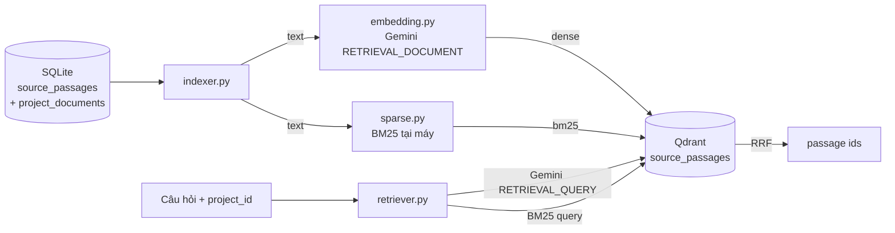
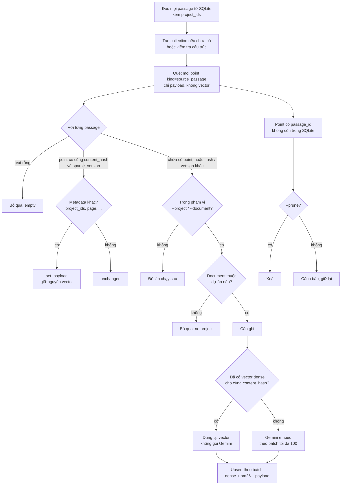
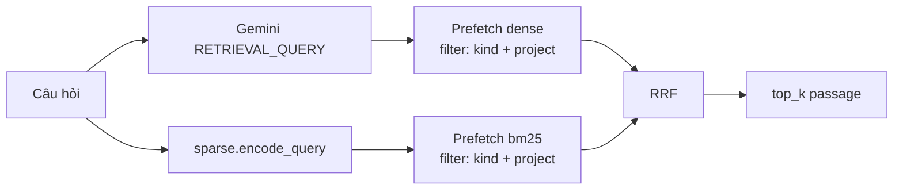

# Retrieval Spec — SpecTestAI

Đặc tả tầng retrieval: đưa passage từ SQLite (`source_passages`) vào Qdrant, rồi tìm passage liên quan đến một câu hỏi bằng **hybrid search** (ngữ nghĩa + từ khoá), luôn trong phạm vi **một dự án**, trả về **passage id**.

| File | Vai trò |
|---|---|
| [indexer.py](indexer.py) | Luồng index SQLite → Qdrant, chống index trùng, CLI `python -m retrieval.indexer` (mục 3) |
| [embedding.py](embedding.py) | Gọi Gemini để lấy vector dense cho passage và câu hỏi, tính `content_hash` (mục 4) |
| [sparse.py](sparse.py) | Tính vector sparse BM25 tại máy, không gọi API (mục 5) |
| [qdrant_store.py](qdrant_store.py) | Kết nối Qdrant, tạo / kiểm tra collection, upsert, xoá (mục 2) |
| [retriever.py](retriever.py) | Tìm kiếm hybrid / dense / sparse có lọc theo dự án (mục 6) |

Phần dùng chung nằm ngoài thư mục này:

- `SQLiteRepository.list_passages_for_index()` trong [database/sqlite_repository.py](../database/sqlite_repository.py): mọi passage kèm `filename` và danh sách `project_ids`. Bảng được mô tả trong [database/spec.md](../database/spec.md).
- `gemini_client.embed_texts()` trong [llm_clients/gemini_client.py](../llm_clients/gemini_client.py): một lần gọi `embed_content`, dùng chung cách xử lý lỗi 429 với `generate_json()`.

---

## 1. Tổng quan



- SQLite là nguồn sự thật. Qdrant chỉ là chỉ mục dẫn xuất: xoá đi thì chạy lại indexer là dựng lại được.
- Kết quả tìm kiếm là `source_passages.id`, cùng loại id mà requirement dùng làm evidence (`requirement_evidence.passage_id`).

---

## 2. Collection Qdrant

### 2.1 Cấu trúc

Tên lấy từ `QDRANT_COLLECTION` (mặc định `source_passages`). Collection được indexer tự tạo nếu chưa có.

| Thành phần | Cấu hình | Dùng cho |
|---|---|---|
| Vector `dense` | `GEMINI_EMBEDDING_DIM` chiều (mặc định 1536), distance **cosine** | Tìm theo nghĩa |
| Sparse vector `bm25` | `Modifier.IDF` (Qdrant tự tính IDF trên toàn collection) | Khớp đúng từ khoá: mã số, thuật ngữ, tên riêng |
| Payload index (keyword) | `kind`, `project_ids`, `document_id`, `passage_id`, `content_hash` | Lọc nhanh theo dự án, quét các point của indexer |

Cosine tự chuẩn hoá vector, nên vector Gemini dưới 3072 chiều (không có độ dài đơn vị) không cần chuẩn hoá trước.

### 2.2 Point

Mỗi passage là **đúng một point**.

| Trường | Giá trị |
|---|---|
| `id` | `uuid5(namespace cố định, passage_id)`. Passage id dạng `DOC-...-P0001` không phải UUID nên không dùng trực tiếp được. Namespace nằm trong `qdrant_store._POINT_NAMESPACE`; **đổi nó là mọi point cũ thành mồ côi** |
| `vector.dense` | Embedding Gemini của `text` |
| `vector.bm25` | Trọng số BM25 của `text` (mục 5) |

Payload:

| Key | Ý nghĩa |
|---|---|
| `kind` | Luôn là `"source_passage"`. Đánh dấu point do indexer quản lý (mục 2.3) |
| `passage_id`, `document_id`, `filename`, `page`, `text` | Sao chép từ SQLite, để trả kết quả mà không cần query lại DB |
| `project_ids` | **Danh sách** dự án mà document thuộc về (một document có thể thuộc nhiều dự án), đã sắp xếp. Rỗng nếu document chưa thuộc dự án nào |
| `content_hash` | `sha256(model, dim, text)`: định danh của vector dense (mục 3.2) |
| `sparse_version` | `sparse.VERSION` lúc tính vector BM25 |
| `embedding_model`, `embedding_dim` | Thông tin tham khảo |

### 2.3 Dùng chung collection với dữ liệu khác

Mọi thao tác quét và xoá của indexer đều lọc theo `kind = "source_passage"`. Point khác trong cùng collection (không có `kind` đó) không bao giờ bị đọc, sửa hay xoá. Retriever cũng lọc theo `kind`.

### 2.4 Kiểm tra cấu trúc

Khi collection đã tồn tại, `qdrant_store.check_layout()` yêu cầu: có vector `dense` đúng số chiều, distance cosine, có sparse `bm25` với modifier IDF. Sai bất kỳ điều nào thì `QdrantStoreError` liệt kê từng vấn đề. Indexer **không tự xoá** collection; người vận hành tự xoá rồi chạy lại (mục 7.2).

Các trường hợp thường gặp:

- Collection cũ chỉ có một vector không tên (layout trước khi có hybrid): `no dense vector named 'dense'; no sparse vector named 'bm25'`.
- Đổi `GEMINI_EMBEDDING_DIM`: `'dense' has 1536 dims but GEMINI_EMBEDDING_DIM=768`.

---

## 3. `indexer.py`: luồng index

### 3.1 Luồng xử lý



### 3.2 Cơ chế chống index trùng

| # | Cơ chế | Chống được gì |
|---|---|---|
| 1 | Point id = `uuid5(passage_id)` | Hai point cho cùng một passage. Index lại là ghi đè đúng point cũ, kể cả khi lần trước dừng giữa chừng |
| 2 | `content_hash = sha256(model \0 dim \0 text)` lưu trong payload | Embed lại passage không đổi. Hash chỉ đổi khi text, model hoặc số chiều đổi |
| 3 | Gom theo `content_hash` trước khi gọi Gemini | Embed nhiều lần cùng một nội dung: passage trùng text trong cùng lần chạy, hoặc đã có trong index dưới passage khác, dùng chung một vector |
| 4 | So sánh metadata (`passage_id`, `document_id`, `filename`, `page`, `project_ids`) khi hash khớp | Gọi Gemini chỉ vì metadata đổi, ví dụ link document sang dự án khác: chỉ `set_payload` |
| 5 | `sparse_version` lưu trong payload | Vector BM25 cũ sau khi đổi cách tách từ: point được ghi lại với vector dense đã lưu, không gọi Gemini |

Phần dữ liệu đã ghi được giữ qua các batch: mỗi batch embed xong là upsert ngay. Nếu hết quota Gemini giữa chừng thì phần đã xong vẫn còn, chạy lại sẽ tiếp tục từ phần chưa có.

### 3.3 Phạm vi `--project` / `--document`

- Phạm vi chỉ giới hạn passage nào được **embed**.
- Việc đồng bộ metadata (mục 3.2, dòng 4) áp dụng cho **mọi** passage đã có point hợp lệ, dù ngoài phạm vi. Việc này rẻ và giữ cho bộ lọc dự án của retriever luôn đúng sau khi link / unlink document.
- Passage ngoài phạm vi mà chưa có point, hoặc có text đã đổi, sẽ để lại cho lần chạy không giới hạn phạm vi.

### 3.4 Passage không thuộc dự án nào

Bị bỏ qua (`skipped_no_project`), vì retriever luôn lọc theo dự án nên không bao giờ tìm thấy chúng. Lần chạy đầu tiên sau khi document được link vào một dự án sẽ index chúng.

### 3.5 Passage đã bị xoá khỏi SQLite (orphan)

Point có `passage_id` không còn trong SQLite được báo trong `IndexReport.orphans` và log cảnh báo. Chỉ xoá khi chạy với `--prune`.

### 3.6 API

```python
from retrieval import indexer

report = indexer.index_passages(
    project_id=None,      # chỉ embed passage của dự án này
    document_id=None,     # chỉ embed passage của document này
    prune=False,          # xoá point của passage không còn trong SQLite
    dry_run=False,        # chỉ đếm, không ghi, không gọi Gemini
    # Tiêm phụ thuộc, dùng trong test:
    repo=None,            # SQLiteRepository; mặc định mở config.DB_PATH
    qdrant=None,          # QdrantClient; mặc định qdrant_store.make_client()
    embed_client=None,    # client Gemini; mặc định gemini_client.make_client()
    collection=None,      # mặc định config.QDRANT_COLLECTION
)
```

`IndexReport`:

| Trường | Ý nghĩa |
|---|---|
| `in_scope` | Số passage trong phạm vi lần chạy |
| `embedded` | Point ghi với vector dense mới tính |
| `reused` | Point ghi với vector dense đã có (cùng `content_hash`) |
| `embedding_calls` | Số text gửi lên Gemini |
| `payload_updated` | Point chỉ cập nhật metadata |
| `unchanged` | Point đã đúng, không làm gì |
| `skipped_no_project`, `skipped_empty` | Passage bị bỏ qua |
| `orphans`, `pruned` | Passage id không còn trong SQLite / số point đã xoá |
| `dry_run` | `True` nếu là dry-run |

Lỗi: `IndexerError` (lỗi Qdrant, lỗi kết nối, lỗi Gemini). Lỗi Gemini có thêm ghi chú "finished points are kept; run again to continue".

### 3.7 Dry-run

Dry-run đếm giống hệt lần chạy thật (gồm cả `reused`) và cũng kiểm tra cấu trúc collection, nhưng không tạo collection, không ghi, không gọi Gemini. Nếu collection chưa tồn tại, mọi passage được tính là cần embed.

---

## 4. `embedding.py`

| Hàm | Task type | Dùng cho |
|---|---|---|
| `embed_documents(texts, client=None)` | `RETRIEVAL_DOCUMENT` | Passage khi index |
| `embed_query(text, client=None)` | `RETRIEVAL_QUERY` | Câu hỏi khi tìm kiếm |
| `content_hash(text)` | – | Định danh vector: `sha256(model \0 dim \0 text)` |

- Model: `GEMINI_MODEL_EMBEDDING`. Số chiều: `GEMINI_EMBEDDING_DIM`, gửi qua `output_dimensionality`.
- Chia batch theo `GEMINI_EMBEDDING_BATCH_SIZE`, tối đa 100 (giới hạn của API).
- Kiểm tra số vector trả về bằng số text, và mỗi vector đúng số chiều. Sai thì `EmbeddingError`.
- Lỗi 429: thử lại khi là rate limit ngắn, không thử lại khi hết quota ngày (dùng chung logic `gemini_client.call_with_rate_limit`). Lỗi 408 / 5xx do SDK tự thử lại.

---

## 5. `sparse.py`: BM25

### 5.1 Vì sao tự tính

Qdrant ≥ 1.15.3 tính được BM25 trên server, nhưng cần bật `cloud_inference=True` trên client, và chế độ local (`QdrantClient(":memory:")`) dùng trong test không hỗ trợ. Tự tính thì:

- chạy được với mọi Qdrant ≥ 1.10, không cần thêm thư viện (fastembed),
- test được hybrid search từ đầu đến cuối mà không cần mạng,
- chủ động được cách tách từ cho tiếng Việt.

### 5.2 Công thức

Qdrant nhân thêm IDF (do `Modifier.IDF`). Module này chỉ cung cấp phần tần suất từ:

```
document: w(t) = tf · (k1 + 1) / (tf + k1 · (1 − b + b · len / AVG_LEN))
query:    w(t) = 1 với mỗi từ khác nhau
```

| Hằng số | Giá trị |
|---|---|
| `K1` | 1.2 |
| `B` | 0.75 |
| `AVG_LEN` | 64 token |
| `VERSION` | `bm25-v1` |

### 5.3 Tách từ

- Chuẩn hoá Unicode **NFC** (text NFD và NFC cho cùng vector), chuyển chữ thường, lấy các cụm `\w+`.
- **Giữ dấu**: "mã" và "ma" là hai từ khác nhau.
- Không stemming, không bỏ stopword, áp dụng cho cả tiếng Việt và tiếng Anh. Tiếng Việt được tách theo âm tiết.
- Id của từ là `crc32(token)`. Hai từ trùng hash thì cộng trọng số.

### 5.4 Đổi cách tính

Mọi thay đổi làm vector khác đi (công thức, hằng số, tách từ) **phải tăng** `VERSION`. Lần chạy indexer tiếp theo ghi lại vector BM25 cho mọi point và dùng lại vector dense, không gọi Gemini.

---

## 6. `retriever.py`: tìm kiếm

### 6.1 Chế độ

| `mode` | Cách làm | `score` |
|---|---|---|
| `"hybrid"` (mặc định) | Mỗi nhánh dense và bm25 lấy `max(PREFETCH_LIMIT=50, top_k)` ứng viên, gộp bằng **RRF** (Reciprocal Rank Fusion) | Điểm RRF, chỉ dùng để xếp hạng |
| `"dense"` | Chỉ vector Gemini | Cosine similarity |
| `"sparse"` | Chỉ BM25 | Điểm BM25 |



### 6.2 Lọc theo dự án

Filter `kind = source_passage AND project_ids chứa project_id` được đặt **trong từng prefetch** và ở cả truy vấn ngoài, nên kết quả gộp không thể chứa passage của dự án khác. `project_ids` là danh sách; Qdrant khớp khi có ít nhất một phần tử bằng `project_id`. Dự án không tồn tại hoặc không có document thì trả về danh sách rỗng.

### 6.3 API

```python
from retrieval import retriever

retriever.search_passage_ids("PRJ-...", "thời hạn mật khẩu", top_k=8)
# -> ["DOC-...-P0002", "DOC-...-P0014", ...]   (tốt nhất trước)

retriever.search_passages("PRJ-...", "thời hạn mật khẩu", top_k=8, mode="hybrid")
# -> [{"passage_id", "document_id", "filename", "page", "text", "score"}, ...]

retriever.search_points("PRJ-...", "...", top_k=8, mode="sparse", with_payload=["passage_id"])
# -> list[ScoredPoint] của qdrant-client

retriever.search_many("PRJ-...", {"purpose": "...", "feature:Login": "..."}, top_k=4)
# -> {"purpose": ["DOC-...-P0003", ...], "feature:Login": [...]}
#    mọi câu truy vấn: 1 lần gọi Gemini embedding + 1 lần query_batch_points

retriever.retrieve_evidence("PRJ-...", query_vector, top_k=8)
# -> chỉ dense, với vector câu hỏi đã tính sẵn
```

`search_many` là hàm SRS generator dùng để lấy evidence cho từng narrative section và từng feature ([agents/spec.md](../agents/spec.md) mục 2.2).

Mọi hàm nhận thêm `client=`, `embed_client=`, `collection=` để tiêm phụ thuộc trong test. Client Qdrant mặc định được tạo một lần, khi cần lần đầu (không tạo lúc import).

Ở chế độ `hybrid` / `dense`, mỗi lần tìm là một lần gọi Gemini để embed câu hỏi. `sparse` không gọi API. Câu hỏi không có từ nào (chỉ có dấu câu) thì `sparse` trả về rỗng, còn `hybrid` chỉ dùng nhánh dense.

---

## 7. Cấu hình và vận hành

### 7.1 Biến môi trường (`src/.env`)

| Biến | Mặc định | Ghi chú |
|---|---|---|
| `GEMINI_API_KEY` | – | Bắt buộc khi index hoặc tìm ở chế độ `hybrid` / `dense` |
| `GEMINI_MODEL_EMBEDDING` | `gemini-embedding-001` | Đổi model thì `content_hash` đổi, mọi passage được embed lại |
| `GEMINI_EMBEDDING_DIM` | `1536` | Phải khớp với collection (mục 2.4); đổi thì phải xoá collection |
| `GEMINI_EMBEDDING_BATCH_SIZE` | `100` | Tối đa 100 |
| `QDRANT_HOST` | `localhost` | Có thể là URL đầy đủ (`http://host:6333`); khi đó bỏ qua `QDRANT_PORT` / `QDRANT_HTTPS` |
| `QDRANT_PORT` | `6333` | |
| `QDRANT_API_KEY` | – | |
| `QDRANT_HTTPS` | không đặt | qdrant-client **tự dùng https khi có API key**. Server chạy http thường thì phải đặt `QDRANT_HTTPS=false`, nếu không sẽ gặp lỗi `SSL: WRONG_VERSION_NUMBER` |
| `QDRANT_COLLECTION` | `source_passages` | |
| `QDRANT_TIMEOUT` | `30` | Giây |

### 7.2 Dòng lệnh (chạy từ `src/`)

```bash
python -m retrieval.indexer                       # mọi passage
python -m retrieval.indexer --project PRJ-...     # chỉ một dự án
python -m retrieval.indexer --document DOC-...    # chỉ một document
python -m retrieval.indexer --dry-run             # xem trước, không ghi
python -m retrieval.indexer --prune               # xoá point của passage đã bị xoá
```

Kết quả in ra một dòng tổng kết, ví dụ:

```
INFO source_passages: 231 passages in scope; embedded 187 (187 Gemini inputs), reused 44, payload updated 0, unchanged 0, skipped 0 without project, 0 empty
```

Chạy lại ngay sau đó:

```
INFO source_passages: 231 passages in scope; embedded 0 (0 Gemini inputs), reused 0, payload updated 0, unchanged 231, ...
```

**Dựng lại collection** (đổi số chiều, hoặc đổi từ layout cũ): xoá collection trên Qdrant (dashboard hoặc `client.delete_collection(name)`), chạy `--dry-run` để xem số lần gọi Gemini, rồi chạy indexer. Collection được tạo lại với cấu trúc ở mục 2.1.

### 7.3 Khi nào cần chạy indexer

Sau mỗi lần ingest tài liệu (`services.document_loader`), sau khi link / unlink document với dự án, và sau khi xoá document (kèm `--prune`). Indexer **chưa được gọi tự động** trong pipeline của [app.py](../app.py).

---

## 8. Test

[test/test_passage_indexer.py](../test/test_passage_indexer.py), chạy từ `src/`:

```bash
python -m unittest discover -s test -t .
```

Không dùng mạng: Qdrant chạy ở chế độ local trong bộ nhớ, Gemini là client giả trả vector cố định theo text và ghi lại những gì được gửi lên. Dữ liệu test là dữ liệu giả.

| Nhóm | Kiểm tra |
|---|---|
| Chống trùng | Lần đầu mỗi nội dung chỉ embed một lần; lần hai không ghi gì; text đổi thì embed lại đúng passage đó, số point không đổi |
| Metadata | Link document sang dự án khác chỉ cập nhật payload, không gọi Gemini |
| Phạm vi | `--project` chỉ embed passage của dự án; lần chạy sau dùng lại vector cho text trùng |
| Bỏ qua / orphan | Document không thuộc dự án bị bỏ qua; passage bị xoá được báo, chỉ xoá khi `prune=True`; point lạ trong collection không bị đụng tới |
| Dry-run | Đếm đúng, không tạo collection, không gọi Gemini |
| Cấu trúc | Sai số chiều và layout cũ (một vector không tên) đều bị từ chối |
| BM25 | Đổi `sparse.VERSION` ghi lại point mà không gọi Gemini; giữ dấu tiếng Việt; NFC = NFD; tần suất tăng thì trọng số tăng nhưng bão hoà |
| Tìm kiếm | Cả 3 chế độ chỉ trả passage của dự án; BM25 tìm đúng từ khoá; hybrid xếp đúng passage lên đầu; `search_passages` trả đủ trường |

---

## 9. Giới hạn hiện tại

- **Chưa tự động**: pipeline trong `app.py` chưa gọi indexer sau khi ingest. SRS generator đã dùng retriever, nhưng requirement extractor thì chưa.
- **Quét toàn bộ collection mỗi lần chạy** (chỉ payload, không vector). Phù hợp với vài chục nghìn passage; lớn hơn thì nên chuyển sang theo dõi trạng thái index trong SQLite.
- **Lần chạy có phạm vi** không sửa point ngoài phạm vi có text đã đổi (mục 3.3).
- **BM25 không stemming**: "requirement" và "requirements" là hai từ khác nhau. Tiếng Việt được tách theo âm tiết, không theo từ ghép.
- `text` **được lưu cả trong payload** (trùng với SQLite) để trả kết quả không cần query DB. Khi xoá dữ liệu khách hàng phải xoá cả ở Qdrant (`--prune`).
- **Mỗi câu hỏi hybrid / dense tốn một lần gọi Gemini**; chưa có cache cho embedding câu hỏi.
- Log từng request HTTP tới Gemini vẫn hiện khi chạy CLI. Log của Qdrant đã được tắt.
