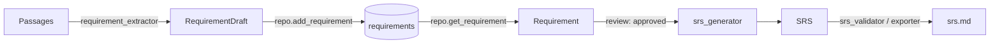

# Schemas Spec — SpecTestAI

Đặc tả các model Pydantic (v2) mô tả dữ liệu đi qua pipeline: requirement trích xuất từ tài liệu, và tài liệu SRS theo chuẩn IEEE 830.

| File | Vai trò |
|---|---|
| [requirement.py](requirement.py) | `Evidence`, `RequirementDraft`, `Requirement`: một requirement kèm bằng chứng |
| [srs.py](srs.py) | `SRS` cùng các model con, và `build_toc()`: toàn bộ tài liệu SRS |

Nguồn gốc:

- [templates/standard_srs.yaml](../templates/standard_srs.yaml) quy định key và cấu trúc lồng nhau của SRS.
- [templates/IEEE_830_SRS_Template.md](../templates/IEEE_830_SRS_Template.md) quy định các mục và cách đánh số.

Tầng lưu trữ tương ứng được mô tả trong [database/spec.md](../database/spec.md).

---

## 1. Vị trí trong pipeline



| Bước trong `app.py` | Model |
|---|---|
| 2. Extract candidate requirements | `RequirementDraft` (chưa có id, chưa có trạng thái) |
| 3. Validate evidence, save as pending | `RequirementDraft` → database → `Requirement` với `status="pending"` |
| 4. Human review | `Requirement.status` chuyển sang `approved` hoặc `rejected` |
| 5–6. Compose SRS từ requirement đã approved | `list[Requirement]` → `SRS` |
| 7. Validate & export | `SRS` (validator của model kiểm tra tính nhất quán giữa các mục) |

---

## 2. Quy ước chung

Tất cả model kế thừa `Contract` (định nghĩa trong `srs.py`):

```python
class Contract(BaseModel):
    model_config = ConfigDict(extra="forbid", strict=True)
```

- **`extra="forbid"`:** field lạ bị từ chối. Nhờ vậy, nếu LLM sinh thừa field hoặc gõ sai tên field thì lỗi lộ ra ngay.
- **`strict=True`:** không tự ép kiểu. Ví dụ `"1"` không được chấp nhận ở chỗ cần `int`. Riêng dict vẫn được nhận cho field kiểu model con.

Các kiểu dùng chung:

| Tên | Định nghĩa | Ý nghĩa |
|---|---|---|
| `Text` | `str`, ít nhất 1 ký tự khác khoảng trắng | Không chấp nhận chuỗi rỗng hoặc chỉ toàn dấu cách |
| `IsoDate` | `str` dạng `YYYY-MM-DD` | Chỉ kiểm tra dạng chuỗi, không kiểm tra ngày có thật |
| `Priority` | `must` \| `should` \| `could` \| `wont` | MoSCoW |
| `ContentStatus` | `specified` \| `unresolved` \| `not_applicable` | Trạng thái nội dung của một mục |
| `VerificationMethod` | `test` \| `inspection` \| `analysis` \| `demonstration` | Cách kiểm chứng NFR |

---

## 3. `requirement.py`

### 3.1 `Evidence`

Một passage làm bằng chứng cho requirement.

| Field | Kiểu | Bắt buộc | Ghi chú |
|---|---|---|---|
| `passage_id` | `Text` | ✔ | Id trong bảng `source_passages` |
| `quote` | `Text \| None` | | Trích nguyên văn từ passage. Mặc định `None` |

### 3.2 `RequirementDraft`

Output của extractor. Chưa có id và chưa có trạng thái review.

| Field | Kiểu | FR | NFR | Mục SRS |
|---|---|---|---|---|
| `type` | `functional` \| `nonfunctional` | ✔ | ✔ | Quyết định đặt vào mục 5 hay mục 6 |
| `statement` | `Text` | ✔ | ✔ | Câu dạng "shall" |
| `priority` | `Priority` | ✔ | ✔ | 5.N.3 / 6.N |
| `evidence` | `list[Evidence]`, ≥ 1 | ✔ | ✔ | Truy vết về nguồn |
| `feature` | `Text \| None` | **bắt buộc** | phải `None` | Gom vào 3.N / 5.N |
| `stimulus_or_condition` | `Text \| None` | tùy chọn | phải `None` | 5.N.2 |
| `response` | `Text \| None` | tùy chọn | phải `None` | 5.N.2 |
| `nfr_category` | `Text \| None` | phải `None` | **bắt buộc** | 6.N (`Performance`, `Security`, …) |
| `verification_method` | `VerificationMethod \| None` | phải `None` | **bắt buộc** | 6.N |
| `acceptance_measure` | `Text \| None` | phải `None` | **bắt buộc** | 6.N, ngưỡng đo được |

Quy tắc (validator `check_type_fields`):

1. FR phải có `feature`, và không được có field nào của NFR.
2. NFR phải có đủ `nfr_category`, `verification_method` và `acceptance_measure`, và không được có field nào của FR.
3. `stimulus_or_condition` và `response` phải cùng có giá trị hoặc cùng `None`.
4. Mỗi `passage_id` chỉ được xuất hiện một lần trong `evidence`.

Property: `passage_ids -> list[str]`.

Ví dụ:

```json
{
  "type": "functional",
  "statement": "Upon login with valid credentials, the system shall show the dashboard.",
  "priority": "must",
  "evidence": [{"passage_id": "5525b5f1...", "quote": "users log in"}],
  "feature": "Login",
  "stimulus_or_condition": "User submits valid credentials",
  "response": "Dashboard is shown"
}
```

```json
{
  "type": "nonfunctional",
  "statement": "The system shall load the dashboard within 2 seconds.",
  "priority": "should",
  "evidence": [{"passage_id": "a91c07de..."}],
  "nfr_category": "Performance",
  "verification_method": "test",
  "acceptance_measure": "p95 <= 2 s"
}
```

Các field không dùng có thể bỏ qua, mặc định là `None`.

### 3.3 `Requirement`

Requirement đã lưu. Gồm mọi field của `RequirementDraft`, cộng thêm:

| Field | Kiểu | Mặc định | Ghi chú |
|---|---|---|---|
| `id` | `Text` | | Id trong database, ví dụ `REQ-001` hoặc uuid. **Không phải** id vị trí trong SRS |
| `status` | `pending` \| `approved` \| `rejected` | `pending` | Chỉ requirement `approved` mới được đưa vào SRS |
| `created_at` | `str \| None` | `None` | ISO 8601 UTC, do database sinh |
| `updated_at` | `str \| None` | `None` | |

Property: `is_approved -> bool`.

### 3.4 Đối chiếu với database

Mỗi field ứng với đúng một cột cùng tên trong bảng `requirements`, riêng `evidence` ứng với bảng nối `requirement_evidence`. Vì vậy không cần chuyển đổi gì:

```python
from database.sqlite_repository import SQLiteRepository
from schemas.requirement import RequirementDraft, Requirement

draft = RequirementDraft.model_validate(llm_output)        # extractor
rid = repo.add_requirement(**draft.model_dump())           # lưu
req = Requirement.model_validate(repo.get_requirement(rid))  # đọc lại
```

Database cũng kiểm tra lại các quy tắc 1–4 bằng ràng buộc CHECK và khóa chính, nên dữ liệu ghi thẳng bằng SQL cũng không vượt qua được.

### 3.5 Id requirement và id trong SRS

`Requirement.id` là id cố định khi lưu trữ. Các id `REQ-1.1` và `NF-2.1` trong SRS phụ thuộc vào vị trí: feature thứ mấy, requirement thứ mấy trong feature đó. Generator sẽ đánh số khi dựng SRS. Bảng `srs_run_requirements` ghi lại SRS run nào chứa requirement nào.

---

## 4. `srs.py`

### 4.1 Cấu trúc theo mục

```
SRS
├── document_control            DocumentControl           (front matter)
├── table_of_contents           list[TocEntry]            sinh bằng build_toc()
├── revision_history            list[Revision] ≥ 1
├── introduction                Introduction              1.
│   ├── purpose … product_scope     Narrative             1.1 – 1.4
│   └── references                  list[Reference]       1.5
├── overall_description         OverallDescription        2.
│   └── product_perspective … assumptions_and_dependencies   Narrative   2.1 – 2.7
├── system_features             list[FeatureOverview] ≥ 1           3.N
├── external_interface_requirements  ExternalInterfaces   4.
│   └── user_interfaces_overview, hardware_interfaces, software_interfaces   Narrative   4.1 – 4.3
├── system_features_modules     list[FeatureModule] ≥ 1             5.N
│   ├── description_and_priority     DescriptionAndPriority          5.N.1
│   ├── stimulus_response_sequences  list[StimulusResponse] ≥ 1      5.N.2
│   └── functional_requirements      list[FunctionalRequirement] ≥ 1 5.N.3
└── nonfunctional_requirements  NonfunctionalRequirements 6.
    ├── performance                  NonfunctionalGroup               6.1
    ├── security                     NonfunctionalGroup               6.2
    └── additional_categories        list[NonfunctionalGroup]         6.3+
        └── requirements             list[NonfunctionalRequirement]
```

### 4.2 Các model

**`Narrative`:** mục văn bản tự do (1.x, 2.x, 4.x).

| Field | Kiểu |
|---|---|
| `status` | `ContentStatus` |
| `text` | `Text \| None` |
| `reason` | `Text \| None` |
| `source_ids` | `list[Text]` |

- `specified` → phải có `text`.
- `unresolved` / `not_applicable` → `text` phải là `null` và phải có `reason`.

Nhờ vậy, mục nào chưa đủ thông tin thì được đánh dấu rõ ràng, thay vì bị bịa nội dung.

**Phần đầu tài liệu**

| Model | Field |
|---|---|
| `DocumentControl` | `project_name`, `version`, `prepared_by` (≥ 1), `organization`, `date_created: IsoDate` |
| `TocEntry` | `section_number`, `title` |
| `Revision` | `name`, `date: IsoDate`, `reason_for_changes`, `version` |
| `Reference` | `reference_id`, `title`, `author?`, `version?`, `date?`, `location?`, `source_ids` |

**Mục 3 và 5: feature**

| Model | Field |
|---|---|
| `FeatureOverview` (3.N) | `feature_id`, `ordinal ≥ 1`, `name`, `description`, `source_ids` |
| `FeatureModule` (5.N) | `feature_id`, `ordinal`, `name`, `description_and_priority`, `stimulus_response_sequences`, `functional_requirements` |
| `DescriptionAndPriority` (5.N.1) | `description`, `priority` |
| `StimulusResponse` (5.N.2) | `sequence_id`, `stimulus_or_condition`, `response`, `source_ids` |
| `FunctionalRequirement` (5.N.3) | `requirement_id` (dạng `REQ-<n>.<m>`), `statement`, `priority`, `stimulus_response_ids` (có thể rỗng), `source_ids` (≥ 1) |

**Mục 6: nonfunctional**

| Model | Field |
|---|---|
| `NonfunctionalGroup` | `ordinal`, `name`, `status`, `reason?`, `requirements` |
| `NonfunctionalRequirement` | `requirement_id` (dạng `NF-<n>.<m>`), `statement`, `priority`, `verification_method`, `acceptance_measure`, `source_ids` (≥ 1) |

`NonfunctionalGroup` theo quy tắc tương tự `Narrative`:

- `specified` → phải có ít nhất 1 requirement.
- Trạng thái khác → `requirements` phải rỗng và phải có `reason`.

### 4.3 Quy tắc nhất quán của `SRS`

Validator `check_consistency` kiểm tra các quy tắc giữa các mục mà kiểu dữ liệu đơn lẻ không diễn tả được:

| # | Quy tắc |
|---|---|
| 1 | `document_control.version` = `version` của dòng cuối trong `revision_history` |
| 2 | Mục 3 và mục 5 có cùng danh sách `(feature_id, ordinal, name)`, cùng thứ tự |
| 3 | `ordinal` của feature liên tục 1, 2, 3, … |
| 4 | Mục 6.1 tên là `Performance`, 6.2 tên là `Security`. `ordinal` của các nhóm NFR liên tục |
| 5 | FR thuộc feature thứ N có id bắt đầu bằng `REQ-N.`. NFR thuộc nhóm thứ N có id bắt đầu bằng `NF-N.` |
| 6 | `stimulus_response_ids` của FR chỉ trỏ tới sequence trong cùng feature |
| 7 | Mỗi stimulus/response sequence được ít nhất một FR trỏ tới |
| 8 | Mọi id (feature, sequence, FR, NFR) là duy nhất trong toàn tài liệu |
| 9 | `table_of_contents` khớp chính xác với `build_toc()` |

### 4.4 Hàm tiện ích

| Hàm | Trả về |
|---|---|
| `SRS.expected_toc()` | Mục lục đúng cho tài liệu hiện tại |
| `SRS.nfr_groups()` | `[performance, security, *additional_categories]` |
| `SRS.requirement_ids()` | Tập id của mọi FR và NFR |
| `SRS.source_ids()` | Tập mọi `source_id` được trích ở bất kỳ đâu trong tài liệu |
| `build_toc(features, nfr_groups)` | Mục lục từ `[(ordinal, name)]` của feature và nhóm NFR |

`build_toc()` sinh các mục cố định của template, gồm 1.1–1.5, 2.1–2.7 và 4.1–4.3. Ngoài ra nó sinh thêm mục 3.N, các mục 5.N kèm 5.N.1–5.N.3, và 6.N.

### 4.5 Template và dữ liệu mẫu

- **[standard_srs.yaml](../templates/standard_srs.yaml)** là khung tài liệu. Đọc nó thẳng vào `SRS` sẽ **lỗi** vì `table_of_contents: []` không khớp quy tắc 9. Chỉ cần điền mục lục là validate được:
  ```python
  import yaml
  from schemas.srs import SRS, build_toc

  tpl = yaml.safe_load(open("templates/standard_srs.yaml", encoding="utf-8"))
  tpl["table_of_contents"] = build_toc(
      [(f["ordinal"], f["name"]) for f in tpl["system_features"]],
      [(1, "Performance"), (2, "Security")],
  )
  SRS.model_validate(tpl)   # ok — các placeholder "<...>" vẫn là Text hợp lệ
  ```
  Lưu ý: khung đã validate được nhưng vẫn còn placeholder. Việc phát hiện các `<...>` chưa được thay là việc của `srs_validator`, không phải của model.
- **`contracts/examples/generation-output.example.json`**, phần `"srs"`, là một SRS hoàn chỉnh và hợp lệ, dùng làm ví dụ đầy đủ.

---

## 5. Đối chiếu với `contracts/models.py`

`srs.py` là bản sao phần SRS của `contracts/models.py`. Phải sao chép vì `contracts` không import được khi chạy từ `src/`. Hai bản hiện cho kết quả giống hệt nhau trên dữ liệu mẫu. **Nếu sửa một bên thì phải sửa cả bên kia.**

| Có trong `contracts/models.py` | Có trong `schemas/srs.py` |
|---|---|
| Các model SRS, `build_toc` | ✔ |
| `UserStory`, `AcceptanceCriterion`, `TestCase`, `VerificationItem`, `TestSpecification`, `Source`, `GenerationOutput` | ✘. Đây là artifact kiểm thử, template ghi rõ không thuộc SRS |
| | Bổ sung: `SRS.source_ids()`, các alias `IsoDate`, `ContentStatus`, `VerificationMethod` |

---

## 6. Ghi chú

- **Ánh xạ từ `Requirement` sang SRS.** Các phần đã cố định:
  - `statement` và `priority` giữ nguyên.
  - FR được gom theo `feature` thành một `FeatureModule`. Cặp `stimulus_or_condition` / `response` trở thành một `StimulusResponse`.
  - NFR được gom theo `nfr_category` thành một `NonfunctionalGroup`.

  Phần **chưa** được quy định: `source_ids` trong SRS lấy từ `evidence` như thế nào (theo passage id hay document id). Phần này do `srs_generator` quyết định.
- **Mục 3 và 5 bắt buộc có ít nhất 1 feature.** Một SRS không có FR nào sẽ không validate được.
