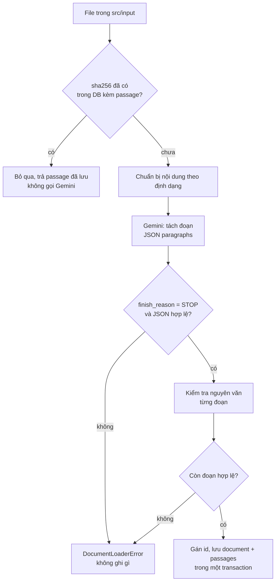

# Services Spec — SpecTestAI

Đặc tả tầng service: các bước xử lý trong pipeline của [app.py](../app.py), nằm giữa tài liệu đầu vào, model AI và database.

| File | Bước trong `app.py` | Trạng thái |
|---|---|---|
| [document_loader.py](document_loader.py) | 1. Đọc tài liệu, lưu passage | ✔ Đã triển khai |
| [evidence_validator.py](evidence_validator.py) | 3. Kiểm tra evidence (quote có thật trong passage) | ✔ Đã triển khai |
| [requirement_registry.py](requirement_registry.py) | 3–5. Cấp id, lưu requirement chờ duyệt, approve/reject, lấy requirement đã duyệt | ✔ Đã triển khai |
| [srs_validator.py](srs_validator.py) | 7. Kiểm tra SRS và dò nguồn gốc từng FR/NFR trước khi export | ✔ Đã triển khai |

Tài liệu liên quan:

- [database/spec.md](../database/spec.md): bảng `documents` và `source_passages`, `SQLiteRepository`.
- [schemas/spec.md](../schemas/spec.md): `Requirement` và `SRS`.

---

## 1. `document_loader.py`

Đọc file PDF / DOCX / TXT / MD, dùng Gemini tách thành đoạn văn (paragraph), kiểm tra từng đoạn đúng nguyên văn, gán id rồi lưu vào `documents` và `source_passages`.

### 1.1 Luồng xử lý



### 1.2 Xử lý theo định dạng

| Đuôi file | Gửi cho Gemini | Text gốc dùng để kiểm tra | `page` |
|---|---|---|---|
| `.pdf` | Nguyên file (inline bytes, `application/pdf`) | Text layer từng trang, đọc bằng `pdfplumber` | Số trang Gemini báo, phải trong khoảng 1..số trang |
| `.docx` | Text trích cục bộ từ `word/document.xml`. Gemini API không nhận `.docx` | Chính text đã trích | `NULL` |
| `.txt`, `.md` | Text, đọc dạng UTF-8 (chấp nhận BOM) | Chính text đó | `NULL` |

Các đuôi khác bị từ chối. Khi quét thư mục, file không hỗ trợ và file ẩn (tên bắt đầu bằng `.`) được bỏ qua, có ghi cảnh báo vào log.

Phần trích DOCX dùng thư viện chuẩn của Python (`zipfile` + `xml.etree`), không cần `python-docx`. Mỗi `<w:p>` là một đoạn; các run trong đoạn được nối lại; `<w:tab>` thành tab; `<w:br>`/`<w:cr>` thành xuống dòng; đoạn rỗng bị bỏ. Ô trong bảng là các đoạn riêng. Header, footer và footnote **không** được đọc.

### 1.3 Gọi Gemini

| Thiết lập | Giá trị |
|---|---|
| Model | `config.GEMINI_MODEL_LOADER`, mặc định `gemini-3.5-flash-lite` |
| `temperature` | `0` |
| `response_mime_type` | `application/json` |
| `response_json_schema` | `{"paragraphs": [{"page": int \| null, "text": str}]}` |
| Timeout | `config.GEMINI_TIMEOUT_MS`, mặc định 300 000 ms, tính cho mỗi lần thử |
| Retry | Tối đa `GEMINI_RETRY_ATTEMPTS` = 4 lần thử (1 lần đầu + 3 lần retry) cho 408/5xx và 429 rate limit. Riêng 429 hết quota ngày thì không retry. Chi tiết ở mục 1.6 |
| Số lần gọi | 1 lần cho mỗi file, gửi cả file trong một request |

System prompt (`SYSTEM_PROMPT`) yêu cầu:

- Chép **nguyên văn**: không tóm tắt, diễn đạt lại, dịch, sửa lỗi hay đổi thứ tự. Giữ nguyên ngôn ngữ gốc.
- Mỗi đoạn văn, tiêu đề, mục danh sách và hàng của bảng là một entry. Ô trong hàng bảng nối bằng `" | "`.
- Nối các dòng bị ngắt do bố cục trang, và nối lại các từ bị gạch nối khi xuống dòng.
- Bỏ header/footer lặp lại ở mỗi trang, số trang và dòng trống.
- `page` là số trang (bắt đầu từ 1) nơi đoạn văn bắt đầu với PDF, và `null` với text thường.

Response bị từ chối, và **không ghi gì vào DB**, khi:

- không có candidate nào;
- `finish_reason` khác `STOP` (ví dụ `MAX_TOKENS`, tức output bị cắt giữa chừng);
- JSON không khớp `ParsedDocument`.

### 1.4 Kiểm tra nguyên văn

Passage được dùng làm **bằng chứng** cho requirement, nên chỉ đoạn nào thật sự có trong tài liệu mới được lưu.

**Chuẩn hóa trước khi so sánh** (`_normalize`): NFKC → casefold → chỉ giữ chữ và số. Nhờ vậy, khác biệt về khoảng trắng, dấu câu, ký tự bullet, gạch nối và chữ hoa thường được bỏ qua. Chữ tiếng Việt có dấu vẫn giữ nguyên.

**Quy tắc cho từng đoạn Gemini trả về:**

| Trường hợp | Kết quả |
|---|---|
| Sau chuẩn hóa thành rỗng (ví dụ `---`, `•`) | Bỏ qua, không tính là bị loại |
| TXT/MD/DOCX: có trong text gốc | Lưu, `page = NULL` (bỏ qua `page` Gemini báo) |
| TXT/MD/DOCX: không có trong text gốc | **Bị loại** |
| PDF: `page` là `null`, < 1 hoặc lớn hơn số trang | **Bị loại** |
| PDF: có trên trang được báo, hoặc trang liền trước/liền sau (Gemini có thể lệch một trang) | Lưu |
| PDF: phần đầu nằm cuối một trang, phần còn lại nằm đầu trang kế tiếp (header/footer chen giữa) | Lưu |
| PDF: các trang lân cận không có text layer (PDF scan), hoặc chưa cài `pdfplumber` | Lưu, tính vào `unverified` |
| PDF: còn lại | **Bị loại** |

Text được lưu là text Gemini trả về, đã gộp khoảng trắng liên tiếp thành một dấu cách (`_clean`). Đoạn bị loại được trả trong `IngestResult.rejected` và ghi cảnh báo vào log.

**Độ phủ (**`coverage`**)** = tổng độ dài (đã chuẩn hóa) của các passage được lưu / độ dài text gốc, tối đa 1.0. Với PDF, độ phủ dưới 100% là bình thường vì header/footer bị bỏ. Độ phủ thấp bất thường là dấu hiệu Gemini bỏ sót nội dung.

### 1.5 Id, chạy lại và tính nguyên tử

| | Quy tắc |
|---|---|
| Document id | `DOC-` + 12 ký tự hex đầu của sha256 nội dung file, ví dụ `DOC-7ad01604423a` |
| Passage id | `<document id>-P0001`, `-P0002`, … theo thứ tự đọc của các đoạn **được lưu** |
| `file_hash` | sha256 đầy đủ (hex) |
| `file_path` | Đường dẫn tương đối so với `src/` nếu file nằm trong `src/`, ngược lại là đường dẫn tuyệt đối |

- **Id cố định.** Cùng nội dung file sẽ luôn cho cùng document id. Passage id có thể khác giữa hai lần ingest *trên hai DB khác nhau*, vì Gemini có thể tách đoạn khác đi. Trong cùng một DB thì passage id không bao giờ đổi, do file đã ingest không bị xử lý lại.
- **Chạy lại.** Nếu `file_hash` đã có trong DB kèm passage, file được bỏ qua (`skipped=True`) và **không gọi Gemini**. Đổi tên hay chuyển chỗ file không tạo document mới, vì việc nhận diện dựa trên nội dung. Nếu document đã có nhưng chưa có passage nào, loader dùng lại id cũ và bổ sung passage.
- **Nguyên tử.** Document và passage được lưu bằng `repo.save_document_with_passages()` trong **một transaction**. Bất kỳ lỗi nào trong một file đều không để lại dữ liệu dở dang của file đó. Các file đã xử lý xong trước đó vẫn được giữ.

### 1.6 API

```python
from services import document_loader
```

| Hàm | Mô tả |
|---|---|
| `ingest(files=None, *, repo=None, client=None, model=None) -> list[dict]` | Ingest các file, mặc định là mọi file hỗ trợ trong `config.INPUT_DIR`. Trả về passage của tất cả file, theo thứ tự file rồi thứ tự đọc. Đây là hàm `app.py` gọi |
| `ingest_with_report(...) -> list[IngestResult]` | Như trên nhưng trả báo cáo cho từng file và ghi log |
| `ingest_file(path, *, repo, client=None, model=None) -> IngestResult` | Ingest một file |
| `discover_files(directory) -> list[Path]` | Các file hỗ trợ nằm trực tiếp trong thư mục (không đệ quy), sắp theo tên |

Tham số:

| Tham số | Mặc định | Ghi chú |
|---|---|---|
| `repo` | Mở `SQLiteRepository(config.DB_PATH)` và tự đóng khi xong | Truyền vào để dùng DB khác hoặc DB in-memory |
| `client` | Tạo `genai.Client` từ `config.GEMINI_API_KEY` | Truyền vào client giả khi test (xem mục 1.9) |
| `model` | `config.GEMINI_MODEL_LOADER` | |

`IngestResult`:

| Field | Ý nghĩa |
|---|---|
| `filename` | Tên file |
| `document_id` | Id document |
| `passages` | Passage đã lưu, dạng dict giống `repo.list_passages()` |
| `skipped` | `True` nếu file đã ingest trước đó (không gọi Gemini) |
| `rejected` | `list[ParsedParagraph]`: các đoạn bị loại vì không đúng nguyên văn |
| `unverified` | Số đoạn PDF được lưu nhưng không kiểm tra được (không có text layer) |
| `coverage` | Độ phủ, từ 0 đến 1. `None` nếu không có text gốc để so |

Lỗi: mọi trường hợp không ingest được đều raise `DocumentLoaderError`, và khi đó không có gì được ghi cho file đó:

| Nguyên nhân | Thông báo (rút gọn) |
|---|---|
| Đuôi file không hỗ trợ | `Unsupported file type '.png' …` |
| File không tồn tại / thư mục input không tồn tại | `File not found …` / `Input directory not found …` |
| PDF lớn hơn 18 MB | `… inline PDFs must be under 18 MB` |
| DOCX hỏng | `Not a valid .docx file …` |
| TXT/MD không phải UTF-8 | `… is not UTF-8 text` |
| File không có text | `… contains no text` |
| Thiếu API key | `GEMINI_API_KEY is not set; add it to src/.env` |
| Chưa cài `google-genai` | `The google-genai package is not installed …` |
| Gemini không trả lời / bị cắt / JSON sai | `Gemini returned no answer` / `stopped early (finish_reason=…)` / `not valid JSON output` |
| Không còn đoạn hợp lệ nào | `no verbatim paragraphs to store (N rejected)` |

Lỗi từ Gemini và cách xử lý retry:

| Lỗi | Ai xử lý | Retry? | Lỗi cuối cùng |
|---|---|---|---|
| 408, 500, 502, 503, 504, lỗi kết nối tạm thời | SDK (`HttpRetryOptions`) | Có, tối đa `GEMINI_RETRY_ATTEMPTS` lần thử, backoff lũy thừa | `google.genai.errors.APIError` |
| 429 **hết quota trong ngày** | `llm_clients/gemini_client.py` (`_generate`) | **Không**, báo lỗi ngay sau 1 lần gọi | `DocumentLoaderError: … daily quota exhausted (<quotaId>); not retrying …` |
| 429 rate limit theo phút (hoặc 429 không rõ loại) | `llm_clients/gemini_client.py` (`_generate`) | Có, tối đa `GEMINI_RETRY_ATTEMPTS` lần thử | `DocumentLoaderError: … rate limit (429) persisted after N attempts …` |
| 400 (request sai), 401/403 (key sai hoặc không có quyền), 404 (sai tên model) | | Không, báo lỗi ngay | `google.genai.errors.APIError` |

SDK không được giao xử lý 429, vì nó chỉ nhìn mã HTTP và không phân biệt được hai loại 429. [llm_clients/gemini_client.py](../llm_clients/gemini_client.py) đọc nội dung lỗi (`_classify_429`) và coi là **hết quota trong ngày** khi gặp một trong hai dấu hiệu:

- `error.code` là chuỗi `"quota_exceeded"`. Đây là mã lỗi Gemini ghi trong tài liệu cho trường hợp hết quota ngày.
- Khối `google.rpc.QuotaFailure` có `quotaId` hoặc `quotaMetric` chứa `PerDay` / `per_day` / `daily`, ví dụ `GenerateRequestsPerDayPerProjectPerModel-FreeTier`. Tài liệu không mô tả cấu trúc này; nó dựa trên dạng response thực tế.

Lưu ý:

- Response hết quota ngày **vẫn** thường kèm `RetryInfo` với thời gian chờ ngắn (ví dụ `33s`), nên loader **không** dựa vào thời gian này để phân loại.
- 429 không khớp dấu hiệu nào được coi là rate limit và vẫn được retry. Đây là hướng an toàn: nếu thực ra là hết quota ngày, cái giá chỉ là vài lần gọi thừa.
- Khi retry 429, loader chờ theo `RetryInfo.retryDelay` nếu có. Nếu không có, nó dùng backoff `GEMINI_RETRY_INITIAL_DELAY × 2^(n-1)` cộng jitter 0–1 s. Mỗi lần chờ tối đa 60 s, vì cửa sổ giới hạn theo phút reset trong vòng một phút.

Sau mọi lỗi, file đó không được ghi gì vào DB. Chạy lại lệnh thì file lỗi được xử lý tiếp, còn các file đã thành công được bỏ qua.

`ingest()` / `ingest_with_report()` dừng ở file đầu tiên bị lỗi. Các file trước đó đã được lưu.

### 1.7 Cấu hình

Đặt trong `src/.env` hoặc biến môi trường. Biến môi trường thật được ưu tiên hơn `.env`.

| Biến | Mặc định | Dùng cho |
|---|---|---|
| `GEMINI_API_KEY` | (bắt buộc) | Key Gemini, truyền thẳng vào client. `GOOGLE_API_KEY` **không** được đọc |
| `GEMINI_MODEL_LOADER` | `gemini-3.5-flash-lite` | Model tách đoạn |
| `GEMINI_TIMEOUT_MS` | `300000` | Timeout mỗi lần thử |
| `GEMINI_RETRY_ATTEMPTS` | `4` | Tổng số lần thử, kể cả lần đầu. `1` = không retry |
| `GEMINI_RETRY_INITIAL_DELAY` | `2` | Thời gian chờ trước lần retry đầu tiên (giây), dùng khi server không gửi `retryDelay` |
| `GEMINI_RETRY_MAX_DELAY` | `30` | Thời gian chờ tối đa giữa hai lần thử khi SDK retry 408/5xx (giây). Retry 429 có giới hạn riêng là 60 s |
| `SPECTEST_INPUT_DIR` | `src/input` | Thư mục `ingest()` quét khi không truyền `files` |
| `SPECTEST_DB_PATH` | `src/data/spectest.db` | File database |

Thư viện cần có: `google-genai`, `pydantic`, `pdfplumber` (để kiểm tra PDF; nếu thiếu thì passage PDF vẫn được lưu nhưng tính là `unverified`).

### 1.8 Chạy từ dòng lệnh

Chạy từ `src/`:

```bash
uv run python -m database.init_db                 # lần đầu: tạo DB
uv run python -m services.document_loader         # mọi file trong src/input
uv run python -m services.document_loader a.pdf   # file cụ thể
```

Output (lần chạy thật với 2 file trong `src/input`):

```
INFO proposal_a.pdf: DOC-7ad01604423a, 98 passages, 0 rejected, 0 unverified, coverage 92%
INFO proposal_b.pdf: DOC-bd148209ea0b, 133 passages, 0 rejected, 0 unverified, coverage 89%
```

Chạy lại lần hai:

```
INFO proposal_a.pdf: already ingested as DOC-7ad01604423a (98 passages)
```

Lỗi thì in ra `ERROR …` và thoát với exit code 1. Output console được ép sang UTF-8 để in được tiếng Việt trên Windows.

Ở lần chạy trên, phần text bị bỏ (8–11%) chỉ gồm header (ngày giờ in) và footer (URL Gmail) lặp lại ở mỗi trang. Không có dòng nội dung nào bị mất.

### 1.9 Test

`client` có thể thay bằng client giả, nên toàn bộ logic test được offline, không cần key và không gọi mạng:

```python
from types import SimpleNamespace as NS
import json

class FakeGemini:
    def __init__(self, paragraphs, finish_reason="STOP"):
        self.models = self
        self._out, self._reason = paragraphs, finish_reason

    def generate_content(self, model, contents, config):
        return NS(text=json.dumps({"paragraphs": self._out}),
                  candidates=[NS(finish_reason=NS(name=self._reason))])

repo = SQLiteRepository(":memory:")
result = document_loader.ingest_file("notes.txt", repo=repo, client=FakeGemini([
    {"page": None, "text": "The system shall export reports to PDF."},
]))
```

Các trường hợp đã được kiểm tra:

- Đoạn bịa thêm bị loại; nối dòng và gạch nối được chấp nhận.
- Id cố định; chạy lại không gọi model.
- Markdown không còn ký hiệu markup vẫn khớp; DOCX có bảng.
- Response bị cắt, JSON sai, hoặc toàn bộ đoạn bị loại đều không ghi gì vào DB.
- PDF: đoạn vắt qua hai trang, lệch một trang, số trang ngoài khoảng, đoạn bịa.
- Thiếu API key.

### 1.10 Giới hạn hiện tại

- **Thời gian chờ tối đa cho mỗi file** khá dài khi Gemini treo: 4 lần thử × 300 s timeout, cộng thời gian backoff. Giảm `GEMINI_TIMEOUT_MS` nếu cần báo lỗi nhanh hơn.
- **Một request cho mỗi file.** Tài liệu rất dài có thể vượt giới hạn output của model và gây `MAX_TOKENS`, khi đó file bị từ chối. Cách khắc phục là chia PDF theo trang, hiện chưa làm.
- **PDF tối đa khoảng 18 MB** (giới hạn inline). Chưa dùng Files API.
- **PDF scan:** không có text layer nên không kiểm tra được nguyên văn. Passage vẫn được lưu nhưng tính vào `unverified`.
- **DOCX:** bỏ qua header, footer, footnote, comment và text box.
- **TXT/MD:** chỉ hỗ trợ UTF-8.
- **Xóa file khỏi** `src/input` không xóa document trong DB.

---

## 2. `evidence_validator.py`

Kiểm tra evidence của requirement có thật sự lấy từ tài liệu nguồn. Đây là bước 3 trong `app.py`, chạy trước khi lưu, và được **chạy lại lúc approve**.

### 2.1 Định nghĩa evidence hợp lệ

Chỉ có **một** định nghĩa, dùng chung cho cả `validate()`, `save_candidates()`, `approve()` và `get_approved()`. Requirement có evidence hợp lệ khi:

1. Có **ít nhất một** evidence, và **mọi** evidence item đều:
2. trỏ tới passage **có trong** `source_passages`;
3. có `quote` (quote thiếu, hoặc chỉ gồm khoảng trắng/dấu câu, thì không kiểm chứng được nên không hợp lệ);
4. quote **nằm trong chính passage được trích**.

Quy tắc nằm ở [database/evidence_rules.py](../database/evidence_rules.py) và được dùng chung với repository, nên kiểm tra trước khi lưu và kiểm tra lúc approve không bao giờ lệch nhau. Quote được so khớp sau khi chuẩn hóa bằng `normalize_for_match` (NFKC, casefold, chỉ giữ chữ và số). Loader cũng dùng đúng hàm này để kiểm tra passage. Vì vậy khác biệt về khoảng trắng, dấu câu, gạch nối hay chữ hoa thường được bỏ qua, nhưng chữ bị đổi hoặc bịa thêm thì không qua.

**Một evidence item sai làm cả requirement không hợp lệ.** Requirement không bị cắt bớt cho còn các item hợp lệ, vì khi đó statement sẽ khẳng định nhiều hơn những gì evidence còn lại chứng minh. Đây là cùng nguyên tắc extractor áp dụng với passage id lạ.

`schemas.requirement.Evidence.quote` vẫn là tùy chọn trong schema. Quy tắc "phải có quote" chỉ áp dụng ở bước kiểm tra này.

| Vấn đề | Thông báo |
|---|---|
| Không có evidence | `no evidence` |
| Passage không tồn tại | `DOC-…-P0999: passage not found` |
| Thiếu quote / quote rỗng | `DOC-…-P0002: no quote to verify` |
| Quote không có trong passage (bịa, hoặc lấy từ passage khác) | `DOC-…-P0001: quote not found in passage: '…'` |

### 2.2 API

```python
from services import evidence_validator
```

| Hàm | Mô tả |
|---|---|
| `validate(candidates, *, repo=None) -> list[RequirementDraft]` | Các candidate có evidence hợp lệ, giữ thứ tự. Candidate không hợp lệ được ghi log `WARNING`. Đây là hàm `app.py` gọi |
| `validate_with_report(candidates, *, repo=None) -> ValidationReport` | `valid: list[RequirementDraft]`, `invalid: list[InvalidCandidate]` (`candidate`, `problems`) |
| `evidence_problems(requirement, repo) -> list[str]` | Danh sách vấn đề của một requirement; danh sách rỗng là hợp lệ. Nhận `RequirementDraft`, `Requirement` hoặc dict từ repository |
| `using_repo(repo)` | Context manager: dùng `repo` được truyền vào, nếu không thì mở `config.DB_PATH` và tự đóng |
| `as_draft(candidate)` | Chuyển dict (kể cả dict có field thừa như `id`, `status`) thành `RequirementDraft` |

`candidates` có thể là `RequirementDraft` hoặc dict. Passage được đọc từ DB bằng một truy vấn duy nhất. Hàm này không gọi model và không ghi gì.

---

## 3. `requirement_registry.py`

Lưu requirement chờ duyệt, cấp id, và chặn approve khi evidence không hợp lệ.

### 3.1 Quy tắc approve (điều kiện "done")

- **Không có đường nào tự động approve.** `save_candidates()` luôn lưu `status = "pending"`, kể cả khi đầu vào ghi `"approved"`.
- **Chỉ `approve(id)` chuyển sang `approved`**, và nó **kiểm tra lại evidence đang lưu trong DB** ngay lúc approve (mục 2.1). Evidence không hợp lệ thì raise `RegistryError`, status giữ nguyên.
- **Repository cũng chặn.** Ngay ở `SQLiteRepository`, mọi đường dẫn tới `approved` đều bị chặn khi evidence không hợp lệ: `set_requirement_status`, thêm requirement với status `approved`, và sửa evidence của requirement đã approve. Cả hai tầng dùng chung một quy tắc trong `database/evidence_rules.py` ([database/spec.md](../database/spec.md) mục 3.3). Gọi thẳng repository cũng không lách được.
- **`get_approved()` kiểm tra lại lần cuối** trước khi giao cho SRS generator, để bắt hai trường hợp repository không chặn được: ghi thẳng bằng SQL, và sửa text của passage ngoài repository. Khi đó nó raise `RegistryError` liệt kê các requirement có vấn đề, thay vì âm thầm sinh SRS từ chúng.

### 3.2 Id

| | Quy tắc |
|---|---|
| Dạng | `RQ-` + 4 chữ số: `RQ-0001`, `RQ-0002`, … (vượt 9999 thì tự dài thêm) |
| Cấp số | Số lớn nhất của các id `RQ-` đang có + 1, **không** dựa trên số dòng. Id bị xóa không được dùng lại nếu nó không phải id lớn nhất |
| Tính nguyên tử | Cấp id và lưu mọi requirement trong **một transaction** (`repo.add_requirements_with_sequential_ids`). Một dòng lỗi thì không lưu dòng nào |
| Phân biệt với SRS | Đây là id lưu trữ, khác id theo vị trí trong SRS (`REQ-1.1`, `NF-2.1`). Id không chứa FR/NFR, vì loại requirement có thể sửa |

Quá trình cấp số giả định chỉ có một tiến trình ghi vào DB (ứng dụng chạy local, một người dùng). Hai tiến trình cùng lưu một lúc có thể tranh cùng một số; khi đó transaction sau sẽ bị khóa chính chặn lại và không lưu gì.

### 3.3 Chống trùng

`save_candidates()` bỏ qua candidate có `statement` trùng (bỏ qua hoa thường và khoảng trắng) với:

- một requirement đã lưu, **ở mọi status**: requirement đã từng bị reject sẽ không quay lại qua lần trích xuất sau;
- một candidate trước đó trong cùng lô.

Candidate bị bỏ qua được trả trong `SaveResult.duplicates` dưới dạng `(statement, id đã có)`. **Câu cùng ý nhưng diễn đạt khác không bị phát hiện**, nên chạy lại extractor (vốn cho kết quả dao động) vẫn có thể thêm bản gần trùng. Người review cần reject các bản này.

### 3.4 API

```python
from services import requirement_registry
```

| Hàm | Trả về | Mô tả |
|---|---|---|
| `save_candidates(candidates, *, repo=None)` | `SaveResult` (`saved_ids`, `duplicates`) | Lưu `pending`, cấp id, all-or-nothing. **Raise `RegistryError` và không lưu gì** nếu có candidate có evidence không hợp lệ: hãy lọc bằng `evidence_validator.validate()` trước |
| `approve(id, *, repo=None)` | `Requirement` | Kiểm tra evidence rồi approve. Lỗi thì `RegistryError`, status giữ nguyên |
| `reject(id, *, repo=None)` | dict (dòng repository) | Reject, không cần kiểm tra evidence |
| `get(id, *, repo=None)` | dict | Một dòng, kèm `evidence`. `RegistryError` nếu không tồn tại |
| `list_by_status(status=None, *, repo=None)` | `list[dict]` | Các dòng theo status, theo thứ tự tạo |
| `get_approved(*, repo=None)` | `list[Requirement]` | Requirement đã approve, có kiểm tra lại evidence (mục 3.1). Đây là hàm `app.py` gọi ở bước 5 |

`get`, `list_by_status` và `reject` trả dict thô thay vì `Requirement`, vì một dòng trong DB có thể hỏng (ví dụ không có evidence sau khi chèn thẳng bằng SQL), và người review vẫn phải xem được và reject được dòng đó. `approve` và `get_approved` trả `Requirement`, vì evidence của chúng đã được kiểm tra.

### 3.5 Duyệt từ dòng lệnh

Chạy từ `src/`:

```bash
uv run python -m services.requirement_registry list [pending|approved|rejected]
uv run python -m services.requirement_registry show RQ-0024
uv run python -m services.requirement_registry approve RQ-0013 RQ-0014
uv run python -m services.requirement_registry reject RQ-0020
```

- `list`: mỗi requirement một dòng; requirement có evidence không hợp lệ được đánh dấu `[INVALID EVIDENCE]`.
- `show`: in mọi field, từng quote **kèm text của passage gốc** để người review đối chiếu, và kết quả kiểm tra evidence.
- `approve` / `reject`: xử lý từng id. Lỗi của một id không làm dừng các id còn lại. Exit code là 1 nếu có id lỗi.

```
RQ-0013: approved
ERROR Requirement 'RQ-9999' not found
```

### 3.6 Kết quả trên dữ liệu thật

Dữ liệu là 39 requirement của lần trích xuất thứ 4 ([agents/spec.md](../agents/spec.md) mục 1.9), chạy trên **bản sao** của DB:

- 48 evidence item, tất cả đều có quote; cả 39 requirement có evidence hợp lệ.
- Id được cấp `RQ-0001` đến `RQ-0039`. Lưu lại lần hai: 0 requirement được lưu, 39 bị bỏ qua vì trùng.
- `approve RQ-0013` thành công; `get_approved()` trả đúng requirement đó.

### 3.7 Test

Chạy trên DB in-memory, các trường hợp đã kiểm tra:

- **Evidence:** quote bịa, quote lấy từ passage khác, thiếu quote, quote chỉ gồm dấu câu, passage không tồn tại, và requirement có evidence lẫn lộn đều bị loại; quote chỉ khác hoa thường hay dấu câu vẫn hợp lệ.
- **Lưu:** lô có evidence không hợp lệ không lưu gì; trùng trong cùng lô và trùng với dữ liệu đã có đều bị bỏ qua; status `approved` ở đầu vào bị bỏ qua; id tiếp nối số lớn nhất kể cả khi có khoảng trống; một dòng lỗi giữa lô làm cả lô rollback.
- **Approve:** requirement hợp lệ được approve; approve bị từ chối khi quote đã lưu bị sửa (status giữ nguyên), khi không có evidence, hoặc khi id không tồn tại; requirement đã reject vẫn approve lại được.
- **Repository** từ chối `set_requirement_status("approved")`, `add_requirement(status="approved")` và lô có dòng `approved` khi evidence không hợp lệ (không ghi gì), từ chối sửa evidence làm hỏng một requirement đã approve (giữ evidence cũ), nhưng cho phép sửa hợp lệ.
- **`get_approved()`** từ chối requirement có status `approved` (được set bằng SQL thô) mà evidence không hợp lệ.
- **Dòng hỏng** (không có evidence) vẫn liệt kê, xem và reject được.

---

## 4. `srs_validator.py`

Kiểm tra một SRS đã sinh, và **dò nguồn gốc của từng FR/NFR** về requirement đã approve trong registry. Đây là bước 7 trong `app.py`, chạy trước khi export. [exporters/markdown.py](../exporters/markdown.py) gọi nó tự động.

### 4.1 Dò nguồn gốc

Schema SRS không có chỗ cho registry id (`RQ-…`), và `app.py` cũng không truyền bảng ánh xạ. Vì vậy validator tự tìm nguồn gốc: generator chép statement nguyên văn, nên mỗi FR/NFR phải khớp **đúng một** requirement đã approve có **cùng loại và cùng statement nguyên văn**. Sau đó validator kiểm tra:

| # | Kiểm tra | Lỗi (ví dụ) |
|---|---|---|
| 1 | Có đúng một dòng khớp | `REQ-1.3: no approved functional requirement in the registry has this exact statement` (bịa thêm, statement bị sửa, hoặc requirement đã bị reject sau khi sinh) / `… matches several approved requirements` |
| 2 | Priority bằng nhau; với NFR, `verification_method` và `acceptance_measure` cũng bằng nhau | `REQ-1.2 (RQ-0002): priority 'must' != registry 'should'` |
| 3 | `source_ids` đúng bằng danh sách passage evidence của requirement đó, đúng thứ tự | `REQ-1.1 (RQ-0001): source_ids [...] != evidence [...]` |
| 4 | Evidence đang lưu vẫn hợp lệ (`repo.approval_problems`) | `REQ-… (RQ-…): invalid evidence: …` |
| 5 | **Mọi** source id trong tài liệu (văn xuôi, feature, sequence, requirement) là passage có thật | `source id DOC-a-P0999 is not a passage in the database` |
| 6 | Nếu truyền `requirement_map` (từ generator), nó phải khớp với nguồn gốc dò được | `REQ-1.1: requirement_map says RQ-0003, traced origin is RQ-0001` |

Ngoài ra, SRS được validate lại bằng `schemas.srs.SRS`, để bắt cả dict sai cấu trúc lẫn object bị sửa sau khi tạo.

### 4.2 Warning (không chặn)

| Warning | Vì sao không phải lỗi |
|---|---|
| Placeholder còn sót, ví dụ `<Project Name>` | `app.py` không truyền tên dự án, nên nếu coi đây là lỗi thì đường mặc định không bao giờ xuất được. Địa chỉ email kiểu `<a@b.de>` không bị coi là placeholder |
| Mục văn xuôi `unresolved` / `not_applicable`, nhóm NFR không có requirement | Đây là cách tài liệu nói thật rằng nguồn không đề cập |
| Requirement đã approve trong `requirements` nhưng không có trong SRS | Một DB có thể chứa nhiều dự án (mục 2.9 của [agents/spec.md](../agents/spec.md)) |

### 4.3 API

```python
from services import srs_validator
```

| Hàm | Mô tả |
|---|---|
| `validate(srs, requirements=None, *, requirement_map=None, repo=None) -> SrsValidationReport` | Kiểm tra; có lỗi thì raise `SrsValidationError` (`.errors`, `.report`). Đây là hàm `app.py` gọi |
| `check(...)` | Như trên nhưng trả báo cáo, không raise |

`SrsValidationReport`:

| Field | Ý nghĩa |
|---|---|
| `srs` | SRS đã validate lại |
| `trace` | `list[TraceEntry]`: mỗi FR/NFR có `srs_id`, `registry_id`, loại, statement, priority, và `evidence` (passage id, tài liệu, tên file, trang, quote đã lưu, nguyên văn passage) |
| `requirement_map` | `{srs_id: registry_id}` dò được |
| `errors`, `warnings`, `ok` | |
| `passages`, `documents` | Mọi passage được trích và tài liệu của chúng (exporter dùng cho Appendix B) |

`requirements` chỉ dùng để cảnh báo về requirement bị bỏ sót. Nguồn gốc luôn được dò trong **mọi** requirement đã approve của registry.

### 4.4 Test

Xem [exporters/spec.md](../exporters/spec.md) mục 1.9. Trên SRS thật (27 FR), validator dò được nguồn gốc của cả 27/27 requirement, không có lỗi, và có 5 warning.
