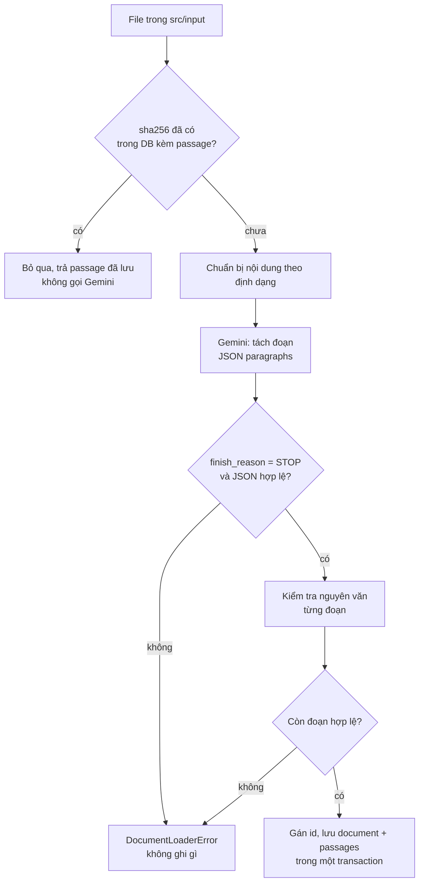

# Services Spec — SpecTestAI

Đặc tả tầng service: các bước xử lý trong pipeline của [app.py](../app.py), nằm giữa tài liệu đầu vào, model AI và database.

| File | Bước trong `app.py` | Trạng thái |
|---|---|---|
| [document_loader.py](document_loader.py) | 1. Đọc tài liệu, lưu passage | ✔ Đã triển khai |
| [evidence_validator.py](evidence_validator.py) | 3. Kiểm tra evidence của requirement | Chưa triển khai (file trống) |
| [requirement_registry.py](requirement_registry.py) | 3–5. Lưu requirement chờ duyệt, lấy requirement đã duyệt | Chưa triển khai (file trống) |
| [srs_validator.py](srs_validator.py) | 7. Kiểm tra SRS trước khi export | Chưa triển khai (file trống) |

Tài liệu liên quan:

- [database/spec.md](../database/spec.md): bảng `documents` và `source_passages`, `SQLiteRepository`.
- [schemas/spec.md](../schemas/spec.md): `Requirement` và `SRS`.

---

## 1. `document_loader.py`

Đọc file PDF / DOCX / TXT / MD, dùng Gemini tách thành đoạn văn (paragraph), kiểm tra từng đoạn đúng nguyên văn, gán id rồi lưu vào `documents` và `source_passages`.

### 1.1 Luồng xử lý



### 1.2 Xử lý theo định dạng

| Đuôi file | Gửi cho Gemini | Text gốc dùng để kiểm tra | `page` |
|---|---|---|---|
| `.pdf` | Nguyên file (inline bytes, `application/pdf`) | Text layer từng trang, đọc bằng `pdfplumber` | Số trang Gemini báo, phải trong khoảng 1..số trang |
| `.docx` | Text trích cục bộ từ `word/document.xml`. Gemini API không nhận `.docx` | Chính text đã trích | `NULL` |
| `.txt`, `.md` | Text, đọc dạng UTF-8 (chấp nhận BOM) | Chính text đó | `NULL` |

Các đuôi khác bị từ chối. Khi quét thư mục, file không hỗ trợ và file ẩn (tên bắt đầu bằng `.`) được bỏ qua, có ghi cảnh báo vào log.

Phần trích DOCX dùng thư viện chuẩn của Python (`zipfile` + `xml.etree`), không cần `python-docx`. Mỗi `<w:p>` là một đoạn; các run trong đoạn được nối lại; `<w:tab>` thành tab; `<w:br>`/`<w:cr>` thành xuống dòng; đoạn rỗng bị bỏ. Ô trong bảng là các đoạn riêng. Header, footer và footnote **không** được đọc.

### 1.3 Gọi Gemini

| Thiết lập | Giá trị |
|---|---|
| Model | `config.GEMINI_MODEL_LOADER`, mặc định `gemini-3.5-flash-lite` |
| `temperature` | `0` |
| `response_mime_type` | `application/json` |
| `response_json_schema` | `{"paragraphs": [{"page": int \| null, "text": str}]}` |
| Timeout | `config.GEMINI_TIMEOUT_MS`, mặc định 300 000 ms, tính cho mỗi lần thử |
| Retry | Tối đa `GEMINI_RETRY_ATTEMPTS` = 4 lần thử (1 lần đầu + 3 lần retry) cho 408/5xx và 429 rate limit. Riêng 429 hết quota ngày thì không retry. Chi tiết ở mục 1.6 |
| Số lần gọi | 1 lần cho mỗi file, gửi cả file trong một request |

System prompt (`SYSTEM_PROMPT`) yêu cầu:

- Chép **nguyên văn**: không tóm tắt, diễn đạt lại, dịch, sửa lỗi hay đổi thứ tự. Giữ nguyên ngôn ngữ gốc.
- Mỗi đoạn văn, tiêu đề, mục danh sách và hàng của bảng là một entry. Ô trong hàng bảng nối bằng `" | "`.
- Nối các dòng bị ngắt do bố cục trang, và nối lại các từ bị gạch nối khi xuống dòng.
- Bỏ header/footer lặp lại ở mỗi trang, số trang và dòng trống.
- `page` là số trang (bắt đầu từ 1) nơi đoạn văn bắt đầu với PDF, và `null` với text thường.

Response bị từ chối, và **không ghi gì vào DB**, khi:

- không có candidate nào;
- `finish_reason` khác `STOP` (ví dụ `MAX_TOKENS`, tức output bị cắt giữa chừng);
- JSON không khớp `ParsedDocument`.

### 1.4 Kiểm tra nguyên văn

Passage được dùng làm **bằng chứng** cho requirement, nên chỉ đoạn nào thật sự có trong tài liệu mới được lưu.

**Chuẩn hóa trước khi so sánh** (`_normalize`): NFKC → casefold → chỉ giữ chữ và số. Nhờ vậy, khác biệt về khoảng trắng, dấu câu, ký tự bullet, gạch nối và chữ hoa thường được bỏ qua. Chữ tiếng Việt có dấu vẫn giữ nguyên.

**Quy tắc cho từng đoạn Gemini trả về:**

| Trường hợp | Kết quả |
|---|---|
| Sau chuẩn hóa thành rỗng (ví dụ `---`, `•`) | Bỏ qua, không tính là bị loại |
| TXT/MD/DOCX: có trong text gốc | Lưu, `page = NULL` (bỏ qua `page` Gemini báo) |
| TXT/MD/DOCX: không có trong text gốc | **Bị loại** |
| PDF: `page` là `null`, < 1 hoặc lớn hơn số trang | **Bị loại** |
| PDF: có trên trang được báo, hoặc trang liền trước/liền sau (Gemini có thể lệch một trang) | Lưu |
| PDF: phần đầu nằm cuối một trang, phần còn lại nằm đầu trang kế tiếp (header/footer chen giữa) | Lưu |
| PDF: các trang lân cận không có text layer (PDF scan), hoặc chưa cài `pdfplumber` | Lưu, tính vào `unverified` |
| PDF: còn lại | **Bị loại** |

Text được lưu là text Gemini trả về, đã gộp khoảng trắng liên tiếp thành một dấu cách (`_clean`). Đoạn bị loại được trả trong `IngestResult.rejected` và ghi cảnh báo vào log.

**Độ phủ (**`coverage`**)** = tổng độ dài (đã chuẩn hóa) của các passage được lưu / độ dài text gốc, tối đa 1.0. Với PDF, độ phủ dưới 100% là bình thường vì header/footer bị bỏ. Độ phủ thấp bất thường là dấu hiệu Gemini bỏ sót nội dung.

### 1.5 Id, chạy lại và tính nguyên tử

| | Quy tắc |
|---|---|
| Document id | `DOC-` + 12 ký tự hex đầu của sha256 nội dung file, ví dụ `DOC-7ad01604423a` |
| Passage id | `<document id>-P0001`, `-P0002`, … theo thứ tự đọc của các đoạn **được lưu** |
| `file_hash` | sha256 đầy đủ (hex) |
| `file_path` | Đường dẫn tương đối so với `src/` nếu file nằm trong `src/`, ngược lại là đường dẫn tuyệt đối |

- **Id cố định.** Cùng nội dung file sẽ luôn cho cùng document id. Passage id có thể khác giữa hai lần ingest *trên hai DB khác nhau*, vì Gemini có thể tách đoạn khác đi. Trong cùng một DB thì passage id không bao giờ đổi, do file đã ingest không bị xử lý lại.
- **Chạy lại.** Nếu `file_hash` đã có trong DB kèm passage, file được bỏ qua (`skipped=True`) và **không gọi Gemini**. Đổi tên hay chuyển chỗ file không tạo document mới, vì việc nhận diện dựa trên nội dung. Nếu document đã có nhưng chưa có passage nào, loader dùng lại id cũ và bổ sung passage.
- **Nguyên tử.** Document và passage được lưu bằng `repo.save_document_with_passages()` trong **một transaction**. Bất kỳ lỗi nào trong một file đều không để lại dữ liệu dở dang của file đó. Các file đã xử lý xong trước đó vẫn được giữ.

### 1.6 API

```python
from services import document_loader
```

| Hàm | Mô tả |
|---|---|
| `ingest(files=None, *, repo=None, client=None, model=None) -> list[dict]` | Ingest các file, mặc định là mọi file hỗ trợ trong `config.INPUT_DIR`. Trả về passage của tất cả file, theo thứ tự file rồi thứ tự đọc. Đây là hàm `app.py` gọi |
| `ingest_with_report(...) -> list[IngestResult]` | Như trên nhưng trả báo cáo cho từng file và ghi log |
| `ingest_file(path, *, repo, client=None, model=None) -> IngestResult` | Ingest một file |
| `discover_files(directory) -> list[Path]` | Các file hỗ trợ nằm trực tiếp trong thư mục (không đệ quy), sắp theo tên |

Tham số:

| Tham số | Mặc định | Ghi chú |
|---|---|---|
| `repo` | Mở `SQLiteRepository(config.DB_PATH)` và tự đóng khi xong | Truyền vào để dùng DB khác hoặc DB in-memory |
| `client` | Tạo `genai.Client` từ `config.GEMINI_API_KEY` | Truyền vào client giả khi test (xem mục 1.9) |
| `model` | `config.GEMINI_MODEL_LOADER` | |

`IngestResult`:

| Field | Ý nghĩa |
|---|---|
| `filename` | Tên file |
| `document_id` | Id document |
| `passages` | Passage đã lưu, dạng dict giống `repo.list_passages()` |
| `skipped` | `True` nếu file đã ingest trước đó (không gọi Gemini) |
| `rejected` | `list[ParsedParagraph]`: các đoạn bị loại vì không đúng nguyên văn |
| `unverified` | Số đoạn PDF được lưu nhưng không kiểm tra được (không có text layer) |
| `coverage` | Độ phủ, từ 0 đến 1. `None` nếu không có text gốc để so |

Lỗi: mọi trường hợp không ingest được đều raise `DocumentLoaderError`, và khi đó không có gì được ghi cho file đó:

| Nguyên nhân | Thông báo (rút gọn) |
|---|---|
| Đuôi file không hỗ trợ | `Unsupported file type '.png' …` |
| File không tồn tại / thư mục input không tồn tại | `File not found …` / `Input directory not found …` |
| PDF lớn hơn 18 MB | `… inline PDFs must be under 18 MB` |
| DOCX hỏng | `Not a valid .docx file …` |
| TXT/MD không phải UTF-8 | `… is not UTF-8 text` |
| File không có text | `… contains no text` |
| Thiếu API key | `GEMINI_API_KEY is not set; add it to src/.env` |
| Chưa cài `google-genai` | `The google-genai package is not installed …` |
| Gemini không trả lời / bị cắt / JSON sai | `Gemini returned no answer` / `stopped early (finish_reason=…)` / `not valid JSON output` |
| Không còn đoạn hợp lệ nào | `no verbatim paragraphs to store (N rejected)` |

Lỗi từ Gemini và cách xử lý retry:

| Lỗi | Ai xử lý | Retry? | Lỗi cuối cùng |
|---|---|---|---|
| 408, 500, 502, 503, 504, lỗi kết nối tạm thời | SDK (`HttpRetryOptions`) | Có, tối đa `GEMINI_RETRY_ATTEMPTS` lần thử, backoff lũy thừa | `google.genai.errors.APIError` |
| 429 **hết quota trong ngày** | Loader (`_generate`) | **Không**, báo lỗi ngay sau 1 lần gọi | `DocumentLoaderError: … daily quota exhausted (<quotaId>); not retrying …` |
| 429 rate limit theo phút (hoặc 429 không rõ loại) | Loader (`_generate`) | Có, tối đa `GEMINI_RETRY_ATTEMPTS` lần thử | `DocumentLoaderError: … rate limit (429) persisted after N attempts …` |
| 400 (request sai), 401/403 (key sai hoặc không có quyền), 404 (sai tên model) | | Không, báo lỗi ngay | `google.genai.errors.APIError` |

SDK không được giao xử lý 429, vì nó chỉ nhìn mã HTTP và không phân biệt được hai loại 429. Loader đọc nội dung lỗi (`_classify_429`) và coi là **hết quota trong ngày** khi gặp một trong hai dấu hiệu:

- `error.code` là chuỗi `"quota_exceeded"`. Đây là mã lỗi Gemini ghi trong tài liệu cho trường hợp hết quota ngày.
- Khối `google.rpc.QuotaFailure` có `quotaId` hoặc `quotaMetric` chứa `PerDay` / `per_day` / `daily`, ví dụ `GenerateRequestsPerDayPerProjectPerModel-FreeTier`. Tài liệu không mô tả cấu trúc này; nó dựa trên dạng response thực tế.

Lưu ý:

- Response hết quota ngày **vẫn** thường kèm `RetryInfo` với thời gian chờ ngắn (ví dụ `33s`), nên loader **không** dựa vào thời gian này để phân loại.
- 429 không khớp dấu hiệu nào được coi là rate limit và vẫn được retry. Đây là hướng an toàn: nếu thực ra là hết quota ngày, cái giá chỉ là vài lần gọi thừa.
- Khi retry 429, loader chờ theo `RetryInfo.retryDelay` nếu có. Nếu không có, nó dùng backoff `GEMINI_RETRY_INITIAL_DELAY × 2^(n-1)` cộng jitter 0–1 s. Mỗi lần chờ tối đa 60 s, vì cửa sổ giới hạn theo phút reset trong vòng một phút.

Sau mọi lỗi, file đó không được ghi gì vào DB. Chạy lại lệnh thì file lỗi được xử lý tiếp, còn các file đã thành công được bỏ qua.

`ingest()` / `ingest_with_report()` dừng ở file đầu tiên bị lỗi. Các file trước đó đã được lưu.

### 1.7 Cấu hình

Đặt trong `src/.env` hoặc biến môi trường. Biến môi trường thật được ưu tiên hơn `.env`.

| Biến | Mặc định | Dùng cho |
|---|---|---|
| `GEMINI_API_KEY` | (bắt buộc) | Key Gemini, truyền thẳng vào client. `GOOGLE_API_KEY` **không** được đọc |
| `GEMINI_MODEL_LOADER` | `gemini-3.5-flash-lite` | Model tách đoạn |
| `GEMINI_TIMEOUT_MS` | `300000` | Timeout mỗi lần thử |
| `GEMINI_RETRY_ATTEMPTS` | `4` | Tổng số lần thử, kể cả lần đầu. `1` = không retry |
| `GEMINI_RETRY_INITIAL_DELAY` | `2` | Thời gian chờ trước lần retry đầu tiên (giây), dùng khi server không gửi `retryDelay` |
| `GEMINI_RETRY_MAX_DELAY` | `30` | Thời gian chờ tối đa giữa hai lần thử khi SDK retry 408/5xx (giây). Retry 429 có giới hạn riêng là 60 s |
| `SPECTEST_INPUT_DIR` | `src/input` | Thư mục `ingest()` quét khi không truyền `files` |
| `SPECTEST_DB_PATH` | `src/data/spectest.db` | File database |

Thư viện cần có: `google-genai`, `pydantic`, `pdfplumber` (để kiểm tra PDF; nếu thiếu thì passage PDF vẫn được lưu nhưng tính là `unverified`).

### 1.8 Chạy từ dòng lệnh

Chạy từ `src/`:

```bash
uv run python -m database.init_db                 # lần đầu: tạo DB
uv run python -m services.document_loader         # mọi file trong src/input
uv run python -m services.document_loader a.pdf   # file cụ thể
```

Output (lần chạy thật với 2 file trong `src/input`):

```
INFO proposal_a.pdf: DOC-7ad01604423a, 98 passages, 0 rejected, 0 unverified, coverage 92%
INFO proposal_b.pdf: DOC-bd148209ea0b, 133 passages, 0 rejected, 0 unverified, coverage 89%
```

Chạy lại lần hai:

```
INFO proposal_a.pdf: already ingested as DOC-7ad01604423a (98 passages)
```

Lỗi thì in ra `ERROR …` và thoát với exit code 1. Output console được ép sang UTF-8 để in được tiếng Việt trên Windows.

Ở lần chạy trên, phần text bị bỏ (8–11%) chỉ gồm header (ngày giờ in) và footer (URL Gmail) lặp lại ở mỗi trang. Không có dòng nội dung nào bị mất.

### 1.9 Test

`client` có thể thay bằng client giả, nên toàn bộ logic test được offline, không cần key và không gọi mạng:

```python
from types import SimpleNamespace as NS
import json

class FakeGemini:
    def __init__(self, paragraphs, finish_reason="STOP"):
        self.models = self
        self._out, self._reason = paragraphs, finish_reason

    def generate_content(self, model, contents, config):
        return NS(text=json.dumps({"paragraphs": self._out}),
                  candidates=[NS(finish_reason=NS(name=self._reason))])

repo = SQLiteRepository(":memory:")
result = document_loader.ingest_file("notes.txt", repo=repo, client=FakeGemini([
    {"page": None, "text": "The system shall export reports to PDF."},
]))
```

Các trường hợp đã được kiểm tra:

- Đoạn bịa thêm bị loại; nối dòng và gạch nối được chấp nhận.
- Id cố định; chạy lại không gọi model.
- Markdown không còn ký hiệu markup vẫn khớp; DOCX có bảng.
- Response bị cắt, JSON sai, hoặc toàn bộ đoạn bị loại đều không ghi gì vào DB.
- PDF: đoạn vắt qua hai trang, lệch một trang, số trang ngoài khoảng, đoạn bịa.
- Thiếu API key.

### 1.10 Giới hạn hiện tại

- **Thời gian chờ tối đa cho mỗi file** khá dài khi Gemini treo: 4 lần thử × 300 s timeout, cộng thời gian backoff. Giảm `GEMINI_TIMEOUT_MS` nếu cần báo lỗi nhanh hơn.
- **Một request cho mỗi file.** Tài liệu rất dài có thể vượt giới hạn output của model và gây `MAX_TOKENS`, khi đó file bị từ chối. Cách khắc phục là chia PDF theo trang, hiện chưa làm.
- **PDF tối đa khoảng 18 MB** (giới hạn inline). Chưa dùng Files API.
- **PDF scan:** không có text layer nên không kiểm tra được nguyên văn. Passage vẫn được lưu nhưng tính vào `unverified`.
- **DOCX:** bỏ qua header, footer, footnote, comment và text box.
- **TXT/MD:** chỉ hỗ trợ UTF-8.
- **Xóa file khỏi** `src/input` không xóa document trong DB.

---

## 2. Service chưa triển khai

Dưới đây là vai trò dự kiến, suy ra từ `app.py`. Phần này **chưa phải đặc tả cuối cùng**.

| Service | Vai trò theo `app.py` | Sẽ dùng |
|---|---|---|
| `evidence_validator.validate(candidates)` | Lọc `RequirementDraft` từ extractor: mỗi evidence phải trỏ tới passage có thật, `quote` (nếu có) phải nằm trong text của passage | `repo.get_passages()`, `schemas.requirement.RequirementDraft` |
| `requirement_registry.save_candidates(...)` | Lưu requirement hợp lệ với `status="pending"` | `repo.add_requirement(**draft.model_dump())` |
| `requirement_registry.get_approved()` | Lấy requirement đã duyệt để sinh SRS | `repo.get_approved_requirements()` → `Requirement` |
| `srs_validator.validate(srs, requirements)` | Kiểm tra SRS trước khi export: đúng `schemas.srs.SRS`, chỉ chứa requirement đã duyệt, không còn placeholder `<...>` | `schemas.srs.SRS`, `SRS.requirement_ids()` |
